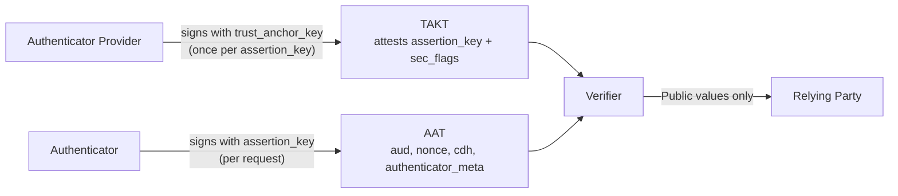

## 1. Abstract

This spec introduces two tokens that attest the integrity of the environment in which a World ID Proof is generated. The **Trust Anchor Key Token (TAKT)** is a statement by an Authenticator Provider that a device-bound `assertion_key` belongs to a genuine Authenticator on a genuine device. The **Authenticator Assertion Token (AAT)** is signed by that `assertion_key` for a single request. Both are CBOR Web Tokens: the TAKT is signed with `BabyJubJub-EdDSA-Poseidon2`, so circuits verify it cheaply, and the AAT with `ES256`, which device hardware supports. They are verified in a privacy-preserving manner, so the Relying Party learns only the security properties it asked for, never the device key or the tokens themselves.

## 2. Motivation

Some use cases need information beyond the World ID Proof about where it was generated, typically when the Authenticator provides inputs the proof cannot verify itself (e.g. a live selfie compared in a ZK circuit). Relying Parties then need to know that a genuine Authenticator on a genuine device produced the proof.

## 3. Specification

The key words "MUST", "MUST NOT", "REQUIRED", "SHALL", "SHALL NOT", "SHOULD", "SHOULD NOT", "RECOMMENDED", "MAY", and "OPTIONAL" in this document are to be interpreted as described in [RFC 2119](https://www.ietf.org/rfc/rfc2119.txt).

1. The definition of an Authenticator Provider is explicitly introduced into the Protocol. An **Authenticator Provider** is the publishing entity (e.g. a software company) of an [Authenticator](https://github.com/worldcoin/world-id-protocol/tree/main/docs/world-id-4-specs#definitions) client.
2. An Authenticator Provider MAY opt in to issuing TAKTs. A TAKT, and every AAT signed by the key it attests, is a statement **only** from the Authenticator Provider. Each Relying Party (RP) decides which Authenticator Providers and which security properties it accepts.
3. The TAKT attests an `assertion_key`; the AAT is signed by that `assertion_key`. The two tokens are bound only by this shared key.
4. The Field ($F$), the Curve (`BabyJubJub`), the hash function ($H_t$), the signature scheme (`BabyJubJub-EdDSA-Poseidon2`) and the `PublicKey` representation MUST follow [WIP-100][wip-100].
5. TAKTs and AATs MUST only be verified in environments that provably guarantee privacy, as specified in [Verification](#38-verification). Authenticators MUST NOT share TAKTs or AATs when this cannot be guaranteed.



### 3.1 Constants

| Constant | Value | Description |
|----------|-------|-------------|
| `DS_TAKT` | `127603488023523044162070750169730677970184433650516` (`b"WORLD-ID/WIP-106/TAKT"`) | Domain separator for the TAKT digest, allocated to $H_8$ with $k = 6$. |
| `DS_KEY` | `498451125091886891258088867850510460821032355161` (`b"WORLD-ID/WIP-106/KEY"`) | Domain separator for the key hash, allocated to $H_3$ with $k = 2$. |
| `MAX_TAKT_LIFETIME` | `2592000` | Maximum remaining lifetime `exp - now` of a TAKT, in seconds (30 days). |
| `MAX_AAT_LIFETIME` | `1800` | Maximum remaining lifetime `exp - now` of an AAT, in seconds (30 minutes). |
| `EAT_PROFILE_TAKT` | `https://world.org/eat/takt/v1` | The `eat_profile` claim ([RFC 9711 §4.3.2](https://datatracker.ietf.org/doc/html/rfc9711#section-4.3.2)) of a TAKT. |
| `EAT_PROFILE_AAT` | `https://world.org/eat/aat/v1` | The `eat_profile` claim of an AAT. |

### 3.2 Token Format

Both tokens are CBOR Web Tokens ([RFC 8392](https://datatracker.ietf.org/doc/html/rfc8392)): untagged `COSE_Sign1` ([RFC 9052](https://datatracker.ietf.org/doc/rfc9052/)) in deterministic CBOR ([RFC 8949 §4.2.1](https://datatracker.ietf.org/doc/html/rfc8949#section-4.2.1)).

1. The payload MUST contain exactly the claims listed for the token, in deterministic CBOR key order, each with the value width given. Verifiers MUST reject any other encoding.
2. Claims that carry a field element MUST encode a value less than the field order, as a 32-byte big-endian byte string. Verifiers MUST reject larger values rather than reduce them.

### 3.3 Trust Anchor Key

1. An Authenticator Provider that issues TAKTs MUST have a `trust_anchor_key`, the key that signs its TAKTs. The `trust_anchor_key` MUST be a `BabyJubJub-EdDSA-Poseidon2` key pair generated randomly.
2. The `trust_anchor_key` is identified by its `kid`, which MUST be the compressed wire encoding of its public key as specified in [WIP-100 §4][wip-100].
3. Circuits and RPs identify it by `trust_anchor_key_hash = H_3(DS_KEY; x, y)`, over the affine coordinates of its public key.
4. A `trust_anchor_key` MUST be published in the [Authenticator Metadata](#39-authenticator-metadata), with `not_before` and `not_after`, before it signs its first TAKT. It SHOULD be published at least 24 hours before, so RPs with cached metadata recognize it.
5. A `trust_anchor_key` MUST NOT sign TAKTs for more than 180 days (`not_after - not_before <= 15552000`). Authenticator Providers SHOULD rotate keys every 90 days.
6. To rotate, an Authenticator Provider MUST publish the next key per item 4 before the current key's `not_after`, and MUST keep the outgoing key published for at least `MAX_TAKT_LIFETIME` after its last TAKT.
7. The `trust_anchor_key` private key SHOULD be generated and used only inside hardware-protected key storage (e.g. an HSM or a TEE), and SHOULD NOT be exportable.
8. On suspected compromise, the Authenticator Provider MUST mark the key `revoked` immediately.

### 3.4 Trust Anchor Key Token (TAKT)

A TAKT attests that an `assertion_key` belongs to a genuine Authenticator on a genuine device, with the security properties in `sec_flags`.

1. The protected header MUST contain exactly `alg` (label `1`) with the value `-65537` and the `kid` (label `4`) of the `trust_anchor_key`, so the Authenticator knows which key signed the TAKT (e.g. during a key rotation). The unprotected header MUST be empty.
2. The payload MUST contain the following claims:

| Claim | Key | Value type | Description |
|-------|-----|------------|-------------|
| `exp` | 4 | uint, in $[2^{16}, 2^{32})$ (4 bytes) | Expiration time, in seconds since the Unix epoch. |
| `cnf` | 8 | map `{1: COSE_Key}` | The attested `assertion_key` ([RFC 8747 §3.1](https://datatracker.ietf.org/doc/html/rfc8747#section-3.1)), an EC2 P-256 `COSE_Key` ([RFC 9053 §7.1](https://datatracker.ietf.org/doc/html/rfc9053#section-7.1)): `{1: 2, -1: 1, -2: x, -3: y}`, with `x` and `y` as 32-byte byte strings. |
| `eat_profile` | 265 | tstr: `EAT_PROFILE_TAKT` | |
| `sec_flags` | -70000 | bstr, big-endian (8 bytes) | Packed security attributes of the `assertion_key` (see [Security Flags](#36-security-flags)). |

3. The algorithm `-65537` (Private Use) is allocated to `BabyJubJub-EdDSA-Poseidon2` over a TAKT. It does not sign the `Sig_structure` bytes ([RFC 9052 §4.4](https://datatracker.ietf.org/doc/html/rfc9052#section-4.4)). Instead it decodes `exp`, `cnf` and `sec_flags` from the claims and signs

   `message = H_8(DS_TAKT; exp, x_hi, x_lo, y_hi, y_lo, sec_flags)`

   where `x_hi` and `x_lo` are the high and low 128 bits of the `assertion_key`'s `x`, read big-endian, and likewise for `y`.
4. The signature field MUST carry the signature over `message` per [WIP-100 §3.5][wip-100], including its encoding. Generic COSE/CWT libraries can decode a TAKT but cannot verify it.
5. The protected header is authenticated implicitly: `alg` is fixed by this specification and bound to the signature through `DS_TAKT`, and `kid` MUST equal the compressed wire encoding of the key the signature verifies under. Verifiers MUST reject a TAKT whose protected header differs from these values.
6. An Authenticator Provider MUST NOT issue TAKTs with differing `sec_flags` for the same `assertion_key`.
7. A TAKT's `exp` MUST NOT be later than the `not_after` of the `trust_anchor_key` that signs it.

### 3.5 Authenticator Assertion Token (AAT)

An AAT binds a single request to an `assertion_key` attested by a TAKT.

1. The `assertion_key` is a P-256 key pair held by the Authenticator. It SHOULD be generated inside, and bound to, the device's secure hardware (e.g. the Secure Enclave or StrongBox), so the private key is not exportable.
2. The AAT MUST be signed with `ES256` ([RFC 9053 §2.1](https://datatracker.ietf.org/doc/html/rfc9053#section-2.1)) over the `Sig_structure` of [RFC 9052 §4.4](https://datatracker.ietf.org/doc/html/rfc9052#section-4.4), with an empty `external_aad`. The protected header MUST contain only `alg` (label `1`) with the value `-7`. The unprotected header MUST be empty.
3. The payload MUST contain the following claims:

| Claim | Key | Value type | Description |
|-------|-----|------------|-------------|
| `aud` | 3 | bstr, big-endian (8 bytes) | The `rpId` of the [ProofRequest](https://docs.rs/world-id-primitives/latest/world_id_primitives/request/struct.ProofRequest.html). This deviates from RFC 8392, which types `aud` as a string; verifiers MUST reject any other type. |
| `exp` | 4 | uint, in $[2^{16}, 2^{32})$ (4 bytes) | Expiration time, in seconds since the Unix epoch. |
| `nonce` | 10 | bstr: field element (32 bytes) | The `nonce` of the ProofRequest. |
| `eat_profile` | 265 | tstr: `EAT_PROFILE_AAT` | |
| `cdh` | -80000 | bstr: field element (32 bytes) | Client data hash (see item 4). |
| `authenticator_meta` | -80001 | bstr: field element (32 bytes) | See [Authenticator Meta](#361-authenticator-meta). |

4. `cdh` is a commitment set by the Authenticator to bind the AAT to its upstream use (e.g. a user's `leaf_index`). `0` is the nil value. Every specification that consumes an AAT MUST define what `cdh` commits to, or explicitly allow the nil value. The Authenticator MUST compute `cdh` exactly as that specification defines.
5. The Authenticator MUST set `exp` such that `exp - now <= MAX_AAT_LIFETIME`, and MUST sign a fresh AAT for every request.
6. This spec does not define how the TAKT is conveyed together with the AAT ([RFC 8747 §3.5](https://datatracker.ietf.org/doc/html/rfc8747#section-3.5)). The binding depends only on the shared `assertion_key`.

### 3.6 Security Flags

`sec_flags` packs the following sub-fields (LSB-first). Bits 52 and above MUST be `0`.

| Bits | Sub-field | Description |
|------|-----------|-------------|
| 0-7 | `platform` | Platform of the Authenticator. |
| 8-15 | `sec_level` | Where the `assertion_key` is generated and stored. |
| 16-47 | `build_version` | Monotonic version of the Authenticator build that requested the TAKT. |
| 48-51 | `sec_meta` | 4-bit bitmask, provider-defined. `0000` is the nil value. The meaning of each bit MUST be published in the [Authenticator Metadata](#39-authenticator-metadata). |

The `platform` enum:

| Value | Definition |
|-------|------------|
| 0 | Unspecified |
| 2 | iOS |
| 4 | Android |
| 6 | Web browser |

The `sec_level` enum. Values are identifiers, not a trust ranking; RPs SHOULD allowlist the exact values they accept.

| Value | Definition | Example evidence |
|-------|------------|------------------|
| 0 | Unspecified | None |
| 1 | Hardware-bound key, attested by the platform manufacturer to belong to a genuine app on a genuine device | Apple App Attest; Android Key Attestation (TEE or StrongBox) |
| 3 | Non-extractable platform key, software-enforced by the device manufacturer | Android Keystore key without hardware-backed Key Attestation |
| 5 | Internally verified. The Authenticator Provider MUST guarantee only authorized parties (e.g. internal developers) obtain this level | Provider-internal |
| 10 | Software key, user-bound, without environment integrity | Non-extractable WebCrypto key, with a WebAuthn passkey assertion as evidence |

#### 3.6.1 Authenticator Meta

`authenticator_meta` is a field element signed with the `assertion_key` for a single request. It packs the following sub-fields (LSB-first). Bits 5 and above MUST be `0`.

| Bits | Sub-field | Description |
|------|-----------|-------------|
| 0-2 | `user_presence` | An assertion by the Authenticator about the user during the proof generation. |
| 3-4 | provider bits | Provider-defined. `00` is the nil value. The meaning of each value MUST be published in the [Authenticator Metadata](#39-authenticator-metadata). |

The `user_presence` enum:

| Value | Definition |
|-------|------------|
| 0 | Undetermined |
| 1 | User is not present |
| 2 | User is present, verified by a biometric check during this request |
| 3 | User was present within the last 30 days |
| 4 | User was present within the last 7 days |

1. `user_presence` values `5` to `7` are reserved and MUST be rejected.
2. The Authenticator MUST report `user_presence` only from checks it performed itself.
3. Values are identifiers, not an order. RPs MUST allowlist the exact values they accept.

### 3.7 Issuance

For every TAKT, the Authenticator Provider:

1. MUST verify platform integrity evidence that commits to the `assertion_key` before signing (e.g. an App Attest assertion with `clientDataHash` = SHA-256 of the `COSE_Key`, or an Android Key Attestation certificate chain for the `assertion_key` itself).
2. MUST set `sec_flags` according to that evidence, and MUST NOT set a `sec_level` the evidence does not support.
3. MUST set `exp` such that `exp - now <= MAX_TAKT_LIFETIME` at issuance.
4. MUST set `build_version` from the evidence where the platform attests it (e.g. Play Integrity `versionCode`), and otherwise from the Authenticator's report.
5. MUST NOT retain a link between a device identifier and an `assertion_key` beyond what abuse prevention requires.

The Authenticator SHOULD request a new TAKT for a new `assertion_key` after an update, so `build_version` stays current.

### 3.8 Verification

A verifier checks a TAKT and an AAT together, against the following inputs. The verifier MUST keep the **Private** inputs confidential and reveal only the **Public** inputs.

A verifier is acceptable only if the Authenticator can establish, before sending it a TAKT or an AAT, that the verifier enforces every check below and reveals only the **Public** values. This holds for:

1. a zero-knowledge proof the Authenticator generates itself, with the **Private** values as private inputs, or
2. a trusted execution environment (TEE) whose remote attestation the Authenticator verifies against a code measurement it trusts. The RP MUST authenticate the TEE's results, e.g. through a signature by a key that attestation binds.

Every specification that consumes TAKTs and AATs MUST name its verifier and how the Authenticator authenticates it.

| Input | Visibility | Type | Description |
|-------|------------|------|-------------|
| `trust_anchor_key_hash` | **Public** | Field element | Hash of the Authenticator Provider's key, supplied by the RP. |
| `now` | **Public** | uint32 | Current time, in seconds since the Unix epoch. |
| `aud` | **Public** | uint64 | The `rpId` of the request. |
| `nonce` | **Public** | Field element | The nonce of the request. |
| `platform` | **Public** | uint8 | See [Security Flags](#36-security-flags). |
| `sec_level` | **Public** | uint8 | See [Security Flags](#36-security-flags). |
| `sec_meta` | **Public** | uint8 | See [Security Flags](#36-security-flags). |
| `authenticator_meta` | **Public** | uint8 | See [Authenticator Meta](#361-authenticator-meta). |
| `min_build_version` | **Public** | uint32 | Minimum `build_version` the RP accepts. |
| `trust_anchor_key` | Private | `PublicKey` | The key that signed the TAKT. |
| `takt` | Private | bytes | The TAKT. |
| `aat` | Private | bytes | The AAT. |
| `cdh` | Private | Field element | Computed by the verifier from the data the consuming specification binds, never taken from the Authenticator. |

The verifier MUST enforce:

1. **Encoding**. Both tokens are encoded as specified in [Token Format](#32-token-format), [TAKT](#34-trust-anchor-key-token-takt) and [AAT](#35-authenticator-assertion-token-aat).
2. **TAKT signature**. The TAKT's signature over `message` verifies under `trust_anchor_key` per [WIP-100 §3.5.1][wip-100], and the TAKT's `kid` is the compressed wire encoding of that key. `H_3(DS_KEY; x, y)` of that key MUST equal `trust_anchor_key_hash`.
3. **AAT signature**. The AAT's signature verifies under the `assertion_key` in the TAKT's `cnf` claim.
4. **Freshness**. `now < exp` for both tokens, `takt.exp - now <= MAX_TAKT_LIFETIME` and `aat.exp - now <= MAX_AAT_LIFETIME`.
5. **Request binding**. The AAT's `aud`, `nonce` and `cdh` equal the `aud`, `nonce` and `cdh` inputs. `nonce` MUST NOT equal `0`. The verifier MUST compute the `cdh` input itself, as the consuming specification defines (e.g. from the `leaf_index` a proof proves, or a hash of the request), otherwise the AAT is not bound to its upstream use.
6. **Security flags**. The TAKT's `sec_flags` has no reserved bits set, and its `platform`, `sec_level` and `sec_meta` equal the public inputs.
7. **Authenticator meta**. The AAT's `authenticator_meta` has no reserved bits set, its `user_presence` is less than `5`, and it equals the public input.
8. **Build version**. `build_version >= min_build_version`. `build_version` MUST remain private.

The `assertion_key`, both `exp` values and both signatures MUST remain private: each would let the Authenticator Provider, or RPs comparing proofs, link proofs to the same device.

### 3.9 Authenticator Metadata

1. Each Authenticator Provider MUST expose a JSON metadata file over HTTPS at `https://<FQDN>/.well-known/world-id-authenticator.json`.
2. The file MUST validate against the JSON Schema in [Appendix A2](#appendix-a2-authenticator-metadata-schema). In summary:

| Field | Type | Description |
|-------|------|-------------|
| `version` | integer | Schema version of this file. MUST be `1` for the format defined here. |
| `provider_id` | string | Stable identifier, which RPs MAY allowlist. |
| `trust_anchor_keys` | array | Each entry: `kid` (hex), `x`, `y` (hex, the `PublicKey` coordinates), `status` (`active`, `retired` or `revoked`), `not_before` and `not_after` (seconds since the Unix epoch). |
| `sec_meta` | object | Meaning of each `sec_meta` bit (see item 3). |
| `authenticator_meta` | object | Meaning of each value of the `authenticator_meta` provider bits (see item 3). |

3. `sec_meta` is keyed by bit index (`"0"` to `"3"`), and `authenticator_meta` by provider-bits value (`"1"` to `"3"`). Each value is an object with `name` (string) and `description` (string). A bit or value without an entry is undefined, and the Authenticator Provider MUST NOT use it.
4. `trust_anchor_key` `status` values:
    - `active`: the key signs TAKTs.
    - `retired`: the key no longer signs TAKTs (e.g. after rotation). TAKTs it signed remain valid until they expire. Authenticator Providers MAY remove a retired key `MAX_TAKT_LIFETIME` after its last TAKT.
    - `revoked`: the key must no longer be trusted (e.g. it was compromised). RPs MUST reject every TAKT signed by it.
5. RPs MAY cache the file, honoring its `Cache-Control` header, but MUST refetch it at least every 24 hours, so a `revoked` key stops being accepted within that time.

## 4. Reference Verification

An RP accepts a proof that carries an Authenticator Assertion by performing the following validations on the **Public** values of [Verification](#38-verification):

1. `trust_anchor_key_hash` is the hash of a `trust_anchor_key` that belongs to an allowlisted Authenticator Provider, is `active` or `retired` (never `revoked`), and `now` is within its validity window.
2. `now` is within 5 minutes of the RP's local time (RECOMMENDED; RPs MAY be stricter).
3. `aud` is the RP's own `rpId`, and `nonce` is one the RP issued, has not expired and has not been used before.
4. `platform`, `sec_level`, `sec_meta` and `authenticator_meta` match values the RP allowlists.
5. `min_build_version` is the RP's own minimum.

## 5. Rationale

1. **Device-bound assertion key.** The Authenticator signs each AAT on the device, so the Authenticator Provider does not need to be online for every proof and does not observe when proofs are generated.
2. **Two tokens bound by a key.** The TAKT carries the expensive platform attestation once per `assertion_key`; the AAT is a cheap per-request signature. The `cnf` claim is the standard confirmation mechanism of [RFC 8747](https://datatracker.ietf.org/doc/html/rfc8747).
3. **`ES256` for the AAT, BabyJubJub for the TAKT.** Secure hardware on iOS and Android supports P-256, so the device-held `assertion_key` signs with `ES256`. The Authenticator Provider can hold any key, so the TAKT uses a signature native to $F$ and a circuit verifies only one `ES256` signature.
4. **CWT for transport.** The TAKT is carried as a CWT, but its signature is over `message` rather than the CBOR bytes, so circuits verify it without hashing CBOR with SHA-256.
5. **Key hash as public value.** A single field element keeps circuits to one public input for the key. RPs compute it from the published `x` and `y`.
6. **Fixed-width encodings.** Constant claim offsets let a verifier, including a future in-circuit one, read the claims without a general CBOR parser.
7. **User presence signed by the Authenticator.** Presence is checked per request, after the TAKT is issued, so only the `assertion_key` can sign it. The TAKT's `sec_level` states how far the Authenticator's integrity, and with it this claim, can be trusted.

## 6. Alternatives Considered

1. **A single provider-signed token per request.** The Authenticator Provider verifies platform evidence and signs a token native to $F$ for every proof. Rejected: the Authenticator Provider must be online for every proof and observes every issuance.
2. **An `ES256` `trust_anchor_key`.** It could live in a standard HSM or KMS and verify with generic COSE libraries. Rejected: a circuit would need SHA-256 and non-native P-256 arithmetic a second time, roughly doubling the cost of verifying both tokens in a circuit.
3. **An `assertion_key` native to $F$.** Rejected: platforms cannot hold such keys in secure hardware, so a device owner can extract the key and sign assertions from any environment.
4. **JWT for the TAKT.** Rejected: one envelope format for both tokens keeps verifiers simple, and CBOR has fixed-width encodings JSON lacks.

## 7. Security

1. **Assertions are Authenticator Provider statements.** The Protocol verifies only that a TAKT was signed by a `trust_anchor_key` and that the attested `assertion_key` signed the AAT. It does not and can not verify the claims. RPs MUST base their trust on the Authenticator Providers they allowlist.
2. **The `assertion_key` is a device pseudonym.** It is stable for the lifetime of its TAKT. Revealing it, or the TAKT, would link all proofs of the device. Hence verification MUST keep both private.
3. **The TAKT is not covered by the AAT signature.** It is authenticated by its own signature and bound to the AAT only through the `cnf` key. Authenticator Providers MUST NOT attest the same `assertion_key` with differing `sec_flags`, so a TAKT can not be swapped for one with other properties.
4. **Trust anchor compromise.** A leaked `trust_anchor_key` lets an attacker attest arbitrary keys with arbitrary `sec_flags`. Revocation is through the [Authenticator Metadata](#39-authenticator-metadata) and reaches every RP within its 24-hour refetch interval; TAKTs themselves are not revocable and rely on `MAX_TAKT_LIFETIME`.
5. **Assertion key compromise.** An `assertion_key` extracted from a device signs AATs from any environment until its TAKT expires. `sec_level` states how well the key is protected.
6. **User presence.** `user_presence` is only as trustworthy as the Authenticator that reports it. Use cases that need stronger guarantees SHOULD verify a signed statement from the check itself (e.g. a face verifier).
7. **Web environments.** Browsers offer no remote attestation of the running code. Evidence from web Authenticators proves possession of a user credential only, hence `sec_level = 10`.

## 8. Future Considerations

The following may be considered for future versions of this spec.

1. Verification inside ZK circuits, once proving systems verify SHA-256 and P-256 efficiently.
2. Delegated AATs (e.g. for agents).

## 9. Backwards Compatibility

This WIP introduces new functionality; no existing functionality is affected.

## Appendix A1. Test Vectors

Field elements are decimal unless prefixed `0x`, bytes are hex. The `trust_anchor_key` secret is 32 bytes of `0x07`, the `assertion_key` secret 32 bytes of `0x09`. The AAT signature uses deterministic `ES256` ([RFC 6979](https://datatracker.ietf.org/doc/html/rfc6979)).

```text
trust_anchor_key.x    = 19037598474602150174935475944965340829216795940473064039209388058233204431288
trust_anchor_key.y    = 3549932221586364715003722955756497910920276078443163728621283280434115857197
kid                   = 2d4bdf6ee60feda0975c770bb7a23dc6e4e0ed1e35ff3c2426cded4ec030d987
trust_anchor_key_hash = 0x14b904063236db16ecda3a3fa9aaa42b3f605706baa2fdb25afeab8df8f252d8

assertion_key.x = 7135fa4fd93a09dce98bbf681b4bfcf50e7c0d6354e62afb0bff2a3429617865
assertion_key.y = ed4c1f02ddb9023ee56a557e515d6a9dc66c11f220960de594334df588776724

now               = 1783446000
aud               = 1928118
nonce             = 42
cdh               = 0x06559c686e02e6fdd317c3faf3d3a871f1660465552dc3c15e36290a44346150
min_build_version = 2006

takt.exp  = 1783532400
sec_flags = 0x0003000007d60102   (platform 2, sec_level 1, build_version 2006, sec_meta 3)
message   = 0x17a7e201265aef7edbe89f804b16ff8c98a7f87e1da7ed566bcaa91340053879
takt      = 84582aa2013a000100000458202d4bdf6ee60feda0975c770bb7a23dc6e4e0ed1e35ff3c2426cded4ec030d987a05885a4041a6a4e8b7008a101a4010220012158207135fa4fd93a09dce98bbf681b4bfcf50e7c0d6354e62afb0bff2a3429617865225820ed4c1f02ddb9023ee56a557e515d6a9dc66c11f220960de594334df588776724190109781d68747470733a2f2f776f726c642e6f72672f6561742f74616b742f76313a0001116f480003000007d6010258409a97b6c24c4873234fc4e72a4a239cedec22652cc9206f87a7b9735db9d54885aa069707c532d0ae86c41add78279ac40c949459193361e166c2705d3cca4c05

aat.exp            = 1783446925
authenticator_meta = 10   (user_presence 2, provider bits 0b01)
aat = 8443a10126a058a3a6034800000000001d6bb6041a6a4d3d8d0a5820000000000000000000000000000000000000000000000000000000000000002a190109781c68747470733a2f2f776f726c642e6f72672f6561742f6161742f76313a0001387f582006559c686e02e6fdd317c3faf3d3a871f1660465552dc3c15e36290a443461503a000138805820000000000000000000000000000000000000000000000000000000000000000a5840c9deddf6657d8d624fc90f035ca1818de26d24aeb9becd946877d7a9f37520ad605b173c60660179227e019370ae9ea824b35f26fefb5b7592b2ab1865263d27
```

## Appendix A2. Authenticator Metadata Schema

```json
{
  "$schema": "https://json-schema.org/draft/2020-12/schema",
  "type": "object",
  "required": ["version", "provider_id", "trust_anchor_keys", "sec_meta", "authenticator_meta"],
  "properties": {
    "version": { "const": 1 },
    "provider_id": { "type": "string", "minLength": 1 },
    "trust_anchor_keys": {
      "type": "array",
      "items": {
        "type": "object",
        "required": ["kid", "x", "y", "status", "not_before", "not_after"],
        "properties": {
          "kid": { "type": "string", "pattern": "^[0-9a-f]{64}$" },
          "x": { "type": "string", "pattern": "^[0-9a-f]{64}$" },
          "y": { "type": "string", "pattern": "^[0-9a-f]{64}$" },
          "status": { "enum": ["active", "retired", "revoked"] },
          "not_before": { "type": "integer", "minimum": 0 },
          "not_after": { "type": "integer", "minimum": 0 }
        },
        "additionalProperties": false
      }
    },
    "sec_meta": {
      "type": "object",
      "propertyNames": { "enum": ["0", "1", "2", "3"] },
      "additionalProperties": { "$ref": "#/$defs/meaning" }
    },
    "authenticator_meta": {
      "type": "object",
      "propertyNames": { "enum": ["1", "2", "3"] },
      "additionalProperties": { "$ref": "#/$defs/meaning" }
    }
  },
  "$defs": {
    "meaning": {
      "type": "object",
      "required": ["name", "description"],
      "properties": {
        "name": { "type": "string" },
        "description": { "type": "string" }
      },
      "additionalProperties": false
    }
  },
  "additionalProperties": false
}
```

[wip-100]: https://github.com/worldcoin/world-id-protocol/blob/main/docs/WIPs/wip-100.md
