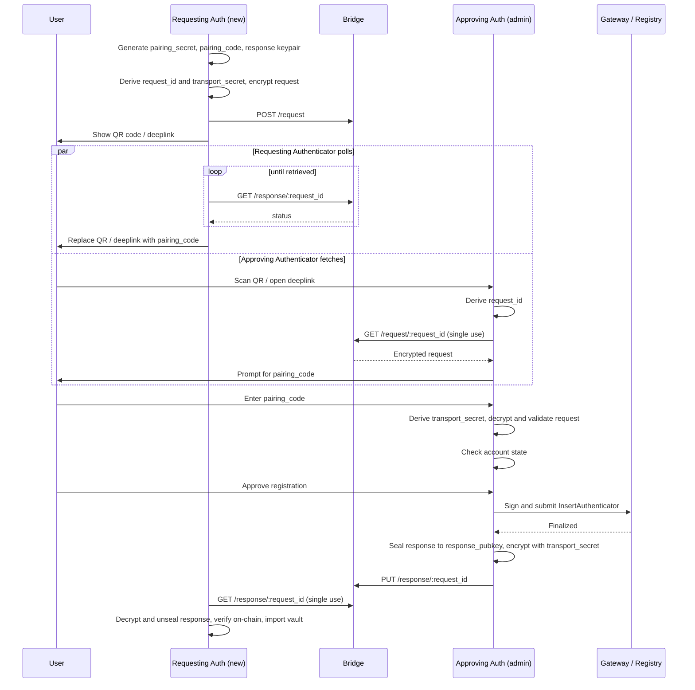

## 1. Motivation

World ID 4.0 supports multiple authenticators per account. Registering a new authenticator requires an existing Admin Authenticator ([WIP-104][wip-104]) to authorize an `InsertAuthenticator` operation on `WorldIDRegistry`, and the new authenticator needs the account's `leaf_index`, its assigned `pubkey_id`, and the user's credentials to generate proofs. This requires:

1. An interoperable, end-to-end encrypted channel between two authenticators across devices and providers.
2. Explicit, informed user approval on the **Approving Authenticator**.
3. Out-of-band authentication via a short pairing code typed into the **Approving Authenticator**, so possession of the Pairing URI alone cannot authorize a request or forge a response.

## 2. Summary

1. The **Requesting Authenticator** generates a random `pairing_secret`, a 6-letter `pairing_code`, and an ephemeral X-Wing `response_pubkey` keypair. It signs a commitment (`registration_digest`) to its keys, encrypts a [WIP-105][wip-105] `worldid_auth_v1_register` request under a key derived from `pairing_secret` and `pairing_code`, publishes the ciphertext to the message-bridge (WIP-110), and displays a `worldid://auth/v1/register` Pairing URI (as a QR code or deeplink).
2. The **Approving Authenticator** opens the Pairing URI, fetches the single-use encrypted request from the bridge, and prompts the user to enter `pairing_code` (which the **Requesting Authenticator** reveals once the bridge reports the request was `retrieved`).
3. Using `pairing_code`, the **Approving Authenticator** decrypts and validates the request, checks the account state, and asks the user for explicit approval (including a separate opt-in to share the credential vault).
4. Upon approval, the **Approving Authenticator** submits `InsertAuthenticator` on `WorldIDRegistry` (unless the key is already registered as requested), waits for finality, and returns the assigned `(leaf_index, pubkey_id)` and optional `vault` sealed to `response_pubkey` and authenticated under the transport key.
5. The **Requesting Authenticator** decrypts and unseals the response, verifies on-chain that its key is registered at `(leaf_index, pubkey_id)`, and imports the vault.

## 3. Specification

The key words "MUST", "MUST NOT", "REQUIRED", "SHALL", "SHALL NOT", "SHOULD", "SHOULD NOT", "RECOMMENDED", "MAY", and "OPTIONAL" in this document are to be interpreted as described in [RFC 2119](https://www.ietf.org/rfc/rfc2119.txt).

Authenticator roles and keys follow [WIP-104][wip-104]. Messages MUST conform to [WIP-105][wip-105].

### 3.1 Terminology

- **Requesting Authenticator**: The new authenticator to be registered.
- **Approving Authenticator**: An existing Admin Authenticator registered on the user's World ID.
- **Bridge**: An untrusted [message-bridge](https://github.com/worldcoin/message-bridge) deployment (WIP-110) that relays encrypted requests and responses.
- **Pairing Secret**: 32 random bytes generated per attempt by the **Requesting Authenticator** and carried in the Pairing URI.
- **Pairing Code**: A 6-letter random code generated per attempt by the **Requesting Authenticator**, displayed after the bridge reports `retrieved`, and manually entered into the **Approving Authenticator**.

### 3.2 Overview



### 3.3 Pairing Secret, Pairing Code and Derived Values

For each registration attempt, the **Requesting Authenticator** MUST generate a fresh 32-byte `pairing_secret`, `pairing_code`, and `response_pubkey` keypair using a CSPRNG. The `pairing_code` MUST be sampled uniformly from six-letter uppercase ASCII strings (`A`–`Z`) and revealed only after the bridge status becomes `retrieved`. Input MUST be normalized by stripping ASCII spaces and hyphens and uppercasing ASCII `a`–`z`, rejecting any other characters or a length other than 6 (without Unicode case folding).

`HKDF` denotes HKDF-SHA256 ([RFC 5869](https://www.rfc-editor.org/rfc/rfc5869)) with an empty salt and 32-byte output. `Argon2id` ([RFC 9106](https://www.rfc-editor.org/rfc/rfc9106.html)) uses version `0x13`, memory `m = 65536` KiB (64 MiB), iterations `t = 3`, parallelism `p = 4`, empty secret and associated data, and a 32-byte output:

```text
request_id       = HKDF(pairing_secret, info = "WORLD-ID/WIP-109/REQUESTID")
code_key         = Argon2id(password = pairing_secret || ASCII(pairing_code), salt = request_id,
                            m = 65536, t = 3, p = 4, version = 0x13, output_length = 32)
transport_secret = HKDF(pairing_secret || code_key, info = "WORLD-ID/WIP-109/TRANSPORTSECRET")
```

Here `request_id` is 32 bytes (encoded as `lowercase_hex(request_id)` in bridge URLs and message `id` fields), and `password` is the 32-byte `pairing_secret` concatenated with the 6-byte ASCII `pairing_code` (38 bytes).

#### 3.3.1 Registration Digest

The **Requesting Authenticator** commits to the registration parameters in the Pairing URI over a fixed-width binary layout:

```text
registration_digest = SHA-256(
    "WORLD-ID/WIP-109/REGISTER"     // ASCII
 || request_id                      // 32 bytes
 || new_authenticator_pubkey        // 32 bytes, WIP-100 §4 wire encoding
 || new_authenticator_address       // 20 bytes; 20 zero bytes for a Proving Authenticator
 || response_pubkey                 // 1216 bytes, X-Wing encapsulation key
)
```

All fields except `name` (an unauthenticated display label) and `registration_sig` are covered.

#### 3.3.2 Registration Signature

The **Requesting Authenticator** proves possession of `new_authenticator_pubkey` by lowering `registration_digest` to a field element and signing it with EdDSA ([WIP-100][wip-100] §3.5):

```text
d_hi, d_lo       = registration_digest[0..16], registration_digest[16..32]    // big-endian integers
m                = H_3(ds("WORLD-ID/WIP-109/REGSIG"); d_hi, d_lo)             // WIP-100 §3.3.2
registration_sig = EdDSA-Sign(signing_key, m)                                 // 64 bytes, WIP-100 §3.5.2
```

### 3.4 Pairing URI

The **Requesting Authenticator** encodes the pairing parameters in a [WIP-105][wip-105] deeplink:

```text
worldid://auth/v1/register?s={pairing_secret}&d={registration_digest}&b={bridge_domain}
```

| Parameter | Required | Description |
| --------- | -------- | ----------- |
| `s` | REQUIRED | 32-byte `pairing_secret` in unpadded base64url ([RFC 4648 §5](https://www.rfc-editor.org/rfc/rfc4648#section-5)), 43 characters. |
| `d` | REQUIRED | 32-byte `registration_digest` (§3.3.1) in unpadded base64url, 43 characters. |
| `b` | REQUIRED | Bare domain of the bridge (e.g. `bridge.example.org`), without scheme, port, path, userinfo, query, or fragment. Always contacted over `https`. |

The **Requesting Authenticator** MUST expose the URI as a deeplink and SHOULD render it as a QR code. The **Approving Authenticator** MUST reject unknown, missing, or duplicate parameters or invalid encodings, and MUST check `b` against an allowlist of known bridges (or require explicit user confirmation before contacting an unknown host). Opening the URI starts pairing and MUST NOT imply approval.

### 3.5 Transport

Requests and responses are exchanged through the bridge under `lowercase_hex(request_id)` (§3.3) and follow the bridge's session lifetime (WIP-110).

- **Outer encryption**: Both directions use AES-256-GCM under `transport_secret` with a fresh random 12-byte nonce (`iv`, standard padded base64) and ciphertext with its 16-byte tag (`payload`, standard padded base64). A nonce MUST NOT be reused under the same key.
- **Request**: Encrypt the CBOR-encoded request with AES-256-GCM using AAD `ASCII("WORLD-ID/WIP-109/REQUEST") || request_id`.
- **Response**: First seal the CBOR-encoded response (success or error) to `response_pubkey` using [WIP-100][wip-100] §3.9 with `info = "WORLD-ID/WIP-109/RESPONSE"`. Then encrypt the sealed bytes with AES-256-GCM under `transport_secret` using AAD `ASCII("WORLD-ID/WIP-109/RESPONSE") || request_id`.

The encoded CBOR plaintext MUST NOT exceed 4 KiB for a request and 3.5 MiB + 4 KiB for a response. Receivers MUST enforce corresponding size bounds before decryption and MUST authenticate the outer AES-GCM envelope before parsing a request or unsealing a response.

> [!NOTE]
> `transport_secret` authenticates both directions because unauthenticated HPKE base mode allows anyone holding `response_pubkey` to seal a message. The inner [WIP-100][wip-100] §3.9 layer provides post-quantum confidentiality for the vault even if the pairing secret and code are later compromised.

### 3.6 Messages

Messages use the [WIP-105][wip-105] CBOR envelope (`version: "1.0"`) with `id` set to `lowercase_hex(request_id)`. Examples below use abbreviated CBOR diagnostic notation (`h'…'`).

#### 3.6.1 `worldid_auth_v1_register` (Requesting → Approving)

| Member | Required | Description |
| ------ | -------- | ----------- |
| `new_authenticator_pubkey` | REQUIRED | Signing public key in [WIP-100 §4](wip-100.md#4-public-key-representation) compressed wire encoding (32-byte CBOR byte string). |
| `new_authenticator_address` | OPTIONAL | Management key address (20-byte non-zero CBOR byte string). Present for an Admin Authenticator; omitted for a Proving Authenticator. |
| `response_pubkey` | REQUIRED | Per-attempt ephemeral X-Wing encapsulation key (1216-byte CBOR byte string). |
| `name` | OPTIONAL | Self-reported label (CBOR text string, at most 64 UTF-8 bytes). Rejected with `invalid_name` if not accepted by the **Approving Authenticator**. |
| `registration_sig` | REQUIRED | Registration Signature (§3.3.2, 64-byte CBOR byte string). |

```text
{
  "version": "1.0",
  "id": "90f29fad9f9354009a277ce306f1867ff351d7d1844be4e41715ed58c0e676e3",
  "method": "worldid_auth_v1_register",
  "params": {
    "new_authenticator_pubkey": h'119ab03f…',
    "response_pubkey": h'420044e7…',
    "name": "Chrome on MacBook",
    "registration_sig": h'8e41c0…'
  }
}
```

#### 3.6.2 Success response (Approving → Requesting)

Sent only after the registration is final on-chain or confirmed already present (§3.7).

| Member | Required | Description |
| ------ | -------- | ----------- |
| `leaf_index` | REQUIRED | Account leaf index (`1 .. 2^30 - 1`; index 0 is reserved per [WIP-100][wip-100] §3.8, §5.1). |
| `pubkey_id` | REQUIRED | Assigned slot index, an unsigned integer below `getMaxAuthenticators()`. |
| `authenticators` | OPTIONAL | Known authenticators on the account: array of maps with `pubkey_id` (uint) and `name` (text string). |
| `vault` | OPTIONAL | Map with `format` (format identifier text string, e.g. `"walletkit_plaintext_v1"`) and `data` (CBOR byte string, at most 3.5 MiB / 3,670,016 bytes) containing the exported credential vault. Included only if the user opts in (§3.7) and the serialized vault fits within 3.5 MiB (otherwise omitted after informing the user). |

```text
{
  "version": "1.0",
  "id": "90f29fad9f9354009a277ce306f1867ff351d7d1844be4e41715ed58c0e676e3",
  "result": {
    "leaf_index": 42,
    "pubkey_id": 1,
    "authenticators": [{ "pubkey_id": 0, "name": "iPhone" }],
    "vault": { "format": "walletkit_plaintext_v1", "data": h'53514c69746520666f726d61742033…' }
  }
}
```

#### 3.6.3 Error response (Approving → Requesting)

| `code` | Meaning |
| ------ | ------- |
| `invalid_params` | Missing or malformed parameter, digest mismatch, or invalid key, address, or signature. |
| `invalid_name` | The **Approving Authenticator** rejected `name`. |
| `internal_error` | Unspecified internal error. |
| `user_rejected` | The user declined approval. |
| `not_authorized` | The **Approving Authenticator** is not an Admin Authenticator of the account. |
| `authenticator_conflict` | The signing key or management address is already registered with a conflicting account, slot, or class. |
| `max_authenticators_reached` | No free authenticator slot below `getMaxAuthenticators()`. |
| `operation_failed` | The `InsertAuthenticator` operation definitively failed. `error.data` MAY be a map with a `detail` text string. |
| `outcome_unknown` | The operation was submitted, but its outcome was not known in time to respond. |

```text
{
  "version": "1.0",
  "id": "90f29fad9f9354009a277ce306f1867ff351d7d1844be4e41715ed58c0e676e3",
  "error": { "code": "user_rejected", "message": "Registration declined" }
}
```

### 3.7 Approving Authenticator Procedure

1. **Fetch and decrypt**:
   - Parse the Pairing URI (§3.4), derive `request_id` (§3.3), and fetch `GET /request/:request_id` before prompting for `pairing_code` (this single-use read sets the bridge status to `retrieved`).
   - Prompt the user for `pairing_code`, derive `code_key` and `transport_secret` (§3.3), and decrypt the request (§3.5). Because `GET /request/:request_id` is single-use, the **Approving Authenticator** MUST retain the ciphertext locally if it allows retrying a mistyped code, and SHOULD limit the number of attempts.
   - Validate the CBOR request (`id == lowercase_hex(request_id)`, `method == "worldid_auth_v1_register"`, and §3.6.1 schema), verify that the recomputed `registration_digest` matches `d` from the URI, and verify `registration_sig` against `new_authenticator_pubkey`. On failure, send an error response (if a valid `response_pubkey` is available) or abort locally.
2. **Check account state**:
   - Refresh account state and verify that the **Approving Authenticator** is an Admin Authenticator of the account; otherwise respond `not_authorized`.
   - **Already registered**: If `new_authenticator_pubkey` is already registered on the account, verify that the slot's class and (for an Admin Authenticator) management address match the request; otherwise respond `authenticator_conflict`. User approval (step 3) is still required before skipping step 4 and returning the existing `leaf_index` and `pubkey_id`.
   - If `new_authenticator_address` is already registered, respond `authenticator_conflict`.
   - Select the lowest free `pubkey_id` below `getMaxAuthenticators()`; if none is free, respond `max_authenticators_reached`.
3. **Approve**:
   - Show an explicit consent screen displaying the requested class (Proving vs Admin), the untrusted `name` (if present), a warning only to approve trusted authenticators, and a separate unselected opt-in to share the credential vault (noting if it contains biometric data and that without it the new authenticator cannot generate proofs for existing credentials).
   - The **Approving Authenticator** SHOULD require local user verification (e.g. device biometric or PIN) before signing `InsertAuthenticator` or exporting the vault. If the user declines, respond `user_rejected`.
4. **Submit and respond**:
   - Unless already registered, sign and submit `InsertAuthenticator` (passing the zero address for a Proving Authenticator per [WIP-104][wip-104]) and wait for finality. Do not submit another insertion while one is in flight. If the operation definitively fails, respond `operation_failed` (or `authenticator_conflict` on an address conflict); if the outcome is not known in time, respond `outcome_unknown`.
   - Seal and encrypt the response (§3.5), and send it via `PUT /response/:request_id`.

### 3.8 Requesting Authenticator Procedure

1. Reuse the same authenticator key(s) and class across retries of the same registration so a retry after a lost response hits the already-registered case (§3.7 step 2) instead of inserting a second slot.
2. Encrypt the request (§3.5) and publish it via `POST /request` before showing the Pairing URI.
3. Display the Pairing URI and poll `GET /response/:request_id`:
   - While `initialized`, keep the Pairing URI visible.
   - Once `retrieved`, replace the Pairing URI with `pairing_code` and instructions to enter it only on the intended **Approving Authenticator**.
   - Once `completed`, proceed to step 4.
4. Authenticate and decrypt the outer response, unseal the inner HPKE payload (§3.5), and validate the CBOR response (`id == lowercase_hex(request_id)` and §3.6 schema).
5. On `result`, verify against on-chain/indexer state that `new_authenticator_pubkey` is registered at `(leaf_index, pubkey_id)` with the requested class and management address before completing registration or importing `vault`, and validate imported credentials against the account before use. On `error`, surface the error (and offer a retry on `outcome_unknown`).

Both authenticators MUST discard `pairing_secret`, `pairing_code`, derived keys, and the ephemeral response private key when the attempt ends, and MUST NOT log or send the Pairing URI or `pairing_code` to analytics or link-preview services.

## 4. Rationale

- **Message-bridge transport**: Reuses the existing off-chain relay without contract or service changes, keyed by a single `request_id` derived from `pairing_secret` to keep the QR code compact.
- **Out-of-band pairing code with Argon2id**: Entering `pairing_code` after the request is fetched binds the session to the user's intended device. Argon2id (salted with `request_id` and keyed with `pairing_secret`) raises the cost of offline guessing without allowing precomputation.
- **Dual-layer response encryption**: The outer AES-GCM layer under `transport_secret` authenticates both success and error responses, while the inner [WIP-100][wip-100] §3.9 X-Wing seal provides forward and post-quantum confidentiality for the credential vault.

## 5. Security

- **Untrusted bridge and URI interception**: The bridge sees metadata (`request_id`, sizes, timing, IPs) and can drop messages or spoof `retrieved`, and any QR scanner or `worldid://` handler can read the Pairing URI. Without `pairing_code`, an interceptor cannot decrypt the request or forge a valid response, though it can consume the single-use request or response slot and force a retry.
- **Offline code guessing**: The 6-letter `pairing_code` has `26^6` (~28 bits of entropy) possibilities. Argon2id slows offline brute-force against captured ciphertexts, and the inner X-Wing seal keeps `vault` confidential even if `transport_secret` is eventually recovered.
- **Phishing and malicious handlers**: A user tricked into scanning an attacker's URI and entering the attacker's code will be prompted to register the attacker's key, and a malicious app intercepting `worldid://` could spoof the code-entry screen. Explicit consent, local user verification, and verifying the target app remain essential.

## 6. Backwards Compatibility

This WIP requires no changes to existing bridge endpoints or contracts. Proving Authenticator registration requires `WorldIDRegistryV2` ([WIP-104][wip-104]). Authenticators that do not implement this WIP are unaffected.

[wip-100]: wip-100.md
[wip-104]: wip-104.md
[wip-105]: wip-105.md
