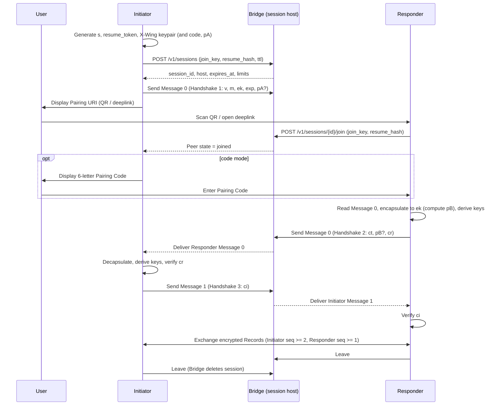

## 1. Motivation

Cross-device protocol flows—such as registering a new authenticator ([WIP-109][wip-109]) or syncing a credential vault—all need to exchange confidential, authenticated messages across devices, providers, and networks over an untrusted relay (**Bridge**).

WIP-110 provides this shared channel with the following guarantees:

- **Post-quantum confidentiality & forward secrecy:** Traffic recorded by the Bridge or a network observer remains confidential against future quantum adversaries (via ephemeral X-Wing), even if the Pairing URI and Pairing Code are disclosed after the session ends.
- **Strong peer authentication with compact QR codes:** A 1216-byte X-Wing public key is too large for a friendly QR code (~1,766 characters, QR v35). Sending the X-Wing key over the Bridge and authenticating it with `psk` (plus SPAKE2 in `code` mode) keeps the Pairing URI around ~140 characters (QR v8) while preventing man-in-the-middle key substitution and offline code brute-forcing.
- **Resilient mobile transport:** Mobile OSes suspend apps and drop WebSockets when backgrounded (e.g., while switching apps or scanning a QR code). Write-once sequence numbers, non-destructive cursor reads, and transport-independent resume tokens make reconnects and WebSocket-to-HTTP fallback idempotent.
- **Agreed session expiry:** The Bridge assigns an absolute `expires_at` timestamp at session creation, which is bound into the handshake transcript and enforced both by the Bridge and locally by each participant.

## 2. Summary

**WIP-110** establishes an end-to-end encrypted, mutually authenticated channel between an **Initiator** and a **Responder** over an untrusted **Bridge** in three layers:

1. **Out-of-Band Pairing (§3.4):** The Initiator creates a session on a Bridge entry host, which routes to and returns the session's assigned Bridge host `b` (a specific region, shard, or instance). The Initiator then presents a compact **Pairing URI** (via QR code or deeplink) carrying a 32-byte random secret `s`, the session host `b`, and the authentication mode `m` (`psk` for pre-shared key only, or `code` for pre-shared key plus a pairing code). In `code` mode, once the Responder joins, the Initiator also displays a 6-letter **Pairing Code** (`A`–`Z`) that the user types into the Responder.
2. **Hybrid Post-Quantum Handshake & Record Layer (§3.5):** Over the Bridge, the participants run a 3-message CBOR handshake combining **X-Wing** (ML-KEM-768 + X25519) for post-quantum forward-secret confidentiality, a pre-shared key `psk` derived from `s`, and (in `code` mode) **SPAKE2** over P-256 to authenticate the 6-letter code without allowing offline guessing. The handshake binds the session expiry and application context into a transcript hash, confirms keys in both directions, and exports a 32-byte `channel_binding` token and directional **ChaCha20-Poly1305** record keys.
3. **Stateful Two-Seat Bridge Mailbox (§3.6):** The Bridge is an untrusted, single-home store-and-forward mailbox with two seats (**Initiator** and **Responder**) and contiguous, write-once sequence numbers per direction. It knows nothing about the handshake or record plaintexts. Participants communicate over **WebSocket** with an **HTTP long-polling fallback**, and can seamlessly reconnect or switch transports using a per-seat `resume_token` and cursor-based reads.

> [!NOTE]
> **What an Application WIP gets from WIP-110:** An application protocol pins the authentication mode (`psk` or `code`), supplies an `app_label` and optional `app_context` (such as a request digest in the URI), exchanges ordered encrypted **Records** over the established channel, and binds its own signatures or credentials to the exported 32-byte `channel_binding`.

## 3. Specification

The key words "MUST", "MUST NOT", "REQUIRED", "SHALL", "SHALL NOT", "SHOULD", "SHOULD NOT", "RECOMMENDED", "MAY", and "OPTIONAL" in this document are to be interpreted as described in [RFC 2119](https://www.ietf.org/rfc/rfc2119.txt).

### 3.1 Terminology & Notation

- **Initiator**: The participant that creates the Bridge session and presents the Pairing URI.
- **Responder**: The participant that consumes the Pairing URI and joins the session.
- **Bridge**: An untrusted relay that stores and forwards opaque **Messages** for a **Session**.
- **Seat**: The Initiator's or Responder's authenticated position in a Session, bound to a random 32-byte `resume_token`.
- **Message**: An opaque byte string stored at a sequence number (`0, 1, 2, …`) in one direction of a Session.
- **Record**: An AEAD-encrypted application payload carried in a Message after the handshake completes.
- **Pairing Secret** (`s`): 32 random bytes generated by the Initiator per session and carried in the Pairing URI, from which the session's **Pre-Shared Key** (`psk`) is derived.
- **Pairing Code**: A 6-letter uppercase ASCII code (`A`–`Z`) shown by the Initiator and entered into the Responder in `code` mode.

**Notation:**

- `||` denotes byte concatenation; string literals in derivations are ASCII bytes.
- `HKDF(ikm, info, L)` is HKDF-SHA-256 extract-and-expand ([RFC 5869](https://www.rfc-editor.org/rfc/rfc5869)) with an empty salt unless `salt` is specified.
- `u8(n)`, `u16(n)`, `u32(n)`, and `u64(n)` are unsigned big-endian encodings of `n` in 1, 2, 4, and 8 bytes.
- `lp(x)` is the 2-byte length-prefixed encoding `u16(len(x)) || x`.

### 3.2 Protocol Overview



### 3.3 Cryptographic Primitives

| Purpose | Primitive |
| ------- | --------- |
| Key encapsulation | X-Wing (`draft-connolly-cfrg-xwing-kem-06`): 1216-byte encapsulation key `ek` (ML-KEM-768 followed by X25519), 1120-byte ciphertext `ct`, 32-byte shared secret `ss`, matching [WIP-100 §3.9][wip-100]. Responders MUST reject an `ek` whose ML-KEM-768 component fails the FIPS 203 §7.2 check. |
| Hash, KDF, and MAC | SHA-256, HKDF-SHA-256, and HMAC-SHA-256. |
| Record encryption | ChaCha20-Poly1305 ([RFC 8439](https://www.rfc-editor.org/rfc/rfc8439)), as in [WIP-100 §3.9][wip-100]. |
| Pairing code PAKE | SPAKE2 ([RFC 9382](https://www.rfc-editor.org/rfc/rfc9382)) with `SPAKE2-P256-SHA256-HKDF-HMAC` and the P-256 points `M` and `N` from RFC 9382 §6. |

There is no cipher negotiation; changing any primitive requires a new handshake version.

### 3.4 Pairing

#### 3.4.1 Authentication Modes

- **`psk` (pre-shared key) mode**: Authenticates the peer solely by possession of the Pairing URI (`s`, from which `psk` is derived). Any party that intercepts the URI before the legitimate Responder joins can claim the Responder seat.
- **`code` mode**: Additionally authenticates the peer via a 6-letter Pairing Code using SPAKE2. An interceptor holding the URI without the code gets at most one online guess per honest participant reached.

Each application WIP pins its required mode (§3.8). Implementations MUST NOT fall back from `code` to `psk`. Sessions in `code` mode MUST be initiated by an explicit user action (never auto-refreshed in the background).

#### 3.4.2 Secret Derivations

For each session, the Initiator generates a fresh 32-byte `s` using a CSPRNG. Both participants derive:

```text
join_key   = HKDF(s, info = "WORLD-ID/WIP-110/JOIN", L = 32)
session_id = SHA-256("WORLD-ID/WIP-110/SESSION" || join_key)       // 32 bytes (64 lowercase hex chars in URLs)
psk        = HKDF(s, info = "WORLD-ID/WIP-110/PSK", L = 32)
```

The Bridge receives `join_key` (on create/join) and `session_id`, never `s` or `psk`. Because `session_id` is a one-way hash of `join_key`, learning `session_id` from URLs or logs does not allow joining a session.

#### 3.4.3 Pairing Code

In `code` mode, the Initiator samples a 6-letter code uniformly at random from uppercase ASCII `A`–`Z` using a CSPRNG.

- **Display timing**: The Initiator MUST NOT display the Pairing Code until the Bridge reports that the Responder has joined, and MUST instruct the user to enter it only on the device that scanned the Pairing URI.
- **Normalization**: Before use, the Responder strips ASCII spaces and hyphens, maps `a`–`z` to `A`–`Z`, and rejects any input that is not exactly 6 uppercase ASCII letters.

#### 3.4.4 Pairing URI Parameters

Application WIPs define their own URI scheme and path (§3.8), which MUST include these parameters:

| Parameter | Description |
| --------- | ----------- |
| `s` | 32-byte Pairing Secret in canonical unpadded base64url ([RFC 4648 §5](https://www.rfc-editor.org/rfc/rfc4648#section-5)), 43 characters. |
| `b` | Assigned Bridge hostname returned at session creation (e.g., `cell-3.eu-central-1.bridge.example.org`), contacted over `https://` and `wss://`. |
| `m` | Authentication mode: `psk` or `code`. |

The Responder MUST reject URIs with missing, duplicate, or malformed parameters, verify that `m` matches the application's required mode, and verify `b` against an allowlist of known Bridge hosts (or require explicit user confirmation). Neither the Pairing URI nor the Pairing Code may be logged or sent to analytics or link-preview services.

### 3.5 Handshake & Record Layer

#### 3.5.1 Handshake Messages

Handshake messages are CBOR maps ([RFC 8949](https://www.rfc-editor.org/rfc/rfc8949)) with text keys and no trailing bytes. Senders MUST use definite-length encodings without tags; receivers MUST reject missing required keys, duplicate defined keys, wrong types/lengths, or a SPAKE2 share whose presence disagrees with `m`, and MUST ignore unknown keys.

| Message | Direction & Seq | CBOR Map Fields |
| ------- | --------------- | --------------- |
| **Message 1** | Initiator → Responder (`seq = 0`) | `v`: uint (`1`); `m`: text (`"psk"` or `"code"`); `ek`: bstr (1216-byte X-Wing encapsulation key); `exp`: uint (`expires_at` from session creation); `pa`: bstr (65-byte uncompressed SEC1 SPAKE2 `pA`, present iff `m == "code"`) |
| **Message 2** | Responder → Initiator (`seq = 0`) | `ct`: bstr (1120-byte X-Wing ciphertext to `ek`); `pb`: bstr (65-byte uncompressed SEC1 SPAKE2 `pB`, present iff `m == "code"`); `cr`: bstr (32-byte Responder confirmation MAC) |
| **Message 3** | Initiator → Responder (`seq = 1`) | `ci`: bstr (32-byte Initiator confirmation MAC) |

The Responder MUST verify that Message 1's `v` is `1`, `m` matches the URI, and `exp` equals the `expires_at` returned by the Bridge when joining.

#### 3.5.2 Transcript Hash & Key Schedule

Both participants compute the transcript hash `th` over the parsed handshake values:

```text
th = SHA-256(
    "WORLD-ID/WIP-110/TRANSCRIPT"
 || lp(app_label)                  // §3.8
 || lp(app_context)                // §3.8 (empty if unused)
 || session_id                     // 32 bytes
 || u8(1)                          // handshake version
 || u8(mode)                       // 1 = psk, 2 = code
 || u64(exp)
 || ek                             // 1216 bytes
 || pA                             // 65 bytes in code mode; omitted in psk mode
 || ct                             // 1120 bytes
 || pB                             // 65 bytes in code mode; omitted in psk mode
)
```

From the X-Wing shared secret `ss` (32 bytes) and the SPAKE2 shared key `ke` (16 bytes in `code` mode, empty in `psk` mode), both participants derive:

```text
prk             = HKDF-Extract(salt = psk, ikm = ss || ke)
okm             = HKDF-Expand(prk, info = "WORLD-ID/WIP-110/KEYS" || th, L = 160)
conf_i || conf_r || key_ir || key_ri || exporter = okm         // five 32-byte keys

cr              = HMAC-SHA-256(conf_r, th)
ci              = HMAC-SHA-256(conf_i, th)
channel_binding = HKDF-Expand(exporter, info = "WORLD-ID/WIP-110/CHANNELBINDING", L = 32)
```

- The Responder sends `cr` in Message 2. The Initiator verifies `cr` in constant time before sending `ci` in Message 3; on mismatch it aborts without sending Message 3.
- The Responder verifies `ci` in constant time upon receiving Message 3.
- Neither participant may send or accept application Records before verifying its peer's confirmation.

#### 3.5.3 SPAKE2 Details (`code` mode)

The Initiator acts as party A (`"WORLD-ID/WIP-110/INITIATOR"`) and the Responder as party B (`"WORLD-ID/WIP-110/RESPONDER"`). The password scalar `w` is derived from the 6-byte canonical ASCII `code` and salted with `psk`:

```text
w = OS2IP(HKDF(ikm = code, salt = psk, info = "WORLD-ID/WIP-110/SPAKE2W", L = 48)) mod q
```

where `q` is the P-256 group order. Shares `pA` and `pB` and the transcript `TT` follow RFC 9382 §3.3 and §4 (8-byte little-endian length prefixes, uncompressed SEC1 points, 32-byte big-endian `w`), with `ke` set to the first 16 bytes of `SHA-256(TT)`. Key confirmation happens via `cr` and `ci` (§3.5.2) rather than RFC 9382's separate MACs.

Each participant MUST process at most one peer share per session, use a fresh random non-zero scalar, validate that the peer share is a 65-byte uncompressed P-256 point, and reject the identity element after unmasking or as the shared point `K`.

#### 3.5.4 Encrypted Records

After key confirmation, each Bridge Message carries a single ChaCha20-Poly1305 Record:

```text
nonce  = u32(0) || u64(seq)
aad    = "WORLD-ID/WIP-110/RECORD" || session_id || u8(direction) || u64(seq)
record = ChaCha20-Poly1305-Encrypt(key, nonce, aad, plaintext)
```

- **Directions & sequence numbers**: `direction = 1` (`key = key_ir`, starting at `seq = 2`) for Initiator → Responder; `direction = 2` (`key = key_ri`, starting at `seq = 1`) for Responder → Initiator.
- **Ordering & retries**: Receivers MUST process Records strictly in sequence order and abort the session if any Record fails authentication. A sender MUST fix the ciphertext for a given `seq` before first transmission and resend the exact same bytes on any retry.
- **No authenticated EOF**: Bridge peer-state notifications, session closure, and expiry are unauthenticated; applications MUST determine completion from authenticated Record contents (§3.8).

### 3.6 Bridge Protocol

#### 3.6.1 Session Model & Guarantees

1. **Single-home session host**: A session is created via an entry host that routes to a healthy Bridge host (which may represent a region, a cell/shard, or an individual stateful instance) and returns that session's assigned `host`. All subsequent requests from both participants go directly to `host` (`b` in the Pairing URI), keeping all state for a session in one place without cross-node or cross-region replication.
2. **Two seats & resume tokens**: Each participant generates a random 32-byte `resume_token` and registers `resume_hash = SHA-256(resume_token)` when claiming its seat (the Initiator at creation, the Responder on first join with `join_key`). Subsequent sends, reads, WebSocket attaches, and leaves require `resume_token`. Joining when the Responder seat is already bound to a different `resume_hash` fails with `seat_taken`.
3. **Write-once sequences**: Each direction stores Messages at contiguous sequence numbers `0, 1, 2, …`. Sending at the next sequence number appends; resending identical bytes at an already-stored sequence number succeeds idempotently; sending different bytes at a stored sequence number fails with `conflict`; sending past the next sequence number fails with `gap`. Before the Responder joins, the Initiator may only store `seq = 0` (up to 4 KiB).
4. **Non-destructive cursor reads**: Reading returns Messages from the peer's direction starting at cursor `from` without deleting them, along with `next` (the caller's own next sequence number, used to recover from lost acknowledgements) and `peer` state bits (`0` = not joined, `1` = joined, `3` = joined and left; the left bit `2` is only reported once the reader has received all Messages stored by the peer).
5. **Lifetime & retention**: At creation, the Initiator requests a `ttl` (seconds), which the Bridge caps at `max_ttl <= 3600` to set `expires_at = now + min(ttl, max_ttl)`. Both participants enforce `min(expires_at - now, 3600)` locally on a monotonic clock from their initial create/join response. The Bridge retains all Messages until `expires_at` or until all joined seats have called `leave`, at which point the session is deleted.
6. **Size limits**: The Bridge advertises `limits: {message, session}` (in bytes) and MUST support at least `message >= 5 MiB` (5,242,880 bytes) and enough `session` capacity for the handshake plus at least four maximum-size Messages.

#### 3.6.2 HTTP Interface

All endpoints live under `https://{host}/v1`. Request/response metadata bodies are CBOR maps (`application/cbor`); `PUT .../messages/{seq}` bodies are raw Message bytes (`application/octet-stream`). Seat-authenticated endpoints carry `Authorization: Bearer <resume_token_base64url>`.

| Endpoint | Request Body | Response (`200 OK`) |
| -------- | ------------ | ------------------- |
| `POST /v1/sessions` | `{join_key, resume_hash, ttl}` | `{session_id, host, expires_at, now, limits}` |
| `POST /v1/sessions/{session_id}/join` | `{join_key, resume_hash}` | `{expires_at, now, limits}` |
| `PUT /v1/sessions/{session_id}/messages/{seq}` | Raw Message bytes | Empty |
| `GET /v1/sessions/{session_id}/messages?from={n}&wait={s}&peer={p}` | Empty (`wait` <= 30s long-poll; holds if no new messages and peer state == `p`) | `{messages: [{seq, data}, ...], next, peer, expires_at, now}` |
| `POST /v1/sessions/{session_id}/leave` | Empty | Empty |

#### 3.6.3 WebSocket Interface

`GET wss://{host}/v1/sessions/{session_id}/ws` upgrades to a WebSocket carrying one CBOR map per binary frame. Clients may switch between WebSocket and HTTP at any time.

| Direction | Frame | Meaning |
| --------- | ----- | ------- |
| Client → Bridge | `{t: "attach", token: bstr(32), from: uint}` | Authenticate seat with raw `resume_token` and subscribe to peer Messages from `from`. |
| Bridge → Client | `{t: "attached", expires_at, now, limits, peer, next}` | Attach succeeded; queued peer Messages follow as `msg` frames. |
| Client → Bridge | `{t: "send", seq: uint, data: bstr}` | Store a Message at `seq`. |
| Bridge → Client | `{t: "sent", seq: uint}` | Message at `seq` is stored (including idempotent resends). |
| Bridge → Client | `{t: "msg", seq: uint, data: bstr}` | Peer Message delivered in sequence order. |
| Bridge → Client | `{t: "peer", peer: uint}` | Peer state bits updated (`1` = joined, `3` = joined & left). |
| Client → Bridge | `{t: "leave"}` | Leave seat; Bridge replies `{t: "left"}` and closes with `1000`. |
| Client → Bridge | `{t: "ping"}` | Application-level keepalive (for browser environments without WS ping access); ignored by Bridge. |
| Bridge → Client | `{t: "error", code: text, message: text, seq?: uint, retry_after?: uint}` | Operation error (`seq` identifies a failed `send`). |

**Connection management & close codes**:

- Attaching a seat replaces any prior WebSocket for that seat (closing the prior socket with `4001`).
- Fatal close codes—`1002`/`1009` (protocol/size violation), `4000` (bad `attach`), `4003` (bad `token`), `4004` (session missing/expired/left)—end the session.
- Transient close codes—`1012` (server restart or failover write loss), `4008` (idle timeout), or unexpected disconnects—prompt the client to reattach with backoff and resend any unacknowledged Messages starting from `next`.
- Endpoints MUST keep reading while writing large frames to avoid deadlock, and send periodic keepalives while connected.

#### 3.6.4 Error Codes

HTTP errors return CBOR `{code: text, message: text}` (and WebSocket errors send `{t: "error", ...}`):

| Code | HTTP | Meaning & Client Action |
| ---- | ---- | ----------------------- |
| `bad_request` | 400 | Malformed request → abort session. |
| `forbidden` | 403 | Invalid `join_key` or `resume_token` → abort session. |
| `not_found` | 404 | Unknown, expired, or deleted session → abort session. |
| `seat_taken` | 409 | Responder seat already claimed by another client → abort and warn user not to enter the code. |
| `conflict` | 409 | Different bytes sent at an already-stored `seq` → abort session. |
| `gap` | 409 | `seq` is beyond `next` → resend stored Messages starting from `next`. |
| `closed` | 409 | New send attempted after a seat has left → stop sending, finish reading peer Messages, and end. |
| `too_large` | 413 | Exceeds `limits.message`, `limits.session`, or pre-join limit (4 KiB at `seq = 0`) → abort session. |
| `rate_limited` / `unavailable` | 429 / 503 | Transient overload or outage → retry with backoff, honoring `Retry-After` / `retry_after`. |

### 3.7 Participant Procedures

**Initiator:**

1. Generate `s`, `resume_token`, an X-Wing keypair, and (in `code` mode) the 6-letter Pairing Code and SPAKE2 share `pA`. Derive `join_key`, `session_id`, and `psk`.
2. Call `POST /v1/sessions` at the entry host. Verify the returned `session_id` and record the local monotonic deadline from `expires_at - now`.
3. Send Handshake Message 1 (`seq = 0`) on the assigned `host` (`b`), then display the Pairing URI (`s`, `b`, `m`).
4. Wait for `peer` state `joined`. In `code` mode, display the Pairing Code.
5. Read Handshake Message 2 (`seq = 0`), decapsulate `ct`, derive keys, and verify `cr`. Send Handshake Message 3 (`seq = 1`, `ci`).
6. Exchange application Records (`seq >= 2`). When finished, call `leave` and zeroize all secrets and keys.

**Responder:**

1. Parse and validate the Pairing URI (`s`, `b`, `m`), generate `resume_token`, and derive `join_key`, `session_id`, and `psk`.
2. Call `POST /v1/sessions/{session_id}/join` on `b` and record the local monotonic deadline. On `seat_taken`, warn the user that another device claimed the link and not to enter the Pairing Code.
3. Read and validate Handshake Message 1 (`seq = 0`), checking `v == 1`, `m`, and `exp == expires_at`.
4. In `code` mode, prompt the user for the 6-letter Pairing Code and compute `pB`.
5. Encapsulate to `ek`, derive keys, and send Handshake Message 2 (`seq = 0`, `ct`, `pB?`, `cr`).
6. Read Handshake Message 3 (`seq = 1`) and verify `ci`.
7. Exchange application Records (`seq >= 1`). When finished, call `leave` and zeroize all secrets and keys.

### 3.8 Application Requirements

A WIP that uses WIP-110 MUST specify:

1. **Pairing URI format**: Scheme, path, and any extra parameters alongside `s`, `b`, and `m` (if using `https://` links, parameters MUST be placed in the URL fragment `#` so they are never sent to web servers).
2. **`app_label` and `app_context`**: The ASCII domain-separation label `app_label` (e.g., `"worldid/auth/v2/register"`) and any out-of-band commitment `app_context` (up to 255 bytes, e.g., a request digest from the URI) bound into `th`.
3. **Session parameters**: Required mode (`psk` or `code`), allowed handshake versions, and requested `ttl`.
4. **Application Records & completion**: Payload schemas, how payloads exceeding `limits.message - 16` are split, how each side detects end-of-stream from authenticated Records, and when each side leaves.
5. **Channel-bound authentication**: How application-level signatures or MACs bind what is at stake (accounts, keys, vaults) to a domain-separated transcript containing `app_label`, participant role, and `channel_binding`.

## 4. Rationale & Security Considerations

- **Why X-Wing travels over the Bridge instead of the URI**: Embedding a 1216-byte X-Wing key in the URI inflates it to ~1,766 characters (QR version 35), making scanning slow and fragile. Sending `ek` in Message 1 keeps the URI compact (~140 characters, QR version 8), while mixing `psk` (and `Ke` in `code` mode) into the HKDF key schedule ensures any key substitution by the Bridge fails confirmation.
- **Why Responder confirms first**: In Message 2, the Responder commits to its SPAKE2 share `pB` and confirmation `cr` before seeing any code-derived output from the Initiator. An attacker in the Responder seat gets at most one guess (`26^-6 ≈ 2^-28`) and learns nothing if it fails; passive observers holding `s` cannot test codes offline because `cr` and `ci` also depend on the ephemeral X-Wing shared secret `ss`.
- **Why no per-authenticator attempt counter**: A global attempt budget (e.g., 3 failed handshakes per 10 minutes) would allow an untrusted Bridge to lock users out by dropping or corrupting handshake messages without even knowing `s`. Requiring a user action per `code` session limits an attacker with `s` to one online guess per participant reached without introducing a denial-of-service vector.
- **Why single-home session hosts and cursor reads**: Returning a dedicated `host` (`b`) at session creation lets the Bridge pin each session to a specific region, shard, or even a single in-memory instance, giving linearizable seat claims and sequence numbers without distributed coordination. Keeping messages until both seats leave (or `expires_at`) avoids acknowledgement sub-protocols and lets mobile clients recover cleanly from dropped connections.
- **Untrusted Bridge threat model**: The Bridge sees metadata (`session_id`, `join_key`, `resume_hash`, message sizes, timing, IP addresses) and can delay, drop, or truncate traffic, but cannot read plaintexts, derive `s` or `psk`, or forge handshakes or Records. Applications detect truncation via their own authenticated Record framing (§3.8).

## 5. Backwards Compatibility

WIP-110 introduces a new protocol and `/v1/sessions` endpoints and does not modify existing functionality.

## Appendix A. Test Vectors

Inputs common to both modes (full `ek`, `ct`, and encoded CBOR messages are in [`wip-110-vectors.txt`](wip-110-vectors.txt)):

| Input | Value |
| ----- | ----- |
| `s` | bytes `00 01 02 … 1f` |
| `app_label`, `app_context` | `test/v1/app`, `commitment` |
| `exp` | `1900000000` |
| X-Wing keygen seed | bytes `20 21 … 3f` (32 bytes) |
| X-Wing encapsulation randomness | bytes `40 41 … 7f` (64 bytes: first 32 ML-KEM, last 32 X25519) |
| Pairing Code (`code` mode) | `QJTWPK` |
| SPAKE2 `x`, `y` (`code` mode, 32-byte big-endian) | `43dd0fd7215bdcb482879fca3220c6a968e66d70b1356cac18bb26c84a78d729`, `dcb60106f276b02606d8ef0a328c02e4b629f84f89786af5befb0bc75b6e66be` |
| Record (Initiator, `seq = 2`) | plaintext `hello` |

Derived values common to both modes:

```text
join_key    = b4097056e988db274ec0beec0d18acbb1d2d0ca8279b5e74c27dc9227e88a515
session_id  = 54ff2808ca4b9c1c4c15c3857c9b3d1f5aa553f814d105322c46ff4ad2b1ab25
psk         = 6281e1f319f4be659d53153513f7074e8547fbeb8ba32565dd3b5e8922b4de30
SHA-256(ek) = a1f324bc0701f1234fbba7b11901023b3644f3bb8c6eb4ee4368d7e859eb6228
SHA-256(ct) = f6bf3f238e83f24cd444f2887e8fd32d630e07dbe6ca2f2b403aaf5333030c48
ss          = 8dac8602d4ce5e27e81335b54b25fdcaea86e56613214ee0522db4a5e0a38d50
```

`psk` mode:

```text
th              = bea6a4f5b56315937dc6efa9baaebba9246f7290da9cb5c426d5b089cc6aff4b
cr              = afe3cc8fe2e0a35c63d169dc43124a9011806ad6320a95b073ac60e35a33c949
message3        = a1626369582024e76d05259dc4b582597fd04856fd146b4bde80f6510eb1caf0a54edd3e2e63
channel_binding = 8dae06270b2ac0ea31c07f9480d1e91df3eb91f64d9b13b08f3d6ce3f339c225
record          = f08ff40fe4d2dd72386799aa9cdc828a59061b337e
```

`code` mode:

```text
w               = df6f7a66d93cd7c6c8896a3060387643117611a692d32bb10a68083688fced87
Ke              = 6f924375e20514541d8ec51a7bbd4924
pA              = 04e555433e9b6767de36b938d2fb8f82d6e3fe8ef4c81b314baf347b610eba3ae8
                  3b6138f049cd763191e6967c1f02d0299b3fa5977bb51876b1a561bab41294d1
pB              = 04542b48e0e5da80b39d9212ff0dad76a04245092891b967bc38ef810392ac5f00
                  4bb77d3be2e569bce7aa7be18bfc93656cc83ec47866bc3b045b241efb36a908
th              = 3baff46387ea6ebd8565dd03417acd0ec04d79f9795a6192e5f7cc58cf026612
cr              = 55bd3a63979a416ceb3b92bd0de43b9fad89e25b44be953cef15afaa19914db2
message3        = a1626369582038d80fc3c30d2268137e406f805f5ba2af3edc3f149504602add1efe28f9134a
channel_binding = 9801bb13cba4f785f5dd5c3f0e46167a1314c612372fceba2bb5475a2db2527f
record          = 8c4ff3516ffcab65836e26ea027b3649a87c151357
```

[wip-100]: wip-100.md#39-public-key-encryption
[wip-109]: wip-109.md
