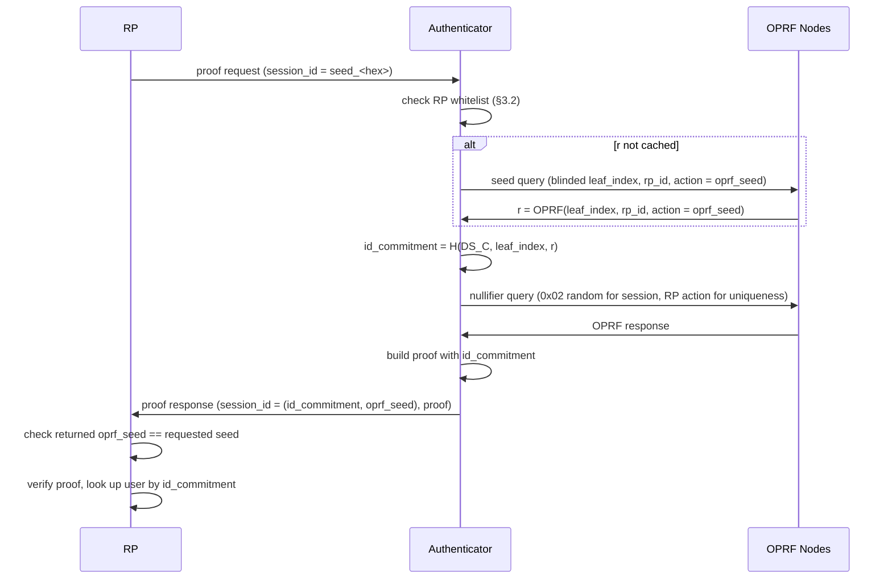

## 1. Abstract

This spec lets a Relying Party (RP) request a session from a seed it provides instead of a session id it stores. Every Authenticator of a World ID derives the same session id for the same RP and seed. The RP can recognize a returning user from a Session Proof alone, for example to authenticate them, without keeping a session id per user on the client.

## 2. Motivation

Session Proofs let an RP recognize a returning user, but only if the RP knows which session id to request. That needs a mapping from user to session id outside the protocol, e.g. a cookie or an email address. RPs that want World ID itself to authenticate users have no such mapping.

Repeated Uniqueness Proofs are no alternative: a nullifier is one-time use, and Authenticators refuse to disclose the same nullifier twice. Seeded sessions close this gap. Every Authenticator of a World ID derives the same session id for a given RP and seed, so the RP can authenticate the user from a Session Proof alone.

## 3. Specification

The key words "MUST", "MUST NOT", "REQUIRED", "SHALL", "SHALL NOT", "SHOULD", "SHOULD NOT", "RECOMMENDED", "MAY", and "OPTIONAL" in this document are to be interpreted as described in [RFC 2119](https://www.ietf.org/rfc/rfc2119.txt).

### 3.1 Proof Request

The `session_id` field of a `ProofRequest` gains a fourth form:

| Wire value                  | Meaning                                                  |
| --------------------------- | -------------------------------------------------------- |
| absent / `null`             | No session                                               |
| `"create"`                  | Mint a session from a random seed                        |
| `"session_<hex>"`           | Prove an existing session                                |
| `"seed_<hex>"` (new)        | Derive the session from the given `oprf_seed`            |

`<hex>` is the 32-byte big-endian `oprf_seed`. The seed MUST have the session seed prefix (MSB `0x01`), the same as a seed generated for `"create"`.

Valid combinations:

| `proof_type` | `session_id` | Use                                                                        |
| ------------ | ------------ | -------------------------------------------------------------------------- |
| `session`    | `seed_<hex>` | Prove the seeded session                                      |
| `uniqueness` | `seed_<hex>` | Uniqueness Proof bound to the seeded session |

The RP signature message is unchanged; the seed is not signed.

### 3.2 RP Whitelist

1. Authenticators MUST only allow seeded requests for RPs that are explicitly whitelisted by the Authenticator Provider. The distribution of this whitelist is out of scope and up to the authenticator provider. It could e.g., distributed as part of an app release.
2. Authenticators MUST be transparent about the members of the whitelist and MUST allow users to remove RPs from the whitelist they do not trust.
3. Authenticators SHOULD allow users to manually add RPs to the whitelist.

### 3.3 Seeded Session Flow

1. The RP sends a proof request with `session_id = "seed_<hex>"` (§3.1).
2. The Authenticator MUST refuse the request if the RP is not whitelisted (§3.2).
3. The Authenticator derives `r` from `oprf_seed` exactly as for `"create"`: a session seed query (MSB `0x01`) with `r = OPRF(leaf_index, rp_id, action = oprf_seed)`. It MAY cache `r` per `(rp_id, oprf_seed)` and skip the seed query.
4. The Authenticator computes `id_commitment = H(DS_C, leaf_index, r)`. Because `r` depends only on `leaf_index`, `rp_id` and `oprf_seed`, all Authenticators of a World ID derive the same `id_commitment`.
5. The Authenticator runs the nullifier query and builds the proof requested by `proof_type`, with `id_commitment` as a public signal.
6. The response carries `session_id = (id_commitment, oprf_seed)` and the proof.
7. The RP SHOULD check that the returned `session_id.oprf_seed` equals the requested seed as a sanity check. The proof does not bind `id_commitment` to `oprf_seed`.
8. The RP verifies the proof against `id_commitment` as for any session, and identifies the user by `id_commitment`.

### 3.4 RP Guidance

1. Seeded sessions are for authentication where the RP has no out-of-protocol way (e.g. a cookie, an email address or its own account) to find a user's session id.
2. If the RP can map users to session ids itself, it SHOULD use standard sessions (`"create"`, then `"session_<hex>"`). Standard sessions also recognize a returning user, but don't let an RP recognize a user it holds no state for.
3. **Uniqueness.** If the RP wants one account per user, it MUST create the account from a `uniqueness` × `seed_<hex>` request, check that the nullifier is unused, and store the account under `id_commitment` (see §4). A `session` × `seed_<hex>` request alone doesn't limit the number of accounts.
4. **Authentication.** The RP sends a `session` × `seed_<hex>` request with the same seed and looks up the account by `id_commitment`. An unknown `id_commitment` MUST NOT authenticate as any account.
5. **Seed choice.** The RP SHOULD keep one fixed seed per purpose. Changing the seed gives every user a new `id_commitment`.

## 4. Rationale

1. **RP-provided seed instead of a fixed one.** A fixed seed is a special case. Several seeds let an RP keep separate ids per user (e.g. per tenant) at no extra risk, because `r` is scoped to `rp_id`.
2. **Sessions instead of repeated Uniqueness Proofs.** A uniqueness nullifier stays one-time use. Authenticators refuse to disclose the same nullifier twice.
3. **Uniqueness Proof for one account per user.** `id_commitment` is deterministic only for honest Authenticators. The circuit doesn't prove that `r` was derived from `oprf_seed`, so a modified Authenticator can produce any number of commitments. Only the uniqueness nullifier limits a user to one account.

## 5. Security

1. **No sybil resistance from the seed alone** (see §4). Authentication stays safe: a foreign commitment can't be proven and an unknown one matches no account.
2. **Tracking within an RP.** A seeded session is a stable per-RP identifier. Uniqueness Proofs bound to it are linkable to each other. This is why §3.2 requires a whitelist. Authenticators SHOULD tell the user the RP can recognize them. Ids for different RPs are unlinkable.
3. **The whitelist is enforced by Authenticators only.** It protects users from RPs. A modified Authenticator that ignores it only exposes its own user.
4. **OPRF key rotation** for an RP changes all of its seeded session ids.

## 6. Backwards Compatibility

The change is additive. Authenticators that don't implement this spec reject `"seed_<hex>"` when parsing the request. OPRF Nodes and contracts need no changes.
