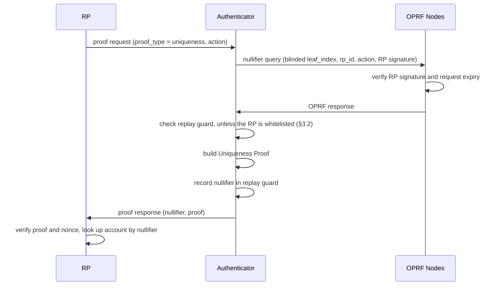

## 1. Abstract

This spec lets Authenticators disclose a nullifier more than once, but only to Relying Parties (RPs) that the Authenticator Provider whitelists. A whitelisted RP can then use the nullifier both to enforce one account per user and to recognize a returning user, for example to authenticate them, from a single Uniqueness Proof. This is an alternative to [WIP-116](https://github.com/worldcoin/world-id-protocol/pull/1100) and [WIP-117](https://github.com/worldcoin/world-id-protocol/pull/1108).

## 2. Motivation

RPs that want World ID itself to authenticate users need a stable per-user identifier that every Authenticator of a World ID can reproduce without client state. The nullifier already is one: it is deterministic in `(leaf_index, rp_id, action)` and bound to the user by the Uniqueness Proof. Authenticators refuse to disclose it twice, so today an RP can't use it to log a user in again.

The protocol doesn't enforce one-time use. Contracts don't store nullifiers and OPRF Nodes don't track them. Each Authenticator keeps a local replay guard, which other Authenticators of the same World ID don't share. Users therefore already trust their Authenticator Provider to keep nullifiers one-time use. That trust can also cover a small set of RPs the provider lets reuse them.

## 3. Specification

The key words "MUST", "MUST NOT", "REQUIRED", "SHALL", "SHALL NOT", "SHOULD", "SHOULD NOT", "RECOMMENDED", "MAY", and "OPTIONAL" in this document are to be interpreted as described in [RFC 2119](https://www.ietf.org/rfc/rfc2119.txt).

### 3.1 Proof Request

The `ProofRequest` and `ProofResponse` formats are unchanged. A whitelisted RP requests a reusable nullifier with a standard `uniqueness` request.

### 3.2 RP Whitelist

1. Authenticators MUST only disclose a nullifier more than once to RPs that are explicitly whitelisted by the Authenticator Provider. The distribution of this whitelist is out of scope and up to the Authenticator Provider. It could e.g. be distributed as part of an app release.
2. Authenticators MUST be transparent about the members of the whitelist and MUST allow users to remove RPs from the whitelist they do not trust.
3. Authenticators MUST NOT let users add RPs to the whitelist without a warning that the RP will be able to recognize them.

### 3.3 Authenticator Flow

1. The Authenticator runs the nullifier query for every request. It MUST NOT reuse a cached OPRF output, because OPRF Nodes are the only party that checks the RP signature and request expiry.
2. If the RP is not whitelisted, the Authenticator MUST refuse a nullifier it already disclosed, as today.
3. If the RP is whitelisted, the Authenticator skips the replay guard check and builds the proof.
4. The Authenticator SHOULD record the nullifier in the replay guard for whitelisted RPs too, so that removing an RP from the whitelist makes its nullifiers one-time use again.

### 3.4 RP Guidance

1. **Registration and authentication.** The RP sends a `uniqueness` request with a fixed `action`. If the nullifier is unknown, it creates an account under the nullifier. If it is known, it logs the user into that account. One request covers both cases.
2. **Nonce.** The RP MUST check that the proof's `nonce` is the one it issued for this login and MUST NOT accept a nonce twice. Otherwise a captured proof logs in anyone who replays it.
3. **Action choice.** The RP SHOULD keep one fixed `action` per purpose. Changing the action gives every user a new nullifier.
4. **Non-whitelisted Authenticators.** An RP MUST NOT assume every Authenticator whitelists it. A user whose Authenticator doesn't whitelist the RP can register but can't log in again with a Uniqueness Proof.

## 4. Rationale

1. **Reuse the nullifier instead of a new identifier.** The nullifier is already deterministic across Authenticators and bound to the user by the circuit. The `id_commitment` of a WIP-116 seeded session isn't proven to derive from the seed, so it needs a Uniqueness Proof next to it for sybil resistance. A reusable nullifier gives both in one proof.
2. **One request, one round trip.** WIP-116 needs a uniqueness request to register and a session request to authenticate, and WIP-117 adds a proof type to merge them. Here the RP always sends the same `uniqueness` request.
3. **No wire format change.** RPs, OPRF Nodes, contracts and circuits stay unchanged. Only Authenticators change their replay guard.
4. **Naming.** A nullifier that repeats for whitelisted RPs is no longer strictly one-time use. A rename, e.g. to "uniqueness output", is left to a follow-up because it touches circuits, SDKs and docs.

## 5. Security

1. **Tracking within an RP.** A reusable nullifier is a stable per-RP identifier. All Uniqueness Proofs a user gives a whitelisted RP for one `action` are linkable. This is why §3.2 requires a whitelist. Authenticators SHOULD tell the user the RP can recognize them. Nullifiers for different RPs stay unlinkable.
2. **The whitelist is enforced by Authenticators only.** It protects users from RPs. A modified Authenticator that ignores it only exposes its own user.
3. **Proof replay.** A proof works as a login credential for a whitelisted RP. The RP's nonce check (§3.4) is what stops replays.
4. **OPRF key rotation** for an RP changes all of its nullifiers, and users lose access to their accounts.

## 6. Backwards Compatibility

The change is additive. Authenticators that don't implement this spec refuse the second request as a replay. RPs, OPRF Nodes, contracts and circuits need no changes. The [World ID 4.0 spec](../world-id-4-specs/README.md) statement that Authenticators never disclose a nullifier more than once becomes: except to whitelisted RPs.
