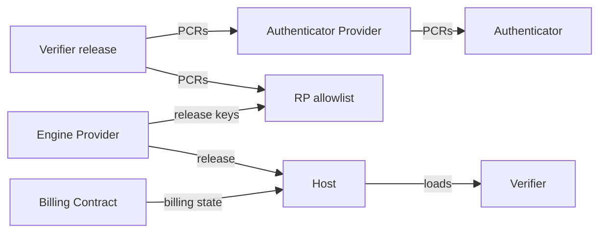
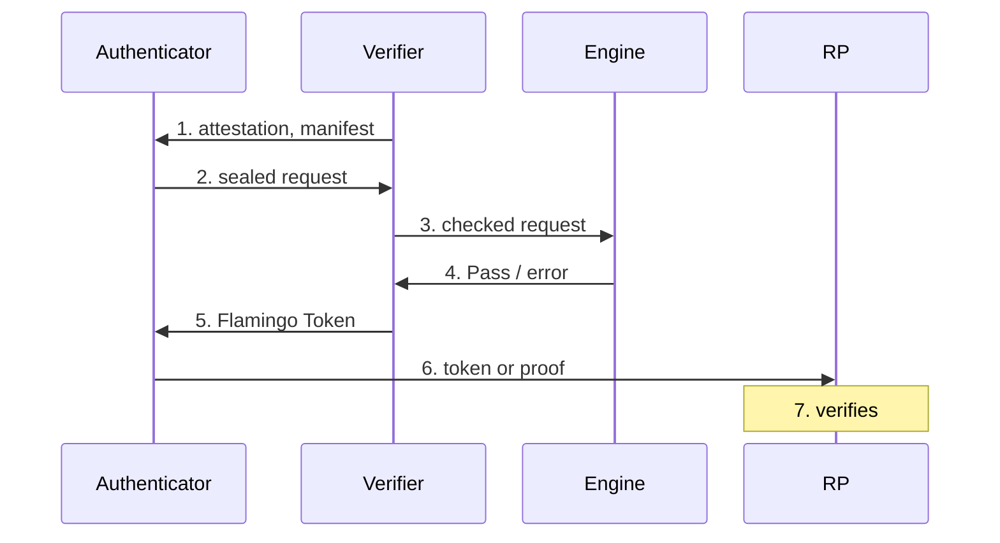

> [!NOTE]  
> This spec outlines a draft functionality for beta testing. Changes are expected.

## 1. Abstract

This spec defines the **Flamingo Verifier** (**Verifier**), a trusted execution environment (TEE) service. It runs one sandboxed biometric Engine release, provided by an Engine Provider. An Engine is a program of biometric models, e.g. presentation attack detection and face matching, that takes a request's entries and returns pass or fail; its code and weights can stay private. A release has one or more pipelines, each identified by its `pipeline_id`, and its release manifest describes them all. Consuming protocols define a pipeline type, an EIP-712-inspired string that names the input roles and their counts, and what a pass of such a pipeline means. The Verifier checks every request against the type. Each input has a role from the type, and its entry is opaque bytes that only the Engine parses. A type can let a role take a variable number of inputs, e.g. frames for a custom liveness check. If the Engine passes, the Verifier signs a **Flamingo Token** over the type's hash, the Engine configuration, and the SHA-256 hash of each entry whose role the type marks with #. Consuming protocols use these hashes to bind entries to other data, e.g. that the reference image the Engine compared is the one committed in a Credential. The Authenticator can also provide a [WIP-106](https://github.com/worldcoin/world-id-protocol/blob/main/docs/WIPs/wip-106.md) Trust Anchor Key Token (TAKT) and Authenticator Assertion Token (AAT) committing to the engine request, which are verified by the Verifier. If the RP is billed, the Authenticator also provides a [WIP-107](https://github.com/worldcoin/world-id-protocol/blob/main/docs/WIPs/wip-107.md) billing nullifier, which is verified against the on-chain billing state. The public [WIP-106](https://github.com/worldcoin/world-id-protocol/blob/main/docs/WIPs/wip-106.md) values and the billing nullifier are then also included in the Flamingo Token. Consuming protocols such as [WIP-202](https://github.com/worldcoin/world-id-protocol/blob/main/docs/WIPs/wip-202.md) use the token to prove the result to a Relying Party (RP), optionally without revealing any entry.

## 2. Motivation

Many Proof-of-Human applications, like deepfake prevention or human presence verification, need biometric checks on images, e.g. presentation attack detection (PAD), liveness or face matching. They also need to bind the result to other data, e.g. that the face on a stream matches the thumbnail in a user's Credential.

Running these models on the user's device is private but not trustworthy: a jailbroken device can report checks it never ran. Fraud detection also relies on obscurity, so its models and weights cannot be published.

This WIP runs the models in an attested TEE instead. The TEE's attestation shows users that the Operator cannot access biometric data, and its signature shows RPs that the checks ran. The Verifier image is open source and reproducibly built, so anyone can check that its measurement matches the source and that no raw media or embeddings leave the TEE. The closed Engine runs inside a kernel-enforced sandbox with no network or storage access. The Verifier attests which Engine release it runs, and the RP accepts only the Engine configurations it allowlists, from releases the Engine Provider signed.

What a pipeline checks differs per use case, so this WIP does not define it. A consuming protocol defines a pipeline type, and the token binds which type ran. The token holds only hashes of entries, so a consuming protocol can prove the result to the RP without revealing any entry, e.g. with a zero-knowledge proof as in [WIP-202](https://github.com/worldcoin/world-id-protocol/blob/main/docs/WIPs/wip-202.md).

## 3. Overview

This section is non-normative. Before any verification:



- The Verifier image is released, and its measurements (PCRs) are published.
- The Engine Provider publishes a signed Engine release and its release keys.&#32;
- The Authenticator Provider ships the Verifier PCRs it trusts (for privacy) in its Authenticator release.
- RPs allowlist the Engine configurations and Verifier PCRs they accept.
- An Operator deploys a Verifier, which loads one Engine release into its sandbox and attests to it.
- The Host keeps supplying the Verifier with [WIP-107](https://github.com/worldcoin/world-id-protocol/blob/main/docs/WIPs/wip-107.md) billing state.

One verification then runs as follows:



1. The Verifier attests its measurement and its loaded release and sends that release's manifest. The Authenticator checks both and picks a pipeline of the type its consuming protocol requires, and a strictness. It may cache this and reuse the attested channel.
2. The Authenticator seals a request to the Verifier: the pipeline, the strictness and one entry per pipeline input, in input order.
3. The Verifier checks the request against the pipeline and passes it to the sandboxed Engine.
4. The Engine runs the pipeline and returns `Pass` or `error`.
5. On `Pass`, the Verifier signs a Flamingo Token over the pipeline's type, the hashes of the entries the type commits to, and the other claims.
6. The Authenticator passes the token, or a proof over it such as [WIP-202](https://github.com/worldcoin/world-id-protocol/blob/main/docs/WIPs/wip-202.md), to the RP.
7. The RP verifies it, as its consuming protocol defines.

## 4. Specification

### 4.1 Terminology

The key words "MUST", "MUST NOT", "REQUIRED", "SHALL", "SHALL NOT", "SHOULD", "SHOULD NOT", "RECOMMENDED", "MAY", and "OPTIONAL" in this document are to be interpreted as described in [RFC 2119](https://www.ietf.org/rfc/rfc2119.txt).

1. The **Verifier** is the TEE service this spec defines.
2. The **Engine** is the sandboxed component of the Verifier that runs pipelines. This spec defines its interface, not its models or thresholds.
3. The **Engine Provider** builds the Engine and signs its release manifests. It is identified by `iss`, an `https` URL without query or fragment ([RFC 8414 §2](https://www.rfc-editor.org/rfc/rfc8414#section-2)). It MAY be the same organization as an Authenticator Provider.
4. The **Authenticator Provider** is as defined in [WIP-106](https://github.com/worldcoin/world-id-protocol/blob/main/docs/WIPs/wip-106.md).
5. The **Host** is the machine that runs the Verifier's enclave and relays all its traffic, on AWS Nitro the parent EC2 instance. The **Operator** runs the Host.
6. A **pipeline** is an Engine-defined computation over its **inputs** that passes or fails, e.g. presentation attack detection on a live capture and a face match with a Credential image.
7. A **type** names what a pipeline's inputs are and what its pass means. A consuming protocol defines it.
8. A **role** is what one input is to the type, e.g. `live`. A **label** is what it is to the Engine, e.g. `unlit_frame`.
9. The **strictness** is a pipeline parameter the request picks, e.g. how strictly faces must match. Its meaning comes from the type.
10. A **consuming protocol** defines one or more types and how a Flamingo Token is requested and used, e.g. a proof type such as [WIP-202](https://github.com/worldcoin/world-id-protocol/blob/main/docs/WIPs/wip-202.md).
11. The field `F`, the hash functions `H_t` and `H_var`, the signature scheme (`BabyJubJub-EdDSA-Poseidon2`) and the `PublicKey` representation MUST follow [WIP-100](https://github.com/worldcoin/world-id-protocol/blob/main/docs/WIPs/wip-100.md). `R(d)` reads a 256-bit digest `d` as a big-endian integer modulo `q`.
12. Field types in tables of CBOR structures (the Engine and Verifier requests, the response and the Flamingo Token) are CBOR types ([RFC 8949](https://datatracker.ietf.org/doc/html/rfc8949)). Those of JSON structures (the release manifest and the Engine Provider metadata) are JSON types. A Field element is a 32-byte byte string, the canonical big-endian encoding.

### 4.2 Constants

| Constant | Value | Description |
| --- | --- | --- |
| `MAX_COMMITTED` | `4` | Maximum committed roles of a type, fixed by the Flamingo Token claims. |
| `MAX_TYPE_BYTES` | `255` | Maximum length of a type string. |
| `DS_WIP_201` | `32666492934021899305490112043451072005703914075407694` (`b"WORLD-ID/WIP-201/TOKEN"`) | Domain separator for the Flamingo Token digest. |
| `DS_WIP_201_ENGINE` | `8362622191109606222205468683123474433460185506268139077` (`b"WORLD-ID/WIP-201/ENGINE"`) | Domain separator for `engine_config_hash`. |
| `TYPE_DOMAIN` | `WORLD-ID/WIP-201/TYPE``\0` | Domain of `pipeline_type`, as bytes including the trailing `0x00`. |
| `MAX_ATTESTATION_AGE` | `10800` | Maximum age of an attestation document at verification, in seconds. |
| `MAX_REQUEST_LIFETIME` | `600` | Maximum time from the Verifier's time to a request's `expires_at`, in seconds. |
| `MAX_DEBUG_REPORT` | `65536` | Maximum `debug_report` size, in bytes. |
| `CHANNEL_DOMAIN` | `WORLD-ID/WIP-201/CHANNEL` | Domain of the request channel. |
| `CHANNEL_KEY_DOMAIN` | `WORLD-ID/WIP-201/CHANNEL-KEY\0` | Domain of the channel key commitment, as bytes including the trailing `0x00`. |
| `EAT_PROFILE` | `https://world.org/eat/flamingo/v1` | The `eat_profile` claim of a Flamingo Token. |

### 4.3 Consuming protocols

A consuming protocol, e.g. [WIP-202](https://github.com/worldcoin/world-id-protocol/blob/main/docs/WIPs/wip-202.md), builds on Flamingo Tokens. It defines the types that pipelines implement, what their results mean, and how an RP asks for a token or a proof over it. This spec defines the Verifier request and the checks every token must pass.

#### 4.3.1 Types

A type string names a pipeline shape. Grammar, in ABNF ([RFC 5234](https://www.rfc-editor.org/rfc/rfc5234)):

```
type   = name "<" levels ">" "(" member *("," member) ")"
name   = segment *("/" segment)
segment = 1*(%x41-5A / DIGIT / "-")
levels = "0" / %x31-39 *2DIGIT
member = role ["#"] ["?" / "*" / "+"]
role   = %x61-7A *(%x61-7A / DIGIT / "_")
```

1. **Form.** A type string is ASCII, at most `MAX_TYPE_BYTES` long, with no whitespace. Its roles MUST be distinct.
2. **Name.** A type's `name` MUST be unique among consuming protocols and SHOULD follow the [WIP-100 label convention](https://github.com/worldcoin/world-id-protocol/blob/main/docs/WIPs/wip-100.md#331-domain-separators) with a version, `WORLD-ID/WIP-<number>/FLAMINGO-TYPE/V<version>`, e.g. `WORLD-ID/WIP-202/FLAMINGO-TYPE/V1`.
3. **Cardinality.** A member without a suffix takes exactly one input. `?` takes exactly one input whose entry a request MAY leave absent. `*` takes any number of inputs and `+` at least one; the pipeline fixes the number.
4. **Commitment.** `#` marks a committed role: the Flamingo Token ([4.6](#46-flamingo-token)) carries the hash of its entry. Only a member without `*` or `+` MAY carry `#`, and a type has at most `MAX_COMMITTED` of them. The committed roles, in type order, are committed roles `0` to `3`.
5. **Hash.** `pipeline_type = R(SHA-256(TYPE_DOMAIN || type string))`, over the string's bytes.

**Example.** `EXAMPLE<2>(reference#,``live#,evidence*``)` has three roles:

- `reference#` and `live#`: exactly one input each, committed in `entry_hash_0` and `entry_hash_1`.
- `evidence*`: any number of inputs, fixed by the pipeline, with no hash in the token.
- `<2>`: strictness levels `1` and `2`.

`entry_hash_2` and `entry_hash_3` are `0`. A pipeline of this type runs liveness and fraud checks on `live` and `evidence`, then matches `live` against `reference` at `strictness`. [Appendix A2](#appendix-a2-examples) uses this type in a full release.

#### 4.3.2 Strictness

1. **Values.** A strictness is a `uint` below `2^8`. A type's `<n>` fixes its strictness levels, with `n` at most 255. With `n = 0` the type has none, and every request uses strictness `0`. Otherwise its levels are `1` to `n`.
2. **Order.** A higher level is at least as strict as a lower one. Generally, a higher strictness lowers the false acceptance rate and raises the false rejection rate, i.e. it favors security over UX.
3. **Meaning.** The consuming protocol defines what each level means, e.g. how strictly faces must match or how strict a liveness check is, and how a request's level is chosen ([4.3.3](#433-what-a-consuming-protocol-defines)).&#32;
4. **Use.** A request picks one level its pipeline lists, and the Flamingo Token's `strictness` claim says which level ran ([4.6](#46-flamingo-token)).

#### 4.3.3 What a consuming protocol defines

A consuming protocol MUST:

1. **Types.** Fix each of its type strings byte for byte, and say what each role is and what a `Pass` of a pipeline of that type means. A published type string MUST keep its meaning: a protocol that changes what a role, a Pass or a strictness level means MUST define a new type string, e.g. by incrementing its version ([4.3.1](#431-types)).
2. **Strictness levels.** Say what each strictness level of its types means, e.g. how strictly faces must match.
3. **Selection.** Say how the strictness level is chosen, e.g. by the RP in its request.
4. **Nonce.** Say how `nonce` is bound to the RP's request.
5. **Delivery.** Say how the RP obtains the Flamingo Token or a proof over it.
6. **Bindings.** Say what each committed role's `entry_hash_k` is bound to, e.g. a Credential claim or the RP's challenge.
7. **Billing.** Bind a nonzero [WIP-107](https://github.com/worldcoin/world-id-protocol/blob/main/docs/WIPs/wip-107.md) `billing_nullifier` to the World ID the token is used for and to the RP `aud`, as [WIP-107 §4.7](https://github.com/worldcoin/world-id-protocol/blob/main/docs/WIPs/wip-107.md#47-billing-verification) requires.
8. **Disclosure.** Say which token values and entries the RP learns.
9. **Checks.** Say, for each check of Consuming Flamingo Tokens, whether the RP or the protocol's proof enforces it ([4.8](#48-consuming-flamingo-tokens)).

### 4.4 Engine

An Engine is developed and released by an Engine Provider. It is stateless: each request names a pipeline of its release, a strictness, and one entry per pipeline input. It returns only whether the pipeline passed. Each pipeline implements a type a consuming protocol defines ([4.3](#43-consuming-protocols)). Each release is described by a signed manifest that lists its pipelines with their types, strictness levels, inputs and response slots.

#### 4.4.1 Request and response

The Verifier passes the Engine request below to the Engine unchanged and passes nothing else. On the sandbox channel this WIP does not specify its encoding; in the Verifier request it is the `payload` map.

**Engine request fields:**

| Field | Type | Bounds | Description |
| --- | --- | --- | --- |
| `pipeline_id` | `uint` | `1..2^16` | A pipeline of the loaded release, chosen by the Authenticator. |
| `strictness` | `uint` | `< 2^8` | A strictness level of that pipeline, chosen by the Authenticator. |
| `entries` | array | exactly the pipeline's `inputs` count | `entries[i]` is the pipeline's `inputs[i]`: bytes holding an encoded image or embedding, or `null` for an absent entry. |

[Appendix A2](#appendix-a2-examples) has an example Engine request.

**Engine response variants:**

| Variant | Contents |
| --- | --- |
| `Pass` | The pipeline passed. Optional `debug_report`. |
| `error` | A `uint16` error code from the release's `errors` ([4.4.3](#443-release-and-release-manifest)). Optional `debug_report`. |

`debug_report` is defined in [4.4.6](#446-debug-report).

#### 4.4.2 Request Processing

For each Engine request, in a reset instance, the Engine:

1. **Validates** the request against its release: `pipeline_id` names one of its pipelines, `strictness` is one of that pipeline's strictness levels, `entries` fits the pipeline's `inputs` as the Engine request ([4.4.1](#441-request-and-response)) and the release ([4.4.3](#443-release-and-release-manifest)) define. Otherwise it MUST return `error`.
2. **Runs** the pipeline on the entries at `strictness`, as the pipeline's type requires.
3. **Responds**: it MUST return `Pass` only if the pipeline passed, and `error` otherwise.

#### 4.4.3 Release and release manifest

A **release** is one version of an Engine: its bundle, i.e. code, model weights and configuration, and the release manifest that describes it. The manifest's hash, `release_hash`, identifies the release. A Verifier runs one release. [Appendix A2](#appendix-a2-examples) has an example manifest.

A release manifest is a JWS ([RFC 7515](https://www.rfc-editor.org/rfc/rfc7515)) in compact serialization, signed with `ES256` by the Engine Provider's release key. Its protected header MUST contain `alg` = `ES256`, `kid` and `typ` = `world-id-engine-manifest`. Its payload is a JSON object:

**Manifest payload fields:**

| Field | Type | Description |
| --- | --- | --- |
| `iss` | string | The Engine Provider. |
| `engine_hash` | string | `SHA-384` of the Engine bundle, 96 lowercase hex digits. |
| `version` | integer | See [Release Versioning](#444-release-versioning). |
| `pipelines` | array | Non-empty; see below. `pipeline_id` values MUST be nonzero and unique within a manifest. |
| `errors` | object | Map from each Engine error code, as 4 lowercase hex digits from `0001` to `fffe`, to a human-readable message the Authenticator MAY display. The Engine MUST return only listed codes. `0000` and `ffff` are reserved for the Verifier ([4.5.1](#451-request-and-response)). |

**Pipeline fields:**

| Field | Type | Description |
| --- | --- | --- |
| `pipeline_id` | integer | The pipeline identifier, `< 2^16`. |
| `type` | string | The pipeline's type string. |
| `strictness_levels` | array of integers | Non-empty, strictly ascending, each `< 2^8`. |
| `inputs` | array | 1 to 255 items; see below. |
| `response_slots` | array of integers | Non-empty, strictly ascending, positive release times in milliseconds. See [4.5.4](#454-response-timing-and-replay). |

**Input fields:**

| Field | Type | Description |
| --- | --- | --- |
| `role` | string | A role of the pipeline's type. |
| `label` | string | Non-empty. What the input is to the Engine, e.g. `unlit_frame`. It has no protocol meaning; the Engine Provider documents it. |
| `media_types` | array of strings | Accepted media types, e.g. `image/jpeg`. Non-empty. |

1. **Conformance.** A pipeline's `type` MUST be a valid type string, every input's `role` MUST be a member of it, and each member's inputs MUST number as its cardinality says. Its `strictness_levels` MUST be levels of its type ([4.3.2](#432-strictness)). Two inputs of a pipeline MUST NOT have the same `role` and `label`, so every input is named without its position.
2. **Strictness.** For each strictness level a pipeline lists, the Engine Provider MUST document how the pipeline meets the meaning its type's consuming protocol defines ([4.3.2](#432-strictness)). Internal thresholds MAY vary, e.g. per input quality.
3. **Release hash.** `release_hash` is the `SHA-256` of the manifest's JWS Payload ([RFC 7515 §2](https://www.rfc-editor.org/rfc/rfc7515#section-2)). Re-signing a release keeps its `release_hash`.
4. **Signatures.** RPs MUST verify a release manifest under an active release key of its `iss` before relying on it. The Verifier and Authenticators do not verify it.

#### 4.4.4 Release Versioning

1. `version` MUST be greater than the `version` of every earlier release of the same `iss`. Every change to the payload is a new release.
2. A later release MUST NOT change a pipeline's `type` or `inputs`; such a change uses a new `pipeline_id`. A later release MAY drop a pipeline, but MUST NOT reuse its `pipeline_id`.

#### 4.4.5 Engine Provider Metadata

The Engine Provider MUST expose a JSON file over HTTPS at `<iss>/.well-known/world-id-engine.json`:

| Field | Type | Description |
| --- | --- | --- |
| `version` | integer | MUST be `1`. |
| `release_keys` | array | Each entry: `jwk` (a P-256 JWK with `kid`) and `status` (`active`, `retired` or `revoked`). |
| `manifests` | array | The release manifests the Engine Provider offers, each a compact JWS. Removing one withdraws its release. |

A reader MUST NOT follow redirects to another origin, and MUST ignore manifests whose `iss` is not the one it fetched the file for. The Verifier never fetches the metadata. RPs compute the `engine_config_hash` values they accept from it, and SHOULD refresh it at least every 24 hours.

#### 4.4.6 Debug Report

An Engine response MAY carry a `debug_report`.

1. **Content.** Opaque bytes the Engine Provider defines, e.g. which check failed, to help debug failures. It is not part of the Flamingo Token and has no protocol meaning. Engine Providers SHOULD keep it to what debugging needs, since it helps anyone probing the Engine ([7](#7-security)).
2. **Size.** The Verifier MUST NOT emit a `debug_report` larger than `MAX_DEBUG_REPORT`.
3. **Delivery.** The Verifier MUST return it only in the sealed, padded response to the Authenticator ([4.5.1](#451-request-and-response)), and MUST NOT expose it to the Engine Provider, the Operator or the Host.
4. **Forwarding.** The Authenticator MAY forward it only to the Engine Provider, and only with the user's explicit consent. It MUST offer the user a way to inspect it, but MAY forward it without an inspection.

### 4.5 Verifier

A Verifier is any implementation of this section built as an open-source, reproducibly built AWS Nitro enclave image. Each image has its own measurements (PCRs), and Authenticator Providers and RPs choose which implementations they trust by allowlisting them. A Verifier is run by an Operator on a Host. It runs one Engine release and serves requests from Authenticators. It checks each request against the pipeline it names, verifies the Authenticator Assertion, checks billing, passes the Engine request to the sandboxed Engine unchanged, and on a `Pass` signs a Flamingo Token. It releases each response only at fixed time slots.

#### 4.5.1 Request and Response

The request is a deterministic CBOR map ([RFC 8949 §4.2.1](https://datatracker.ietf.org/doc/html/rfc8949#section-4.2.1)) with the fields below. The Authenticator encrypts the entire encoded map to the Verifier. `payload` is a byte string holding the deterministic CBOR encoding of the Engine request, so the Verifier checks the Authenticator Assertion against exactly the bytes it received and passes them on unchanged.

**Verifier request fields:**

| Field | Type | Description |
| --- | --- | --- |
| `version` | `uint` | MUST be `1`. |
| `payload` | bytes | The encoded Engine request. |
| `aud` | Field element | The `rpId` of the request; MUST be less than `2^64`. |
| `nonce` | Field element | Nonzero, fresh for each request and bound to the RP's request as the consuming protocol defines, so a retry is a new request. |
| `expires_at` | `uint` | Unix seconds after which the Verifier rejects the request. MUST NOT be more than `MAX_REQUEST_LIFETIME` ahead of the Verifier's time. |
| `billing_nullifier` | Field element | The [WIP-107](https://github.com/worldcoin/world-id-protocol/blob/main/docs/WIPs/wip-107.md) `billingNullifier` of the Authenticator's registration for `aud` in an active billing period, or `0` if it holds none. |
| `aat_inputs` | map, optional | Inputs for verifying a TAKT and an AAT; see below. |

`billing_nullifier` stays outside `payload`, so it never reaches the Engine and the AAT's `cdh` does not cover it. The Verifier uses it only as [WIP-107 §4.7](https://github.com/worldcoin/world-id-protocol/blob/main/docs/WIPs/wip-107.md) requires, and signs the value that section determines.

`aat_inputs` is OPTIONAL. If present, it is a map with the fields marked `aat_inputs.` below, and the Verifier obtains every input of [WIP-106 §3.8](https://github.com/worldcoin/world-id-protocol/blob/main/docs/WIPs/wip-106.md) as follows:

| [WIP-106 §3.8](https://github.com/worldcoin/world-id-protocol/blob/main/docs/WIPs/wip-106.md) input | Type | Source |
| --- | --- | --- |
| `trust_anchor_key` | `PublicKey` | `aat_inputs.trust_anchor_key` |
| `takt` | bytes | `aat_inputs.takt` |
| `aat` | bytes | `aat_inputs.aat` |
| `now` | uint32 | The Verifier's time, in Unix seconds. |
| `min_build_version` | uint32 | `aat_inputs.min_build_version`, set as the consuming protocol defines. |
| `aud`, `nonce` | uint64, Field element | The request's `aud` and `nonce`. |
| `cdh` | Field element | `R(SHA-256(payload))`. |
| `platform`, `sec_level`, `sec_meta` | uint8 | Unpacked from the TAKT's `sec_flags`. |
| `authenticator_meta` | uint8 | The AAT's `authenticator_meta`. |

The response is a deterministic CBOR map with exactly the fields of one variant:

| Variant | Fields |
| --- | --- |
| `Success`, when the Engine returned `Pass` | `token` (the Flamingo Token), `signing_key_attestation` (the latest attestation of the token signing key), `debug_report` (optional) |
| `VerifierError`, when the Verifier refused the request before the Engine call | `error` (a Verifier code, see Error codes below) |
| `EngineError`, when the Engine ran and did not pass | `error` (an Engine code, see Error codes below), `debug_report` (optional) |

**Error codes.** Each `error` is a `uint16`. A `VerifierError` response carries a Verifier code below. A `EngineError` response carries the Engine's code from its release's `errors` ([4.4.3](#443-release-and-release-manifest)), or one of the two reserved `EngineError` codes below.

| Code | Response | Name | Meaning |
| --- | --- | --- | --- |
| `0x0001` | `VerifierError` | `malformed_request` | The request does not meet the request formats or does not fit the loaded release. |
| `0x0002` | `VerifierError` | `expired` | The request's `expires_at` has passed. |
| `0x0003` | `VerifierError` | `replay` | The request was seen before. |
| `0x0004` | `VerifierError` | `billing_nullifier_required` | As [WIP-107 §4.7](https://github.com/worldcoin/world-id-protocol/blob/main/docs/WIPs/wip-107.md#47-billing-verification) defines. |
| `0x0005` | `VerifierError` | `billing_unregistered` | As [WIP-107 §4.7](https://github.com/worldcoin/world-id-protocol/blob/main/docs/WIPs/wip-107.md#47-billing-verification) defines. |
| `0x0000` | `EngineError` | `engine_timeout` | The Engine did not finish by the last response slot. |
| `0xFFFF` | `EngineError` | `unlisted_error` | The Engine returned a code its release does not list. |

1. The response MUST be encrypted to the requester and padded to the length of the largest possible response, i.e. one with a `MAX_DEBUG_REPORT`-byte report, hiding the outcome and the report size.
2. The Verifier MUST handle `debug_report` as [4.4.6](#446-debug-report) requires.
3. The Verifier MUST emit a Flamingo Token only when the Engine returns `Pass`.

#### 4.5.2 Attestation and Channel

1. **Keys.** At boot, the Verifier MUST generate a channel key and a Flamingo Token signing key inside the enclave, from its hardware RNG, and MUST NOT export or persist either. It SHOULD replace its channel key frequently and accept the previous key for `MAX_REQUEST_LIFETIME` afterwards.
2. **Documents.** The Verifier MUST attest each key in its own Nitro attestation document, a `COSE_Sign1` chaining to the AWS Nitro Root G1. The channel attestation has `public_key = SHA-256(CHANNEL_KEY_DOMAIN || channel_key)` and `user_data` = the loaded `release_hash`; the `signing_key_attestation` has `public_key` = the token signing key. A document's `timestamp` is its creation time, in milliseconds since the Unix epoch.
3. **Release manifest.** The Verifier MUST send the release manifest ([4.4.3](#443-release-and-release-manifest)) of the Engine release it loaded, as received, with the channel attestation.
4. **Response.** The Verifier MUST seal the padded response to `response_key`.
5. **Refresh.** The Verifier MUST re-attest both keys at least every `MAX_ATTESTATION_AGE`.
6. **Time.** The Verifier MUST sync its clock to the `timestamp` of each new attestation, advance it on its monotonic clock in between, and MUST NOT move it backward. It MUST NOT use any other time source.

**Channel Encoding.** Both directions use the public-key encryption of [WIP-100 §3.9](https://github.com/worldcoin/world-id-protocol/blob/main/docs/WIPs/wip-100.md). `info` is `CHANNEL_DOMAIN || 0x00` for a request and `CHANNEL_DOMAIN || 0x01` for a response. The first 1216 bytes of a request's plaintext are `response_key`, a fresh X-Wing encapsulation key; the rest is the request. The Verifier MUST reject a request shorter than 1216 bytes or with an invalid `response_key`.

#### 4.5.3 Request Processing

The Host MAY drop requests above a size limit it chooses. For each sealed request it relays, the Verifier, in order:

1. **Checks.** After decrypting, it MUST reject a request that does not meet the Verifier request and Engine request formats, or whose `pipeline_id`, `strictness` or `entries` do not fit the loaded release as [Request Processing item 1](#442-request-processing) of the Engine says, apart from media types.
2. **Expiry and replay.** It MUST reject an expired or replayed request.
3. **Authenticator Assertion.** If `aat_inputs` is present, every check of [WIP-106 §3.8](https://github.com/worldcoin/world-id-protocol/blob/main/docs/WIPs/wip-106.md) MUST hold. The TAKT, the AAT, the `assertion_key` and `build_version` MUST NOT leave the Verifier.
4. **Billing.** Before the Engine call, it MUST check `billing_nullifier` as [WIP-107 §4.7](https://github.com/worldcoin/world-id-protocol/blob/main/docs/WIPs/wip-107.md) requires. It MUST NOT check billing again afterward.
5. **Engine call.** It MUST pass the Engine request to the sandboxed Engine unchanged, and nothing else.
6. **Response.** On `Pass`, it signs a Flamingo Token. It returns a `Success` or `EngineError` response, released at a response slot.

#### 4.5.4 Response Timing and Replay

1. **Release.** The Verifier MUST hold each response until the first of the pipeline's `response_slots` at or after the Engine's finish, measured on its monotonic clock from the request's arrival, whatever the outcome. If the Engine has not finished by the last slot, the request fails and the Verifier MUST reset the Engine instance. Rejections before the Engine call MAY be released immediately.
2. **Choosing slots.** Engine Providers SHOULD put the first slot at or above the pipeline's fastest complete run and the last above its 99.9th-percentile run time.
3. **Expiry.** The Verifier MUST reject a request whose `expires_at` has passed or is more than `MAX_REQUEST_LIFETIME` ahead of its time.
4. **Replay.** The Verifier MUST reject a request whose (`aud`, `nonce`) it has already processed or is processing. It MUST keep each pair until the request's `expires_at` has passed and MAY drop it after. While the set is full, it MUST reject every request.

#### 4.5.5 Sandboxed Engine

1. **Loading.** At start-up, the Verifier receives exactly one Engine bundle and its release manifest from the Host. It MUST check that the bundle hashes to the manifest's `engine_hash` and that the manifest is well-formed, including [Conformance](#443-release-and-release-manifest), without verifying its signature, and MUST NOT fetch anything else.
2. **Sandbox.** The Verifier MUST run the Engine with no network access, no writable persistent storage, no process creation, no access to the Verifier's keys, nothing outside its bundle, and only one bounded request-response channel.
3. **Per request.** Before each request, the Verifier MUST reset the Engine to a state no earlier request has influenced, without relying on the Engine's cooperation. It MUST bound the Engine's memory, and MUST return an `error` if the Engine exceeds it, crashes, or returns anything other than an Engine response.

#### 4.5.6 Build and Measurement

1. **Publication.** For each published Verifier measurement, an immutable reference to its source and its build instructions MUST be publicly available.
2. **Build.** Building that source with the documented toolchain MUST produce a bit-identical Enclave Image File (EIF).
3. **Measurement.** PCR0, PCR1 and PCR2 of that EIF are the Verifier's measurement.
4. **Configuration.** Everything that affects the Verifier's behavior MUST be in the EIF. The Host supplies only the Engine bundle, its manifest, [WIP-107](https://github.com/worldcoin/world-id-protocol/blob/main/docs/WIPs/wip-107.md) billing state updates and requests.

### 4.6 Flamingo Token

On a `Pass`, the Verifier builds a Flamingo Token from the request, the verified AAT, if any, and the loaded release.

**Envelope.** A Flamingo Token is a CWT ([RFC 8392](https://datatracker.ietf.org/doc/html/rfc8392)) in an untagged `COSE_Sign1`, encoded as deterministic CBOR. The protected header MUST contain `alg` (label `1`) = `-65537` (Private Use, `BabyJubJub-EdDSA-Poseidon2`) and `kid` (label `4`) = the compressed signing public key. The signature MUST be a `BabyJubJub-EdDSA-Poseidon2` signature per [WIP-100](https://github.com/worldcoin/world-id-protocol/blob/main/docs/WIPs/wip-100.md) over the signed digest below.

**Claims.** The payload MUST contain exactly these claims, in the bytewise order of their encoded keys.

| Claim | Key | Value |
| --- | --- | --- |
| `eat_profile` | `265` | `EAT_PROFILE`. |
| `entry_hash_k`, `k = 0..3` | `-90000 - k` | `R(SHA-256(data))` of the entry of committed role `k`, or `0` if that entry is absent or the type has no committed role `k`. |
| `aud` | `-90004` | `aud` from the request. |
| `nonce` | `-90005` | `nonce` from the request. |
| `trust_anchor_key_hash` | `-90006` | [WIP-106](https://github.com/worldcoin/world-id-protocol/blob/main/docs/WIPs/wip-106.md) hash of the `trust_anchor_key` that signed the verified TAKT, or `0` without an AAT. |
| `aat_flags` | `-90007` | Public TAKT and AAT values, packed as below; `0` without an AAT. |
| `has_aat` | `-90008` | `1` if the Verifier verified an AAT, otherwise `0`. |
| `now` | `-90009` | The Verifier's time when it signed the token, in Unix seconds. |
| `engine_config_hash` | `-90010` | `H_4(DS_WIP_201_ENGINE; R(release_hash), pipeline_id, strictness)` per [WIP-100 §3.3.2](https://github.com/worldcoin/world-id-protocol/blob/main/docs/WIPs/wip-100.md), with `k = 3`. |
| `pipeline_type` | `-90011` | The `pipeline_type` of the pipeline that ran. |
| `strictness` | `-90013` | The strictness the pipeline ran at. |
| `billing_nullifier` | `-90012` | The [WIP-107](https://github.com/worldcoin/world-id-protocol/blob/main/docs/WIPs/wip-107.md) `billingNullifier` the Verifier checked for a billed RP, or `0` for an RP that is not billed. |

[Appendix A2](#appendix-a2-examples) shows which entries fill `entry_hash_0..3` for an example request.

1. `aat_flags`, `has_aat` and `now` are CBOR uints. All other claims except `eat_profile` are 32-byte byte strings, the canonical big-endian encoding of a field element.
2. `eat_profile` is not in the signed digest and MUST be treated as an untrusted hint.
3. The entry of committed role `k` is `entries[i]` for the one input `i` whose `role` is that role.
4. The Verifier MUST set `billing_nullifier` as [WIP-107 §4.7](https://github.com/worldcoin/world-id-protocol/blob/main/docs/WIPs/wip-107.md) requires, whatever value the request carries.

**`aat_flags` bits.**

| Bits | Value | From |
| --- | --- | --- |
| 0–7 | `platform` | TAKT `sec_flags` |
| 8–15 | `sec_level` | TAKT `sec_flags` |
| 16–47 | `min_build_version` | `aat_inputs`, in place of the TAKT's `build_version` |
| 48–51 | `sec_meta` | TAKT `sec_flags` |
| 52–56 | `authenticator_meta` | AAT |

**Signed digest.** The signed message is **not** the COSE `Sig_structure`. It MUST be

```
H_16(DS_WIP_201; now,
     entry_hash_0, entry_hash_1, entry_hash_2, entry_hash_3,
     aud, nonce, trust_anchor_key_hash, aat_flags, has_aat,
     pipeline_type, strictness, engine_config_hash, billing_nullifier)
```

per [WIP-100 §3.3.2](https://github.com/worldcoin/world-id-protocol/blob/main/docs/WIPs/wip-100.md), with `k = 14`.

### 4.7 Authenticator

The Authenticator MUST accept only PCR0–2 values its Authenticator Provider ships with it, e.g. in the app release or as signed configuration. Before sending biometrics, it completes these steps in order, and MUST NOT send biometrics if one fails:

1. **Attestation.** It MUST check that the channel attestation is a valid `COSE_Sign1` whose chain leads to the AWS Nitro Root G1 and is valid now; does not have all-zero PCRs and has PCR0–2 it accepts; has `public_key = SHA-256(CHANNEL_KEY_DOMAIN || channel_key)` for the key it encrypts to; has `user_data` equal to the `release_hash` of the manifest the Verifier sent; and is at most `MAX_ATTESTATION_AGE` old. It MAY reuse a checked attestation while these hold.
2. **Configuration.** It MUST choose a pipeline of the loaded release whose `type` is one its consuming protocol requires and whose inputs it can produce, as their labels describe, and a `strictness` the consuming protocol requires and the pipeline lists. Among qualifying pipelines, it follows the consuming protocol or, where it sets none, the Authenticator Provider's policy. It fills `entries` in input order and leaves an entry absent only where the consuming protocol allows it. If no pipeline qualifies, it MAY use another Verifier instance.
3. **Response timing.** It MUST NOT use a pipeline whose `response_slots` list more release times than its configured maximum. The maximum SHOULD be at most 8, so a response's timing reveals at most 3 bits.
4. **Seal.** It MUST seal `response_key || request` to `channel_key`, send it, and open the response with `response_key`.
5. **Retries.** To retry, it MUST send a new request with a fresh `nonce` and `response_key`, and a new AAT. Authenticator Providers SHOULD rate-limit attempts.

### 4.8 Consuming Flamingo Tokens

A consuming protocol defines its types and how an RP requests and uses Flamingo Tokens. An RP MUST NOT accept a Flamingo Token, directly or through the protocol's proof, unless every check below holds. A proof that hides the token MUST enforce checks 2, 3, 7 and 8; for the others it reveals the values they need or takes the RP's accepted sets as public inputs.

1. **Attestation.** The `signing_key_attestation` chains to the AWS Nitro Root G1, with every certificate valid at its `timestamp`; does not have all-zero PCRs and has PCR0–2 the RP accepts; attests `verifier_key` (`kid` is only a hint); and is at most `MAX_ATTESTATION_AGE` old.
2. **Signature.** `sig` verifies under `verifier_key` per [WIP-100 §3.5.1](https://github.com/worldcoin/world-id-protocol/blob/main/docs/WIPs/wip-100.md) over the signed digest computed from the values, with `aat_flags = platform + 2^8 * sec_level + 2^16 * min_build_version + 2^48 * sec_meta + 2^52 * authenticator_meta`.
3. **Well-formed values.** `has_aat` is `0` or `1`. The `aat_flags` sub-fields are range-checked to their widths, with the `user_presence` bits of `authenticator_meta` below `5`. With `has_aat = 0`, `trust_anchor_key_hash` and the `aat_flags` sub-fields are `0`.
4. **Request.** `aud` is the RP's own; `nonce` is bound, as the consuming protocol defines, to a request the RP issued that has not expired and has not been used before; and `now` is recent by the RP's clock. The RP MUST accept at most one proof per request.
5. **Authenticator Assertion.** With `has_aat = 0`, the RP accepts tokens without an AAT. Otherwise `min_build_version`, `trust_anchor_key_hash` and the `aat_flags` sub-fields pass [WIP-106 §4](https://github.com/worldcoin/world-id-protocol/blob/main/docs/WIPs/wip-106.md).
6. **Engine.** `engine_config_hash` is the hash of a release, `pipeline_id` and `strictness` the RP accepts, from an active manifest it verified under an active key of its `iss`, at or above the RP's minimum `version` per `iss`.
7. **Type.** `pipeline_type` is the hash of a type string the consuming protocol defines, and each `entry_hash_k` its statement depends on is bound to the protocol's own inputs, e.g. a Credential claim or the RP's challenge.
8. **Strictness.** `strictness` is a level the consuming protocol accepts for this request, e.g. the level the RP requested.
9. **Billing.** `billing_nullifier` is `0`, or the consuming protocol binds it to the World ID the token is used for, as [WIP-202](https://github.com/worldcoin/world-id-protocol/blob/main/docs/WIPs/wip-202.md) constraint 7 does.

## 5. Trust Assumptions

The protocol assumes the isolation, measurement and attestation of AWS Nitro Enclaves are sound. If they fail, neither privacy nor integrity holds. Every party below is trusted only for the listed parts.

| Party | Trusted for | Not trusted for |
| --- | --- | --- |
| AWS (Nitro Enclaves) | Isolation, measurement and attestation of the enclave. | Nothing: if this fails, neither privacy nor integrity holds. |
| Engine Provider | Engine correctness: each pipeline does what its type requires, keeps doing so across releases, and meets each strictness level it lists. | Privacy: the sandbox keeps the Engine from exporting data. |
| Authenticator Provider | Verifying the Authenticator's integrity, as stated in the TAKT, and the Verifier measurements its Authenticators accept. | — |
| Authenticator | The source and freshness of the entries it sends, e.g. that a capture is live. | — |
| Host and Operator | Availability, and the [WIP-107](https://github.com/worldcoin/world-id-protocol/blob/main/docs/WIPs/wip-107.md) billing state they supply. | Privacy, and every other token claim: they see only ciphertext, and the Verifier rejects replayed requests. |

**Out of scope.** Collusion between an RP and the user's Authenticator, which can then produce any proof the RP accepts, and between an RP, an Engine Provider and the Operator, which can only gather more timing information through requests the user consents to one by one. Collusion between an Engine Provider and the Operator alone is in scope: the sandbox and response slots bound what they learn per request.

## 6. Rationale

1. **Typed pipelines.** What a pass means differs per use case, so the consuming protocol defines it and WIP-201 only fixes the shape. The release fixes each input's role and processing, so a requester cannot relabel an entry.
2. **The type in the token.** The consuming protocol checks `pipeline_type` against a constant, so a pipeline of another shape fails even if an RP's allowlist names it by mistake, e.g. after a reused `pipeline_id` or a hand-copied hash.
3. **Explicit commitment.** `#` makes the type string say what the token hashes. A single role without `#`, e.g. a depth map, stays possible.
4. **Roles and labels.** A role is the protocol's, so several Engines can serve one type; a label is the Engine's, so it can tell inputs apart.
5. **Strictness levels in the type.** Scores depend on the model and the pair and are biometric signals, so a request names a level whose meaning the consuming protocol defines. Putting `n` in the type lets the Verifier reject a release with levels the protocol does not define at load, as it does for roles. Levels `1` to `n` need no list.
6. **The strictness in the token.** The protocol can check the level that ran against the one it expects, e.g. the RP's request, instead of relying on the RP's `engine_config_hash` allowlist alone.
7. **Only the RP checks manifest signatures.** Who signed a release only matters for trusting its results, which the RP decides, so the Verifier image holds no Engine Provider keys.
8. **`SHA-384` for the bundle.** It matches how Nitro measures images; every other hash is `SHA-256`.
9. **Minimum versions.** RPs accept a minimum `version` per `iss`, so new releases reach them without changes; a breaking change takes a new `pipeline_id`.
10. **The AAT in the Verifier, and optional.** The Verifier keeps [WIP-106](https://github.com/worldcoin/world-id-protocol/blob/main/docs/WIPs/wip-106.md)'s private inputs and signs the public values; RPs decide whether they accept tokens without an AAT.
11. **Hashes over raw bytes.** The RP and the Credential can compute the same `SHA-256`; embeddings only the Engine can compute.
12. **Signature over claim values.** A circuit verifies the token without parsing CBOR.
13. **Verifier time.** The Verifier checks the AAT at its own time and signs it, so an expired TAKT or AAT cannot pass.
14. **Engine configuration hash.** One hash over the manifest's JWS Payload, pipeline and strictness gives RPs exact control and keeps the values private.
15. **Numeric engine ****error codes.** A `uint16` keeps responses one size, gives Authenticators a stable code to act on, and keeps free text out of the response. The release's `errors` map gives each code a message and shows reviewers every error an Engine can return.
16. **Debug reports only to the Authenticator.** A report may describe the user's biometrics, so only the user's device receives it, and it reaches the Engine Provider only with the user's consent.
17. **AWS Nitro.** Nitro Enclaves have no persistent storage or external network, measure the whole image with reproducible PCRs, and sign attestations with a public root, which is what Authenticators and RPs need to check the Verifier.
18. **Two attestations.** The channel key and the signing key are attested separately, so the channel key can be replaced frequently while the signing key, which RPs check tokens against, stays for the whole boot.
19. **Post-quantum channel.** Biometrics don't expire, so a recorded request must stay confidential even if it is decrypted years later. The channel therefore uses the X-Wing hybrid KEM.
20. **The Verifier fetches nothing.** The Host supplies the bundle, the manifest and billing state, and the Verifier checks them. No network dependency enters the measured image, and its behavior follows from the measurement alone.
21. **Fixed-length responses.** Every response is padded to the largest possible size, so the Host learns neither the outcome nor the report size from the ciphertext.
22. **Response slots.** Random delays average out over repeated requests, and one fixed time makes every request wait for the worst case. A few slots per pipeline bound what timing reveals per request ([7](#7-security)) while keeping fast pipelines fast.

## 7. Security

1. **Channel confidentiality.** Requests and responses stay confidential while ML-KEM-768 or X25519 holds. It does not cover a compromised enclave.
2. **Missing AATs.** Without an AAT anyone can submit arbitrary media, and the verdict becomes an oracle for tuning attacks; RPs that accept `has_aat = 0` accept that risk.
3. **Pipelines that do not meet their type.** The type fixes the shape, not what the Engine does. Only the Engine Provider and the release audit stand behind it, so RPs accept releases per `iss` and per pipeline.
4. **Unreviewed Engines.** A Host may load any Engine; its tokens carry an `engine_config_hash` no RP accepts, and the sandbox keeps it from exporting data. A leaked release key works until it is `revoked` and RPs refresh.
5. **Closed Engine.** The sandbox removes the Engine's channels out, and the per-request reset keeps one request's data from the next.
6. **Token privacy.** A committed Credential hash and a nonzero `billing_nullifier` link a user to an RP request, so consuming protocols MUST keep tokens private, e.g. as private proof inputs.
7. **Verifier keys.** The signing key never leaves the TEE; RPs stop accepting a compromised measurement, and `MAX_ATTESTATION_AGE` bounds its attestation.
8. **Timing.** Slots limit each request to at most log2(n) bits for n slots, replay rejection keeps that bound per request, and any Engine failure becomes an `error` at a slot. Per-pipeline slots may reveal the pipeline.
9. **Stale measurements.** An Authenticator accepts a compromised measurement until its provider removes it; signed, expiring configuration shortens that window.
10. **Engine as an oracle.** Anyone can seal a request, so a modified Authenticator can query the Engine without bound. Operators SHOULD rate-limit at the Host, and Engine Providers SHOULD keep `debug_report` small.

## 8. Future Considerations

1. **Other TEEs**, through attestation profiles for each provider's document, root and measurement.
2. **Several Engines per Verifier.** The Authenticator would choose among them, and RPs accept per `engine_config_hash` as today.
3. **Published measurements.** A standard format for publishing Verifier PCRs with a status.
4. **Bounded Engine queries.** A per-key attempt limit, keyed by the RP's signed request or the AAT's assertion key.
5. **Committed multi-valued roles.** `#` on a `*` or `+` member, with an `H_var` commitment over that role's entry hashes.
6. **Nested types.** Grouping roles, e.g. a live capture and its evidence, as an EIP-712-style struct, once a second protocol needs it.

## 9. Alternatives Considered

1. **Running the models in a ZK circuit.** Rejected: proving these models is still infeasible for most devices, and the prover would need the secret weights.
2. **MPC.** Rejected: orders of magnitude slower, and it adds a non-collusion assumption.

## Appendix A1. Test Vectors

To be regenerated for the 14-claim digest, the new domain separator and `pipeline_type`.

## Appendix A2. Examples

This appendix is non-normative. It uses the example type `EXAMPLE<2>(reference#,live#,evidence*)` of [4.3.1](#431-types).

**Release manifest payload:**

```json
{
  "iss": "https://engines.example.com",
  "engine_hash": "2a2a…2a",
  "version": 7,
  "pipelines": [
    {
      "pipeline_id": 1,
      "type": "EXAMPLE<2>(reference#,live#,evidence*)",
      "strictness_levels": [1, 2],
      "inputs": [
        { "role": "reference", "label": "stored_image", "media_types": ["image/png"] },
        { "role": "live", "label": "front_frame", "media_types": ["image/jpeg"] }
      ],
      "response_slots": [500, 1587, 5039, 16000]
    },
    {
      "pipeline_id": 2,
      "type": "EXAMPLE<2>(reference#,live#,evidence*)",
      "strictness_levels": [2],
      "inputs": [
        { "role": "reference", "label": "stored_image", "media_types": ["image/png"] },
        { "role": "live", "label": "lit_frame", "media_types": ["image/jpeg"] },
        { "role": "evidence", "label": "unlit_frame", "media_types": ["image/jpeg"] }
      ],
      "response_slots": [500, 1587, 5039, 16000]
    }
  ]
}
```

Pipeline 1 takes a single frame and has no `evidence` input, which `*` allows. Pipeline 2 takes a lit and an unlit frame: the lit frame is `live`, the unlit one `evidence`.

**Engine request** for pipeline 2, in CBOR diagnostic notation:

```
{
  "entries": [h'…reference…', h'…lit frame…', h'…unlit frame…'],
  "strictness": 2,
  "pipeline_id": 2
}
```

**Token entries.** The committed roles are `reference` and `live`, so `entry_hash_0` is the reference's hash, `entry_hash_1` the lit frame's, and `entry_hash_2` and `entry_hash_3` are `0`. The unlit frame gets no hash.
