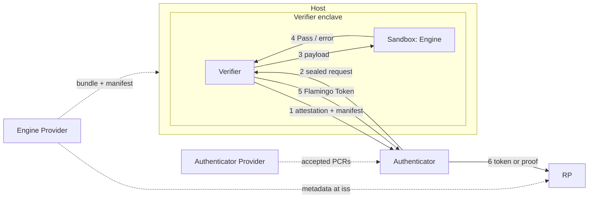

> [!NOTE]  
> This spec outlines a draft functionality for beta testing. Changes are expected.

## 1. Abstract

This spec defines the **Flamingo Verifier** (**Verifier**), a trusted execution environment (TEE) service. It runs one sandboxed biometric Engine release, provided by an Engine Provider. For a request, the Engine runs a pipeline's checks, e.g. fraud detection, on some of the request's entries, e.g. live frames, and compares entries, e.g. a live frame with a Credential image, under a requested `match_strictness`. If the Engine accepts, the Verifier signs a **Flamingo Token** over the Engine configuration, the compared entries and the public values of an Authenticator Assertion, if any. If a [WIP-106][wip-106] Trust Anchor Key Token (TAKT) and Authenticator Assertion Token (AAT) are provided, they are also verified. Consuming protocols such as [WIP-202][wip-202] use the Flamingo Token to prove the Verifier’s checks to a Relying Party (RP), optionally without revealing any entry.

## 2. Motivation

Many Proof-of-Human applications like deep fake prevention or human presence verification require A) running fraud detection models like presentation attack detection (PAD) on a set of input images and B) comparing images using embedding models, e.g., to verify that the person on a stream is the same as the one performing a liveness check on a phone.

Building a privacy preserving system for such image comparisons is very difficult. For example, running the models and comparisons locally on the user's device is privacy-preserving but it has very low security guarantees: a mobile device's output is not trustworthy, e.g., a jailbroken device could report that fraud detection and embedding comparison were performed, while simply running a spoofed client that does not perform them at all. Therefore, an RP cannot be sure that the claimed checks have actually been executed. Additionally, fraud detection models' security relies on obscurity and obtaining the model weights, or even just the model architecture, opens up a wide range of attack vectors.

To achieve verifiability in a privacy-preserving way, this document introduces a general approach that runs fraud detection models and embedding models in an attested Trusted Execution Environment (TEE). This allows users to verify that the TEE operator is not able to access any biometric data, and a signature by the TEE proves to RPs that all claimed checks have been correctly executed. The Verifier image MUST be open source and reproducibly built, so anyone can check that its attested measurement matches the source and that no raw media or embeddings leave the TEE. Fraud detection models cannot be open, so the Verifier runs them as a closed Engine inside a kernel-enforced sandbox that has no network or storage access. The Verifier attests which Engine release it runs, and the RP accepts only releases the Engine Provider signed.

## 3. Overview

This section is non-normative. It sketches the parties and the one-shot verification flow.



Dashed arrows are set up once. Numbered arrows are steps 1–6 of one verification; in step 7 the RP verifies the token locally:

1. The Verifier attests its measurement and its loaded release, and sends that release's manifest ([Attestation and Channel](#442-attestation-and-channel)) to the Authenticator. The Authenticator checks both and chooses a configuration. The results of this step can be cached and the attested channel can be re-used.
2. The Authenticator seals a request to the Verifier with its entries, which of them the pipeline checks, and which are compared ([Authenticator](#46-authenticator), [Request and Response](#441-request-and-response)).
3. The Verifier checks the request and passes it to the sandboxed Engine ([Request Processing](#443-request-processing)).
4. The Engine runs the pipeline's checks on the pipeline inputs and compares the selected entries ([Request Processing](#433-request-processing)).
5. On a pass, the Verifier signs a Flamingo Token ([Flamingo Token](#45-flamingo-token)).
6. The Authenticator passes the token, or a proof over it such as [WIP-202][wip-202], to the RP.
7. The RP verifies it ([Consuming Flamingo Tokens](#47-consuming-flamingo-tokens)).

How the RP requests a token and what it learns is defined by the consuming protocol ([Terminology](#41-terminology)).

Components and parties:

- **RP:** requests and verifies the result, as its consuming protocol defines ([Consuming Flamingo Tokens](#47-consuming-flamingo-tokens)).
- **Authenticator:** checks the attestation and the manifest before sending biometrics ([Authenticator](#46-authenticator)).
- **Verifier:** open source; checks and forwards requests, enforces response timing and signs tokens. It runs one Engine release ([Verifier](#44-verifier)).
- **Sandbox and Engine:** closed source and closed weights; run fraud detection and comparison, with no way to export data ([Engine](#43-engine), [Sandboxed Engine](#445-sandboxed-engine)).
- **Host and operator:** run the enclave and relay its ciphertext; trusted for availability only ([Request Processing](#443-request-processing)).
- **Engine Provider:** signs Engine releases and publishes them ([Release and Release Manifest](#434-release-and-release-manifest), [Engine Provider Metadata](#436-engine-provider-metadata)).
- **Authenticator Provider:** ships the Verifier measurements its Authenticators accept ([Authenticator](#46-authenticator)).

What each party is trusted for is in [Trust Assumptions](#5-trust-assumptions).

## 4. Specification

### 4.1 Terminology

The key words "MUST", "MUST NOT", "REQUIRED", "SHALL", "SHALL NOT", "SHOULD", "SHOULD NOT", "RECOMMENDED", "MAY", and "OPTIONAL" in this document are to be interpreted as described in [RFC 2119](https://www.ietf.org/rfc/rfc2119.txt).

1. The **Verifier** is the TEE service this spec defines.
2. The **Engine** is the sandboxed component of the Verifier that performs extraction, fraud detection and comparison. This spec defines the Engine's interface ([Engine](#43-engine)), not its models or thresholds.
3. The **Engine Provider** builds the Engine and signs its release manifests. It is identified by `iss`, an `https` URL without query or fragment ([RFC 8414 §2](https://www.rfc-editor.org/rfc/rfc8414#section-2), [Rationale](#6-rationale) item 6). It MAY be the same organization as an Authenticator Provider.
4. The **Authenticator Provider** is as defined in [WIP-106][wip-106].
5. The **host** is the machine that runs the Verifier's enclave and relays all its traffic, on AWS Nitro the parent EC2 instance. The **operator** runs the host. Neither is trusted beyond availability ([Trust Assumptions](#5-trust-assumptions)).
6. A **pipeline** is an Engine-defined set of pass/fail checks on its **pipeline inputs**, e.g. fraud detection such as presentation attack or deepfake detection.
7. **Match strictness levels** say how similar compared entries must be to count as a match ([Match Strictness Levels](#432-match-strictness-levels)).
8. A **consuming protocol** defines how a Flamingo Token is requested and used, e.g. a proof type such as [WIP-202][wip-202], or an RP that verifies tokens directly ([Consuming Flamingo Tokens](#47-consuming-flamingo-tokens)).
9. The Field ($F$), the hash function ($H_t$), the signature scheme (`BabyJubJub-EdDSA-Poseidon2`) and the `PublicKey` representation MUST follow [WIP-100][wip-100]. `R(d)` reads a 256-bit digest `d` as a big-endian integer modulo $q$.

### 4.2 Constants

| Constant | Value | Description |
| --- | --- | --- |
| `MAX_COMPARED` | `4` | Maximum compared entries, fixed by the Flamingo Token claims. |
| `DS_WIP_201` | `127603488023523044162070750169730750022280897185614` (`b"WORLD-ID/WIP-201/SIGN"`) | Domain separator for the Flamingo Token digest. |
| `DS_WIP_201_ENGINE` | `8362622191109606222205468683123474433460185506268139077` (`b"WORLD-ID/WIP-201/ENGINE"`) | Domain separator for `engine_config_hash`. |
| `MAX_ATTESTATION_AGE` | `10800` | Maximum age of an attestation document at verification, in seconds (3 hours, the validity of a Nitro attestation's certificate). |
| `MAX_REQUEST_LIFETIME` | `600` | Maximum time from the Verifier's time to a request's `expires_at`, in seconds (10 minutes). |
| `MAX_DEBUG_REPORT` | `65536` | Maximum `debug_report` size, in bytes. |
| `CHANNEL_DOMAIN` | `WORLD-ID/WIP-201/CHANNEL` | Domain of the request channel. |
| `CHANNEL_KEY_DOMAIN` | `WORLD-ID/WIP-201/CHANNEL-KEY\0` | Domain of the channel key commitment, as bytes including the trailing `0x00`. |
| `EAT_PROFILE` | `https://world.org/eat/flamingo/v1` | The `eat_profile` claim ([RFC 9711 §4.3.2](https://datatracker.ietf.org/doc/html/rfc9711#section-4.3.2)) of a Flamingo Token. |

### 4.3 Engine

An Engine is developed and released by an Engine Provider. It operates in a stateless request/response model. It encompasses the following high-level concepts:

- **Request entries.** The Engine accepts requests that contain an array of `entries`. Each entry is one image or embedding with associated metadata ([Request and response](#431-request-and-response)).
- **Pipeline.** The request further specifies `pipeline_id`, to select the pipeline to run on a subset of `entries`. The subset is specified via a `pipeline_inputs` array that contains entry indices ([Request Processing](#433-request-processing)).
- **Comparisons.** Similarly, an array of indices called `compare` specifies a subset of entries, possibly overlapping with `pipeline_inputs`, which are compared pair-wise using Engine-specific models at the requested `match_strictness` ([Match Strictness Levels](#432-match-strictness-levels)).
- **Response.** The Engine only returns whether every check passed and every comparison matched ([Request and response](#431-request-and-response)).
- **Releases.** An Engine Provider publishes a signed release manifest for every Engine version. The manifest specifies the release's pipelines, their inputs and response slots, and its match strictness levels ([Release and Release Manifest](#434-release-and-release-manifest), [Release Versioning](#435-release-versioning), [Engine Provider Metadata](#436-engine-provider-metadata)).

#### 4.3.1 Request and response

The Verifier passes the Engine request below to the Engine unchanged and passes nothing else. On the sandbox channel this WIP does not specify its encoding; in the Verifier request it is the `payload` map ([Request and Response](#441-request-and-response)).

**Engine request fields:**

| Field | Type | Bounds | Description |
| --- | --- | --- | --- |
| `pipeline_id` | `uint` | `1..2^16` | A pipeline of the loaded release, chosen by the Authenticator ([Authenticator](#46-authenticator)). |
| `match_strictness` | `uint` | `< 2^8` | A level of the loaded release, chosen by the Authenticator. |
| `hints` | bytes | ≤ 1 KiB | Request-level Engine hints, e.g. experiment flags. MUST NOT change any security assumptions or weaken `match_strictness`; anything that changes the verdict belongs in the pipeline. |
| `entries` | array of maps | | The request's images or embeddings, each a map; see below. Every entry MUST be in `pipeline_inputs` or `compare`. |
| `pipeline_inputs` | array of `uint` | exactly the pipeline's `inputs` count | Distinct indices into `entries` the pipeline checks; `pipeline_inputs[i]` is the entry the pipeline's `inputs[i]` describes. |
| `compare` | array of `uint` | `2..=MAX_COMPARED` | Distinct indices into `entries`. Order matters: `compare[k]` becomes `compared_entry_hash_k`. |

**Entry fields**, for each item of `entries`:

| Field | Type | Bounds | Description |
| --- | --- | --- | --- |
| `data` | bytes | | An encoded image or an embedding. |
| `meta` | bytes | ≤ 256 bytes | How the Engine reads `data`, e.g. which frame of a live capture it is. |

See [Appendix A2](#appendix-a2-examples) for an example request and response.

**Engine response variants:**

| Variant | Contents |
| --- | --- |
| `Pass` | Every check of the pipeline passed and every two entries in `compare` match at `match_strictness`. Optional `debug_report`. |
| `error` | Implementation-defined. Optional `debug_report`. |

#### 4.3.2 Match Strictness Levels

1. **Meaning.** A match strictness level says how similar compared entries must be to count as a match. A request picks one with `match_strictness`. Internally, the Engine MAY use different similarity thresholds for a level depending on the inputs, e.g. their image type or quality, as long as the level keeps its documented meaning.
2. **Trade-off.** A higher level lowers the chance of a false match, i.e. accepting entries that show different persons, but raises the chance of a false non-match, i.e. rejecting entries that show the same person.
3. **Rules.** Levels are defined per release, as the manifest's ascending `match_strictness_levels`. A level MUST mean the same whichever `pipeline_id` a request uses, and a higher level MUST be at least as strict for every two compared entries. The Engine Provider MUST document what each level means.

#### 4.3.3 Request Processing

For each Engine request, in a reset instance ([Sandboxed Engine](#445-sandboxed-engine)), the Engine:

1. **Validates** the request against its release: `pipeline_id` names one of its pipelines, `match_strictness` is listed, and the pipeline inputs match the pipeline's `inputs` in count and media type. Otherwise it MUST return `error`.
2. **Checks** the pipeline inputs: it MUST run the pipeline's checks, e.g. presentation attack or deepfake detection, on the entries `pipeline_inputs` names, reading each entry's `meta` as the pipeline defines. The checks MUST NOT depend on `match_strictness`.
3. **Compares** the entries `compare` names: it extracts what the release compares, e.g. face embeddings, and MUST match every two of them at `match_strictness` ([Match Strictness Levels](#432-match-strictness-levels)).
4. **Responds**: it MUST return `Pass` only if every check passed and every comparison matched, and `error` otherwise ([Request and response](#431-request-and-response)).

#### 4.3.4 Release and Release Manifest

A **release** is one version of an Engine: its bundle, i.e. code, model weights and configuration ([Sandboxed Engine](#445-sandboxed-engine)), and the release manifest that describes it. The manifest names the release's pipelines and strictness levels, and its hash, `release_hash`, identifies the release. A Verifier runs one release. See [Appendix A2](#appendix-a2-examples) for an example manifest.

A release manifest is a JWS ([RFC 7515](https://www.rfc-editor.org/rfc/rfc7515)) in compact serialization, signed with `ES256` by the Engine Provider's release key. Its protected header MUST contain `alg` = `ES256`, `kid` and `typ` = `world-id-engine-manifest`. Its payload is a JSON object:

**Manifest payload fields:**

| Field | Type | Description |
| --- | --- | --- |
| `iss` | string | The Engine Provider ([Terminology](#41-terminology)). |
| `engine_hash` | string | `SHA-384` of the Engine bundle, 96 lowercase hex digits. |
| `version` | integer | See [Release Versioning](#435-release-versioning). |
| `match_strictness_levels` | array of integers | The release's levels, non-empty, strictly ascending, each `< 2^8`. |
| `pipelines` | array | The release's pipelines; see below. `pipeline_id` values MUST be nonzero and unique within a manifest. |

**Pipeline fields**, for each item of `pipelines`:

| Field | Type | Description |
| --- | --- | --- |
| `pipeline_id` | integer | The pipeline identifier, `< 2^16`. |
| `inputs` | array | A non-empty array of at most 255 items; see below. Item `i` describes the entry `pipeline_inputs[i]` names. |
| `response_slots` | array of integers | Non-empty, strictly ascending, positive release times in milliseconds; see [Response Timing and Replay](#444-response-timing-and-replay). |

**Pipeline input fields**, for each item of a pipeline's `inputs`:

| Field | Type | Description |
| --- | --- | --- |
| `role` | string | What the input is, e.g. `live_frame`. Roles MAY repeat within a pipeline. |
| `media_types` | array of strings | Accepted media types, e.g. `image/jpeg`. MUST NOT be empty. |

1. **Release hash**. `release_hash` is the `SHA-256` of the manifest's JWS Payload ([RFC 7515 §2](https://www.rfc-editor.org/rfc/rfc7515#section-2)). It excludes the protected header and the signature, so re-signing a release keeps its `release_hash`.
2. **Signatures**. RPs MUST verify a release manifest under an active release key of its `iss` ([Engine Provider Metadata](#436-engine-provider-metadata)) before relying on it. The Verifier and Authenticators do not verify it.

#### 4.3.5 Release Versioning

1. `version` MUST be greater than the `version` of every earlier release of the same `iss`. Every change to the payload is a new release.
2. A later release MUST NOT change a pipeline's `inputs`, increase the number of its `response_slots`, or drop a `match_strictness` level; such a change uses a new `pipeline_id` value. A later release MAY drop a pipeline, but MUST NOT reuse its `pipeline_id` for different `inputs`.
3. A later release MUST NOT give an existing `match_strictness` value a different meaning; a changed meaning uses a new value. It MAY change the Engine's thresholds to keep a level's meaning, e.g. for a new model.

#### 4.3.6 Engine Provider Metadata

The Engine Provider MUST expose a JSON file over HTTPS at `<iss>/.well-known/world-id-engine.json`:

**Metadata fields:**

| Field | Type | Description |
| --- | --- | --- |
| `version` | integer | MUST be `1`. |
| `release_keys` | array | Each entry: `jwk` (a P-256 JWK with `kid`) and `status` (`active`, `retired` or `revoked`). |
| `manifests` | array | The release manifests the Engine Provider offers, each a compact JWS. Removing one withdraws its release. |

A reader MUST NOT follow redirects to another origin, and MUST ignore manifests whose `iss` is not the one it fetched the file for. The Verifier never fetches the Engine Provider metadata. RPs compute the `engine_config_hash` values they accept from it, and SHOULD refresh it at least every 24 hours, so a withdrawn release or a revoked key stops being accepted.

### 4.4 Verifier

A Verifier is an open-source, reproducibly built AWS Nitro enclave image, run by an operator on a host. It runs one Engine release and serves requests from Authenticators. It encompasses the following high-level concepts:

- **Request and response.** A request carries the RP's `aud` and `nonce`, an expiry, the Engine request, and optionally an Authenticator Assertion. On a `Pass`, the response carries a signed Flamingo Token ([Request and Response](#441-request-and-response), [Flamingo Token](#45-flamingo-token)).
- **Attestation.** The Verifier attests its channel key together with the loaded release, and its token signing key, in Nitro attestation documents. Authenticators encrypt their requests to the attested channel key. The Verifier syncs its clock to each new attestation's timestamp ([Attestation and Channel](#442-attestation-and-channel)).
- **Processing.** The Verifier checks the request, rejects expired and replayed requests, verifies the Authenticator Assertion, and passes the Engine request to the Engine unchanged. It releases each response only at fixed time slots, so its timing reveals little ([Request Processing](#443-request-processing), [Response Timing and Replay](#444-response-timing-and-replay)).
- **Sandboxed Engine.** At start-up, the Verifier loads one Engine release and runs it in a sandbox that cannot export data ([Sandboxed Engine](#445-sandboxed-engine)).
- **Measurement.** Anyone can rebuild the image from source and check its PCR values, which identify the Verifier to Authenticators and RPs ([Build and Measurement](#446-build-and-measurement)).

#### 4.4.1 Request and Response

The request is a deterministic CBOR map ([RFC 8949 §4.2.1](https://datatracker.ietf.org/doc/html/rfc8949#section-4.2.1)) with the fields below. The Authenticator encrypts the entire encoded map to the Verifier ([Channel Encoding](#442-attestation-and-channel)). Field elements are 32-byte byte strings, the canonical big-endian encoding.

`payload` is a CBOR byte string that contains the deterministic CBOR encoding ([RFC 8949 §4.2.1](https://datatracker.ietf.org/doc/html/rfc8949#section-4.2.1)) of the [Engine request](#431-request-and-response). It is carried as a byte string, so the Verifier checks the Authenticator Assertion against exactly the bytes it received and passes them to the Engine unchanged.

**Verifier request fields:**

| Field | Type | Description |
| --- | --- | --- |
| `version` | `uint` | MUST be `1`. |
| `payload` | bytes | The encoded [Engine request](#431-request-and-response); see above. |
| `aud` | Field element | The `rpId` of the request. |
| `nonce` | Field element | The RP's nonce for the request, sampled uniformly from the nonzero elements of $F$ with a CSPRNG. |
| `expires_at` | `uint` | Unix seconds after which the Verifier rejects the request. MUST NOT be more than `MAX_REQUEST_LIFETIME` ahead of the Verifier's time ([Response Timing and Replay](#444-response-timing-and-replay)). |
| `aat_inputs` | map, optional | Inputs for verifying a TAKT and an AAT; see below. |

`aat_inputs` is OPTIONAL. Authenticators without an Authenticator Provider that issues TAKTs omit it. If present, it is a map with the fields marked `aat_inputs.` below, and the Verifier obtains every input of [WIP-106 §3.8][wip-106] as follows:

**WIP-106 inputs:**

| WIP-106 §3.8 input | Type | Source |
| --- | --- | --- |
| `trust_anchor_key` | `PublicKey` | `aat_inputs.trust_anchor_key` |
| `takt` | bytes | `aat_inputs.takt` |
| `aat` | bytes | `aat_inputs.aat` |
| `now` | uint32 | The Verifier's time, in Unix seconds ([Attestation and Channel](#442-attestation-and-channel)). |
| `min_build_version` | uint32 | `aat_inputs.min_build_version`, set as the consuming protocol defines ([Consuming Flamingo Tokens](#47-consuming-flamingo-tokens)). |
| `aud`, `nonce` | uint64, Field element | The request's `aud` and `nonce`. The Verifier MUST reject an `aud` not less than $2^{64}$. |
| `cdh` | Field element | Computed as `R(SHA-256(payload))`. |
| `platform`, `sec_level`, `sec_meta` | uint8 | Unpacked from the TAKT's `sec_flags`. |
| `authenticator_meta` | uint8 | The AAT's `authenticator_meta`. |

The response is a deterministic CBOR map with exactly the fields of one variant below; `token` is present if and only if it is a `Success`.

**Success fields**, when the Engine returned `Pass`:

| Field | Type | Description |
| --- | --- | --- |
| `token` | bytes | The Flamingo Token ([Flamingo Token](#45-flamingo-token)). |
| `signing_key_attestation` | bytes | The latest attestation of the token signing key ([Attestation and Channel](#442-attestation-and-channel)). |
| `debug_report` | bytes, optional | The Engine response's `debug_report`, if present. |

**Failed fields**, when the Engine returned an `error` or the Verifier rejected the request without a `Pass`:

| Field | Type | Description |
| --- | --- | --- |
| `error` | text | Implementation-defined and bounded in size. The Engine's `error`, passed through, or the Verifier's own when it rejected the request. |
| `debug_report` | bytes, optional | The Engine response's `debug_report`, if present. |

1. The response MUST be encrypted to the requester and MUST be padded to a fixed length, hiding the outcome and the report size.
2. `debug_report` is optional Engine output outside the Flamingo Token. The Verifier MUST NOT emit a report larger than `MAX_DEBUG_REPORT`. Clients MUST NOT forward it without the user's explicit consent, and only to the Engine Provider. It SHOULD let the user inspect a report before forwarding it.
3. The Verifier MUST emit a Flamingo Token only when the Engine returns `Pass`.

#### 4.4.2 Attestation and Channel

1. **Keys.** At boot, the Verifier MUST generate a channel key and a Flamingo Token signing key inside the enclave, from its hardware RNG, and MUST NOT export or persist either. It SHOULD replace its channel key frequently, e.g. at each refresh, and accept the previous key for `MAX_REQUEST_LIFETIME` afterwards.
2. **Documents.** The Verifier MUST attest each key in its own Nitro attestation document, a `COSE_Sign1` chaining to the [AWS Nitro Root G1](https://aws-nitro-enclaves.amazonaws.com/AWS_NitroEnclaves_Root-G1.zip), with `public_key` and `user_data` as in the table below. A document's `timestamp` is its creation time, in milliseconds since the Unix epoch.

**Attestation documents:**

| Document | `public_key` | `user_data` | Used by |
| --- | --- | --- | --- |
| Channel attestation | `SHA-256(CHANNEL_KEY_DOMAIN \|\| channel_key)` | The loaded `release_hash`. | The Authenticator, to check the Verifier and encrypt a request; discarded afterwards. |
| `signing_key_attestation` | The Flamingo Token signing key (`kid`) | — | RPs, with every Flamingo Token. |

3. **Manifest.** The Verifier MUST set the channel attestation's `user_data` to the `release_hash` it computed from the manifest it loaded ([Sandboxed Engine](#445-sandboxed-engine)), and MUST send that manifest, as received, with the attestation.
4. **Response**. The Verifier MUST seal the padded response to `response_key`. Only the requester holds `response_key`, so the response is bound to its request; a `Success` is authenticated by its Flamingo Token.
5. **Refresh**. The Verifier MUST re-attest its channel key and its signing key at least every `MAX_ATTESTATION_AGE`, and return its latest `signing_key_attestation`.
6. **Time.** The Verifier MUST sync its clock to the `timestamp` of each new Nitro attestation and advance it on its monotonic clock in between. It MUST NOT use any other time source.

**Channel Encoding.** Both directions use the public-key encryption of [WIP-100][wip-100] §3.9.

1. **Info**. `info` is `CHANNEL_DOMAIN || 0x00` for a request and `CHANNEL_DOMAIN || 0x01` for a response.
2. **Request plaintext**. The first 1216 bytes are `response_key`, a fresh X-Wing encapsulation key; the rest is the [Request and Response](#441-request-and-response).
3. **Rejection**. The Verifier MUST reject a request shorter than 1216 bytes or with an invalid `response_key`.

#### 4.4.3 Request Processing

The host MAY drop requests above a size limit it chooses. For each sealed request it relays, the Verifier, in order:

1. **Checks.** After decrypting ([Channel Encoding](#442-attestation-and-channel)), it MUST reject a request that does not meet the Verifier request ([Request and Response](#441-request-and-response)) and Engine request ([Request and response](#431-request-and-response)) formats, including their bounds and their references to the loaded release.
2. **Expiry and replay.** It MUST reject an expired or replayed request ([Response Timing and Replay](#444-response-timing-and-replay)).
3. **Authenticator Assertion.** If `aat_inputs` is present, every check of [WIP-106 §3.8][wip-106] MUST hold, or it rejects the request. The TAKT, the AAT, the `assertion_key` and `build_version` MUST NOT leave the Verifier.
4. **Engine call.** It MUST pass the Engine request to the sandboxed Engine unchanged, and nothing else ([Sandboxed Engine](#445-sandboxed-engine)).
5. **Response.** On `Pass`, it signs a Flamingo Token ([Flamingo Token](#45-flamingo-token)). It then returns a `Success` or `Failed` response ([Request and Response](#441-request-and-response)), released at a response slot ([Response Timing and Replay](#444-response-timing-and-replay)).

#### 4.4.4 Response Timing and Replay

The host sees when each response leaves the Verifier; slots and replay rejection bound what that reveals ([Security](#8-security) item 9).

1. **Slots.** Each pipeline's `response_slots` list its release times in milliseconds after a request's arrival ([Release and Release Manifest](#434-release-and-release-manifest)).
2. **Release.** The Verifier MUST hold each response until the first slot at or after the Engine's finish, measured on its monotonic clock from the request's arrival, and MUST NOT release it earlier, whatever the outcome. If the Engine has not finished by the last slot, the request fails and the Verifier MUST reset the Engine instance. Rejections before the Engine call MAY be released immediately; they do not depend on the entries.
3. **Choosing slots.** Engine Providers SHOULD put the first slot at or above the pipeline's fastest complete run and the last above its 99.9th-percentile run time, with slots in between following its run-time distribution.
4. **Expiry.** The Verifier MUST reject a request whose `expires_at` has passed or is more than `MAX_REQUEST_LIFETIME` ahead of its time ([Attestation and Channel](#442-attestation-and-channel)).
5. **Replay.** The Verifier MUST reject a request whose (`aud`, `nonce`) it has already processed ([Security](#8-security) item 9). It keeps each pair until the request's `expires_at`, so the set holds at most `MAX_REQUEST_LIFETIME` of requests. A reboot discards the set with the channel keys, so no older request can be opened.

#### 4.4.5 Sandboxed Engine

1. **Loading.** At start-up, the Verifier receives exactly one Engine bundle and its release manifest from the host. It MUST check that the bundle hashes to the manifest's `engine_hash` and that the manifest is well-formed ([Release and Release Manifest](#434-release-and-release-manifest)), without verifying its signature, and MUST NOT fetch anything else.
2. **Sandbox.** The Verifier MUST run the Engine with no network access, no writable persistent storage, no process creation, no access to the Verifier's keys, nothing outside its bundle, and only one bounded request-response channel. See the [reference implementation's sandbox](https://github.com/worldcoin/flamingo/tree/main/verifier/sandbox-client) for one way to meet these requirements.
3. **Per request.** Before each request, the Verifier MUST reset the Engine to a state no earlier request has influenced, e.g. by starting a new instance or restoring one prepared before the first request. The reset MUST NOT depend on the Engine's cooperation. It MUST bound the Engine's memory, and MUST return an `error` if the Engine exceeds that bound, crashes, or returns anything other than an Engine response ([Request and response](#431-request-and-response)). Its runtime is bounded by the last response slot ([Response Timing and Replay](#444-response-timing-and-replay)).

#### 4.4.6 Build and Measurement

The Verifier's measurement MUST be verifiable from source:

1. **Publication.** For each published Verifier measurement, an immutable reference to its source, e.g. a commit hash in a public repository, and its build instructions MUST be publicly available.
2. **Build.** Building that source with the documented toolchain MUST produce a bit-identical Enclave Image File (EIF).
3. **Measurement.** PCR0, PCR1 and PCR2 of that EIF, as AWS Nitro Enclaves computes them, are the Verifier's measurement.
4. **Configuration.** Everything that affects the Verifier's behavior MUST be in the EIF. The host supplies only the Engine bundle, its release manifest ([Sandboxed Engine](#445-sandboxed-engine)) and requests.

### 4.5 Flamingo Token

On a `Pass`, the Verifier builds a Flamingo Token from the request, the verified AAT, if any, and the loaded release, as specified below.

**Envelope.** A Flamingo Token is a CWT ([RFC 8392](https://datatracker.ietf.org/doc/html/rfc8392)) in an untagged `COSE_Sign1`, encoded as deterministic CBOR ([RFC 8949 §4.2.1](https://datatracker.ietf.org/doc/html/rfc8949#section-4.2.1)).

1. The protected header MUST contain `alg` (label `1`) = `-65537` (Private Use, `BabyJubJub-EdDSA-Poseidon2`) and `kid` (label `4`) = the compressed signing public key.
2. The signature MUST be a `BabyJubJub-EdDSA-Poseidon2` signature per [WIP-100][wip-100] over the signed digest below.

**Claims.** The payload MUST contain exactly these claims, in the bytewise order of their encoded keys.

| Claim | Key | Value |
| --- | --- | --- |
| `eat_profile` | `265` | `EAT_PROFILE`. |
| `compared_entry_hash_k`, `k = 0..3` | `-90000 - k` | `R(SHA-256(data))` of the entry `compare[k]` names, over its `data` only, or `0` if `compare` has no position `k`. |
| `aud` | `-90004` | `aud` from the request. |
| `nonce` | `-90005` | `nonce` from the request. |
| `trust_anchor_key_hash` | `-90006` | [WIP-106][wip-106] hash of the `trust_anchor_key` that signed the verified TAKT, or `0` without an AAT. |
| `aat_flags` | `-90007` | Public TAKT and AAT values, packed as below; `0` without an AAT. |
| `has_aat` | `-90008` | `1` if the Verifier verified an AAT, otherwise `0`. |
| `now` | `-90009` | The Verifier's time when it signed the token, in Unix seconds. |
| `engine_config_hash` | `-90010` | The Engine configuration that ran; see below. |
| `compare_sources` | `-90011` | Which pipeline input each compared entry is; see below. |

1. `aat_flags`, `has_aat`, `now` and `compare_sources` are CBOR uints. All other claims except `eat_profile` are 32-byte byte strings, the canonical big-endian encoding of a field element.
2. `eat_profile` is not in the signed digest and MUST be treated as an untrusted hint.
3. Byte `k` of `compare_sources`, least significant first, is `i + 1` if `compare[k]` is `pipeline_inputs[i]`, and `0` otherwise, including when `compare` has no position `k`.
4. `engine_config_hash` is `H_4(DS_WIP_201_ENGINE; R(release_hash), pipeline_id, match_strictness)` per [WIP-100][wip-100] §3.3.2, with $k = 3$.

**`aat_flags` bits.** `aat_flags` packs public values of two [WIP-106][wip-106] objects into one field element: the TAKT's `sec_flags` layout (bits 0–51), with the public `min_build_version` in place of the private `build_version`, and the AAT's `authenticator_meta` in bits WIP-106 leaves `0`.

| Bits | Value | From |
| --- | --- | --- |
| 0–7 | `platform` | TAKT `sec_flags` |
| 8–15 | `sec_level` | TAKT `sec_flags` |
| 16–47 | `min_build_version` | `aat_inputs`, in place of the TAKT's `build_version` |
| 48–51 | `sec_meta` | TAKT `sec_flags` |
| 52–56 | `authenticator_meta` | AAT |

**Signed digest.** The signed message is **not** the COSE `Sig_structure`. It MUST be

```
H_16(DS_WIP_201; now,
     compared_entry_hash_0, compared_entry_hash_1, compared_entry_hash_2, compared_entry_hash_3,
     aud, nonce, trust_anchor_key_hash, aat_flags, has_aat, compare_sources, engine_config_hash)
```

per [WIP-100][wip-100] §3.3.2, with $k = 12$.

### 4.6 Authenticator

The Authenticator MUST accept only PCR0–2 values its Authenticator Provider ships with it, e.g. in the app release or as signed configuration. Before sending biometrics, it completes these steps in order, and MUST NOT send biometrics if one fails:

1. **Attestation.** It MUST check that the channel attestation ([Attestation and Channel](#442-attestation-and-channel)):
   - is a valid `COSE_Sign1` whose certificate chain leads to the AWS Nitro Root G1 and is valid at the current time;
   - does not have all-zero PCRs, which mark debug mode, and has PCR0–2 it accepts;
   - has `public_key = SHA-256(CHANNEL_KEY_DOMAIN || channel_key)` for the `channel_key` it encrypts to;
   - has `user_data` equal to the `release_hash` of the manifest the Verifier sent ([Release and Release Manifest](#434-release-and-release-manifest));
   - has a `timestamp` at most `MAX_ATTESTATION_AGE` old.

   It MAY reuse a checked attestation for later requests while these hold.
2. **Configuration.** It MUST choose a pipeline the loaded release defines and whose `inputs` the device can produce, and a `match_strictness` the release lists, following the consuming protocol's requirements or, where it sets none, the Authenticator Provider's policy. It MUST build `pipeline_inputs` and `compare` so that they give the `compare_sources` the consuming protocol requires ([Flamingo Token](#45-flamingo-token)). If no pipeline and level qualify, it MAY use another Verifier instance.
3. **Response timing.** It MUST NOT use a pipeline whose `response_slots` ([Response Timing and Replay](#444-response-timing-and-replay)) list more release times than its configured maximum. The maximum SHOULD be at most 8, so a response's timing reveals at most 3 bits ([Security](#8-security) item 9).
4. **Seal.** It MUST seal `response_key || request` to `channel_key` ([Channel Encoding](#442-attestation-and-channel)), send it, and open the response with `response_key`.

### 4.7 Consuming Flamingo Tokens

A consuming protocol ([Terminology](#41-terminology)), e.g. [WIP-202][wip-202], defines how an RP requests and uses Flamingo Tokens. An RP MUST NOT accept a Flamingo Token, directly or through the protocol's proof, unless every check below holds.

**Checks.** The checks use the Flamingo Token's claims ([Flamingo Token](#45-flamingo-token)), with `aat_flags` unpacked into `platform`, `sec_level`, `min_build_version`, `sec_meta` and `authenticator_meta`, its signature `sig`, and the signing key `verifier_key`. A proof that hides the token MUST enforce check 2. For the other checks, it either reveals the values they need or takes the RP's accepted sets as public inputs.

1. **Attestation.** The `signing_key_attestation`:
   - chains to the AWS Nitro Root G1, with every certificate valid at its `timestamp`, and does not have all-zero PCRs, which mark debug mode;
   - has PCR0–2 the RP accepts;
   - attests `verifier_key` (`kid` is only a hint);
   - has a `timestamp` at most `MAX_ATTESTATION_AGE` old.

   An RP that receives the attestation MAY cache it by key; it identifies the Verifier instance, not the user.
2. **Signature.** `sig` verifies under `verifier_key` per [WIP-100 §3.5.1][wip-100], over the signed digest computed from the values ([Flamingo Token](#45-flamingo-token)), with `aat_flags = platform + 2^8 * sec_level + 2^16 * min_build_version + 2^48 * sec_meta + 2^52 * authenticator_meta`. The values are well-formed: `has_aat` is `0` or `1`; the `aat_flags` sub-fields are range-checked to their widths, with the `user_presence` bits of `authenticator_meta` below `5`; `compare_sources < 2^32`; and with `has_aat = 0`, `trust_anchor_key_hash` and the `aat_flags` sub-fields are `0`.
3. **Request.** `aud` is the RP's own; `nonce` is one the RP issued, has not expired and has not been used before; and `now` is recent by the RP's clock.
4. **Authenticator Assertion.** With `has_aat = 0`, the RP accepts tokens without an AAT. Otherwise `min_build_version`, `trust_anchor_key_hash` and the `aat_flags` sub-fields pass [WIP-106 §4][wip-106].
5. **Engine.** `engine_config_hash` is the hash of a release, `pipeline_id` and `match_strictness` the RP accepts, from an active release manifest it verified under an active key of the manifest's `iss` ([Engine Provider Metadata](#436-engine-provider-metadata)), including the RP's minimum `version` per `iss`. A circuit MAY take the hash's components as private values and recompute it, to constrain them.
6. **Statement.** The compared entries are the ones the consuming protocol's statement depends on: `compare_sources` is the value it requires, e.g. `256`, bytes `[0, 1, 0, 0]`: the entry compared at position `1` is pipeline input `0`, and the others are references. Each `compared_entry_hash` the statement depends on is bound to the protocol's own inputs, e.g. a Credential claim or the RP's challenge.

## 5. Trust Assumptions

The protocol assumes the isolation, measurement and attestation of AWS Nitro Enclaves are sound. If they fail, neither privacy nor integrity holds. Every party in the table below is trusted only for the listed parts, and a compromise of one only affects those parts, except AWS.

**Parties:**

| Party | Trusted for | Not trusted for |
| --- | --- | --- |
| AWS (Nitro Enclaves) | Isolation, measurement and attestation of the enclave. | Nothing: if this fails, neither privacy nor integrity holds. |
| Engine Provider | Engine correctness: fraud detection, matching, keeping each pipeline stable across releases, and documenting what each level means. | Privacy: the sandbox keeps the Engine from exporting data. |
| Authenticator Provider | Verifying the Authenticator's integrity, as stated in the TAKT, and the Verifier measurements its Authenticators accept. | — |
| Authenticator | The source and freshness of the live capture. | — |
| Host and operator | Availability only. | Privacy and integrity: they see only ciphertext, and the Verifier rejects replayed requests ([Response Timing and Replay](#444-response-timing-and-replay)). |

**Out of scope.** Collusion between an RP and the user's Authenticator, which can then produce any proof the RP accepts, and between an RP, an Engine Provider and the operator, which can only gather more than one response's worth of timing information through requests the user consents to one by one. Collusion between an Engine Provider and the operator alone is in scope: [Sandboxed Engine](#445-sandboxed-engine) and [Response Timing and Replay](#444-response-timing-and-replay) bound what they learn per request ([Security](#8-security) item 9).

## 6. Rationale

1. **Match strictness instead of scores** ([Match Strictness Levels](#432-match-strictness-levels)). A score's meaning depends on the model and the pair, so an RP cannot pick a meaningful threshold, and scores are biometric signals. An ordered strictness survives model upgrades and keeps scores out of every Flamingo Token. Levels apply to comparisons, which every pipeline of a release shares, so the release defines them.
2. **A separate Engine Provider signs the Engine** ([Release and Release Manifest](#434-release-and-release-manifest)). Models may come from different parties, and trust in the models stays separate from trust in the capture environment. A pipeline keeps its meaning across an Engine Provider's releases ([Release Versioning](#435-release-versioning)).
3. **Only the RP checks manifest signatures** ([Release and Release Manifest](#434-release-and-release-manifest)). Who signed a release matters only for whether its results are trusted, which the RP decides; the sandbox protects privacy whoever wrote the Engine. So Authenticators need only accepted PCRs, and the Verifier image contains no Engine Provider keys, so one image serves every Engine Provider.
4. **`SHA-384` for the Engine bundle** ([Release and Release Manifest](#434-release-and-release-manifest)). Only the Verifier computes `engine_hash`, over the bundle file, and AWS Nitro Enclaves measures images with `SHA-384` too, so the Verifier's measurement and its bundle check share one algorithm. Every other hash in this WIP is `SHA-256`, because it is reduced into the field with `R(d)` or is defined by another spec, e.g. `cdh` by [WIP-106][wip-106].
5. **Minimum versions and stable pipelines** ([Release Versioning](#435-release-versioning)). RPs accept a minimum version per `iss` instead of exact releases, so a new release reaches them without changing their requests, and Verifiers can move to it. A breaking change gets a new `pipeline_id` value, which RPs opt into. As with FIDO metadata's `authenticatorVersion` and SUIT sequence numbers, the version is a plain integer that only orders releases.
6. **`iss` as the Engine Provider identifier** ([Engine Provider Metadata](#436-engine-provider-metadata)). As in JWT ([RFC 7519](https://www.rfc-editor.org/rfc/rfc7519)) and OAuth metadata ([RFC 8414](https://www.rfc-editor.org/rfc/rfc8414)), the signer is named by an `https` URL from which its metadata location follows. Each manifest repeats it, so a manifest stays bound to its provider wherever it is read.
7. **The AAT is verified in the Verifier** ([Request and Response](#441-request-and-response)). The Verifier is a [WIP-106 §3.8][wip-106] verifier: it keeps the Private inputs confidential and signs the Public values into the token, so RPs apply their [WIP-106 §4][wip-106] policy as usual. `cdh` covers the exact `payload`, so the AAT vouches for exactly the compared input.
8. **The AAT is optional** ([Request and Response](#441-request-and-response)). Not every Authenticator has an Authenticator Provider that issues AATs, and requiring one would exclude them. The RP decides per request whether it accepts a Flamingo Token without one.
9. **Opaque entries** ([Request Processing](#443-request-processing)). The Verifier never decodes entries; only the Engine interprets them. A new capture method or image format then needs a new Engine release, not a new Verifier image, request or token format.
10. **Listed slots per pipeline** ([Response Timing and Replay](#444-response-timing-and-replay)). A list rather than a formula lets each Engine fit its slots to its run times, and in the signed manifest the latency trade-off is public. Slots are per pipeline because run times differ; shared slots would let a slow pipeline's early exits stand out.
11. **Request expiry** ([Response Timing and Replay](#444-response-timing-and-replay)). Replay rejection needs a set of processed (`aud`, `nonce`) pairs, and the set has to stay bounded. An `expires_at` in the sealed request lets the Verifier forget each pair once its request expires. `MAX_REQUEST_LIFETIME` caps the expiry, because anyone can seal a request to the public channel key. The Verifier takes its time from its attestations, so it needs no clock the host sets.
12. **Hashes over the raw images** ([Flamingo Token](#45-flamingo-token)). `compared_entry_hash` is the `SHA-256` of the image bytes the Verifier received. Other parties can compute the same hash: the RP hashes its challenge image, and a PoH Credential already lists the `SHA-256` of its face image. Embeddings wouldn't work, because only the Engine can compute them.
13. **Signature over claim values, not CBOR bytes** ([Flamingo Token](#45-flamingo-token)). The signature covers a Poseidon2 hash of the claim values, so a circuit verifies the Flamingo Token without parsing CBOR.
14. **Verifier time in the token** ([Flamingo Token](#45-flamingo-token)). The Verifier checks the AAT at its own time and signs that time as `now`, so an Authenticator cannot pass off an expired TAKT or AAT by stating an old time. Every token carries it, so RPs can check a token's age with or without an AAT; the single-use `nonce` still makes it fresh.
15. **Engine configuration hash** ([Flamingo Token](#45-flamingo-token)). As in remote attestation ([RFC 9334](https://www.rfc-editor.org/rfc/rfc9334)), the Verifier reports a measurement and the RP appraises it against reference values, here signed release manifests. One hash gives RPs exact control over accepted configurations, keeps the individual values private, and lets circuits constrain its components. Its release input hashes the manifest's JWS Payload rather than the bundle, so the pipelines and slots the Verifier enforces are the ones the RP accepted, and re-signing a release keeps the hash stable.

## 7. Alternatives Considered

1. **Running the models in a ZK circuit.** The Authenticator proves extraction and fraud detection in ZK. Rejected: proving these models is still computationally infeasible for most devices and most models, and the prover would need the model weights, while fraud detection relies on keeping them secret.
2. **MPC.** Parties jointly run the models over secret-shared inputs and weights. Rejected: it runs the models orders of magnitude slower and adds the assumption that the parties don't collude.
3. **Random or fixed response times.** Random delays only lower the timing channel's bandwidth, since repeated requests average the noise out. A single fixed response time removes the channel but makes every request wait for the worst case. Rejected in favor of quantized response times.
4. **Exact `release_hash` lists.** The RP accepts only listed releases. Rejected: every release would require RPs to update their accepted sets, and Verifiers to keep old releases loaded until they do.
5. **Semantic versions.** `MAJOR.MINOR.PATCH` with breaking changes in a new major. Rejected: the only boundary RPs need is "breaking or not", which a new `pipeline_id` value expresses without range rules.

## 8. Security

1. **Post-quantum channel** ([Attestation and Channel](#442-attestation-and-channel)). Biometrics don't expire, so a party that records ciphertexts today (e.g. the host) MUST NOT be able to decrypt them with a future quantum computer. X-Wing combines ML-KEM-768 with X25519 and stays secure while either holds, assuming its SHA3 hash functions are secure.
2. **Classical token signatures** ([Flamingo Token](#45-flamingo-token)). A quantum computer that recovers the Verifier's signing key can forge Flamingo Tokens for unspent nonces, claiming comparisons no Engine ran. RPs MUST stop accepting `BabyJubJub-EdDSA-Poseidon2` tokens before that becomes practical, and migrate to a post-quantum scheme.
3. **Authenticator integrity and missing AATs** ([Request and Response](#441-request-and-response)). A TAKT and an AAT show that a genuine Authenticator produced `payload`, which keeps modified or emulated Authenticators from injecting media. Without an AAT anyone can submit arbitrary media, and the verdict becomes an oracle for tuning attacks; RPs that accept `has_aat = 0` accept that risk.
4. **Unchecked entries** ([Flamingo Token](#45-flamingo-token)). An entry the pipeline did not check, e.g. a replayed photo, can be compared like any other. `compare_sources` shows which compared entries the pipeline checked, so a consuming protocol that requires a checked live capture rejects tokens where it was only compared.
5. **Unreviewed Engines** ([Release and Release Manifest](#434-release-and-release-manifest)). A host may load any Engine, and the channel attestation reveals which one. Authenticators do not check who signed it, so they may send biometrics to an unreviewed Engine; the sandbox still keeps it from exporting data (item 6), and its Flamingo Token carries an `engine_config_hash` no RP accepts. A leaked release key lets an attacker publish release manifests RPs accept until the Engine Provider marks the key `revoked` and RPs refresh its metadata ([Engine Provider Metadata](#436-engine-provider-metadata)). RPs accept new releases unreviewed, so a leaked key or a faulty release reaches them at once; the Engine Provider withdraws a release by removing its manifest, and RPs MAY raise the minimum `version` they accept.
6. **Closed Engine** ([Sandboxed Engine](#445-sandboxed-engine)). The Engine is not trusted with privacy. The sandbox removes its channels out, the per-request reset keeps one request's data from the next, and `debug_report` reaches only the requester and is forwarded only with the user's consent.
7. **Flamingo Token privacy** ([Consuming Flamingo Tokens](#47-consuming-flamingo-tokens)). `compared_entry_hash` of a credential entry is constant per user, so together with `aud` and `nonce` a Flamingo Token links a user to a specific RP request. Consuming protocols MUST keep Flamingo Tokens private, e.g. as private inputs to [WIP-202][wip-202].
8. **Verifier keys** ([Attestation and Channel](#442-attestation-and-channel)). The Verifier generates its signing key inside the TEE at boot from the hardware RNG and never exports it, so a key in a valid `signing_key_attestation` was generated by that measurement and each boot uses a new key. A key cannot be revoked; RPs stop accepting a compromised measurement, and `MAX_ATTESTATION_AGE` bounds how long its attestation stays acceptable.
9. **Timing** ([Response Timing and Replay](#444-response-timing-and-replay)). The host sees when each response leaves the Verifier, and a malicious Engine can modulate its run time with the input. Releasing responses only at slots limits each request to revealing its slot, at most $\log_2 n$ bits for $n$ slots, a budget the Authenticator checks before sending biometrics ([Authenticator](#46-authenticator)). Replay rejection keeps the bound per request: otherwise the host could replay one request, and the Engine could leak a different part of the input on each run. An Engine that crashed the enclave could signal outside the slots, so the Verifier bounds the Engine's memory and turns any Engine failure into an `error` released at a slot ([Sandboxed Engine](#445-sandboxed-engine)). Rejections before the Engine call depend only on the request's structure, its expiry, the replay set and the AAT, so they are released immediately. With per-pipeline slots, timing may also reveal the release and pipeline. Microarchitectural side channels on shared hardware remain outside the guarantees of AWS Nitro Enclaves.
10. **Stale measurements** ([Authenticator](#46-authenticator)). An Authenticator keeps accepting a compromised Verifier measurement until its Authenticator Provider removes it. Shipping the accepted PCRs as signed, expiring configuration, rather than only with app releases, shortens that window.

## 9. Future Considerations

1. **Other TEEs.** Support for TEEs beyond AWS Nitro Enclaves, through attestation profiles that map each provider's document, root and measurement to the rules of [Attestation and Channel](#442-attestation-and-channel).
2. **Several Engines per Verifier.** A Verifier that loads more than one release, with the Authenticator choosing among them.
3. **Published measurements.** A standard format for publishing Verifier PCR values with a status, from which RPs and Authenticator Providers build their accepted sets.

## 10. Backwards Compatibility

This WIP introduces a new interface; no existing contracts or functionality are affected.

## Appendix A1. Test Vectors

Field elements are hex unless decimal, bytes are hex. The `trust_anchor_key` secret is 32 bytes of `0x07`, the `assertion_key` secret 32 bytes of `0x09` (P-256, signed per RFC 6979), the Verifier's signing key secret 32 bytes of `0x15`. `payload` has `pipeline_id = 1`, `match_strictness = 2`, empty `hints`, three entries with empty `meta` and `data` `"credential image"`, `"live image"` and `"challenge image"` (ASCII), `pipeline_inputs = [1]`, and `compare = [0, 1, 2]`. The loaded release has `release_hash` 32 bytes of `0x2a`. The pipeline's only input has role `live_frame`, and `compare_sources = 256`. The Verifier's time `now` is `1783446000` in both vectors.

### With an AAT

```text
payload   = a66568696e74734067636f6d706172658300010267656e747269657383a264646174615063726564656e7469616c20696d616765646d65746140a264646174614a6c69766520696d616765646d65746140a264646174614f6368616c6c656e676520696d616765646d657461406b706970656c696e655f6964016f706970656c696e655f696e707574738101706d617463685f7374726963746e65737302
cdh       = 0x03ca8744a87789b5684fd3569cc3ac735de925464f2cd29e87bdfc2a45591d27

aud       = 1928118
nonce     = 42
now       = 1783446000   (Verifier time)
min_build_version = 0

trust_anchor_key.x = 19037598474602150174935475944965340829216795940473064039209388058233204431288
trust_anchor_key.y = 3549932221586364715003722955756497910920276078443163728621283280434115857197
takt_message = 0x17a7e201265aef7edbe89f804b16ff8c98a7f87e1da7ed566bcaa91340053879
takt      = 84582aa2013a000100000458202d4bdf6ee60feda0975c770bb7a23dc6e4e0ed1e35ff3c2426cded4ec030d987a05885a4041a6a4e8b7008a101a4010220012158207135fa4fd93a09dce98bbf681b4bfcf50e7c0d6354e62afb0bff2a3429617865225820ed4c1f02ddb9023ee56a557e515d6a9dc66c11f220960de594334df588776724190109781d68747470733a2f2f776f726c642e6f72672f6561742f74616b742f76313a0001116f480003000007d6010258409a97b6c24c4873234fc4e72a4a239cedec22652cc9206f87a7b9735db9d54885aa069707c532d0ae86c41add78279ac40c949459193361e166c2705d3cca4c05
            (exp 1783532400; sec_flags 0x0003000007d60102: platform 2, sec_level 1, build_version 2006, sec_meta 3)
aat       = 8443a10126a058a3a6034800000000001d6bb6041a6a4d3d8d0a5820000000000000000000000000000000000000000000000000000000000000002a190109781c68747470733a2f2f776f726c642e6f72672f6561742f6161742f76313a0001387f582003ca8744a87789b5684fd3569cc3ac735de925464f2cd29e87bdfc2a45591d273a000138805820000000000000000000000000000000000000000000000000000000000000000a58403c24fd0eb59bdcb7ca3177348f69f7ad45affbce19eb3aa85b1a51dcc3499683e84559b276e8bf5d1b6b7e28d2d45dd7ad86eb3e90c09292370f7e2c27feb09f
            (exp 1783446925; authenticator_meta 10: user_presence 2, provider bits 0b01)

compare_sources    = 256
engine_config_hash = 0x2f0bcb30b9051ec78ed6ac1bb206c612546c6ad9872ad0463e55984e2c78ad1d

has_aat        = 1
aat_flags      = 0x00a3000000000102
compared_entry_hash_0 = 0x21e9fe96ff18807a727830c56281c96af824005400bcb8ef0f463b34cb20c415
compared_entry_hash_1 = 0x010cff8544f0007179c076ddb49de551bd5743797bfe05cb3b26f55c696f507b
compared_entry_hash_2 = 0x2abb4a81875eb0e308f0fbfb8c0a0f57e77243e095b145ae7973e0b2771e044d
compared_entry_hash_3 = 0
trust_anchor_key_hash = 0x14b904063236db16ecda3a3fa9aaa42b3f605706baa2fdb25afeab8df8f252d8
digest = 0x24a02c43c27878dc6623224138ec390efe9044be4271c8a2f82bb5a78910bc4f
kid    = f2d46cc6aa89d38add66256beb34e089ebd1e33951c5085b3c228ed5dd8f1c12
sig    = 60c450c9c5a170c975d8871958997c0cbbaf8295218cd97ea4745b18ed5587a24dc37ee1ef39bcf8783a56e1097b9b4cad7904a426b6e69ab05595d8fd835d04

cwt = 84582aa2013a00010000045820f2d46cc6aa89d38add66256beb34e089ebd1e33951c5085b3c228ed5dd8f1c12a0590185ad190109782168747470733a2f2f776f726c642e6f72672f6561742f666c616d696e676f2f76313a00015f8f582021e9fe96ff18807a727830c56281c96af824005400bcb8ef0f463b34cb20c4153a00015f905820010cff8544f0007179c076ddb49de551bd5743797bfe05cb3b26f55c696f507b3a00015f9158202abb4a81875eb0e308f0fbfb8c0a0f57e77243e095b145ae7973e0b2771e044d3a00015f92582000000000000000000000000000000000000000000000000000000000000000003a00015f93582000000000000000000000000000000000000000000000000000000000001d6bb63a00015f945820000000000000000000000000000000000000000000000000000000000000002a3a00015f95582014b904063236db16ecda3a3fa9aaa42b3f605706baa2fdb25afeab8df8f252d83a00015f961b00a30000000001023a00015f97013a00015f981a6a4d39f03a00015f9958202f0bcb30b9051ec78ed6ac1bb206c612546c6ad9872ad0463e55984e2c78ad1d3a00015f9a190100584060c450c9c5a170c975d8871958997c0cbbaf8295218cd97ea4745b18ed5587a24dc37ee1ef39bcf8783a56e1097b9b4cad7904a426b6e69ab05595d8fd835d04
```

### Without an AAT

Same `payload`, `aud`, `nonce`, `compare_sources` and `engine_config_hash`, with `has_aat = 0`, `trust_anchor_key_hash = 0` and `aat_flags = 0`.

```text
digest = 0x045442bd20ef9bbcf96e1d5534508467891d17532204659aa56e80c8a5ff0b06
sig    = 34ba37c01cf069bc44799804624a3167b200adb62b90349526decc1ec1966296935b04a880fe4cc5e1f0a6b481075395837af053456ca3baba9575bec055b100

cwt = 84582aa2013a00010000045820f2d46cc6aa89d38add66256beb34e089ebd1e33951c5085b3c228ed5dd8f1c12a059017dad190109782168747470733a2f2f776f726c642e6f72672f6561742f666c616d696e676f2f76313a00015f8f582021e9fe96ff18807a727830c56281c96af824005400bcb8ef0f463b34cb20c4153a00015f905820010cff8544f0007179c076ddb49de551bd5743797bfe05cb3b26f55c696f507b3a00015f9158202abb4a81875eb0e308f0fbfb8c0a0f57e77243e095b145ae7973e0b2771e044d3a00015f92582000000000000000000000000000000000000000000000000000000000000000003a00015f93582000000000000000000000000000000000000000000000000000000000001d6bb63a00015f945820000000000000000000000000000000000000000000000000000000000000002a3a00015f95582000000000000000000000000000000000000000000000000000000000000000003a00015f96003a00015f97003a00015f981a6a4d39f03a00015f9958202f0bcb30b9051ec78ed6ac1bb206c612546c6ad9872ad0463e55984e2c78ad1d3a00015f9a190100584034ba37c01cf069bc44799804624a3167b200adb62b90349526decc1ec1966296935b04a880fe4cc5e1f0a6b481075395837af053456ca3baba9575bec055b100
```

## Appendix A2. Examples

This appendix is non-normative. The release and request match the vectors of [Appendix A1](#appendix-a1-test-vectors).

**Release manifest payload** ([Release and Release Manifest](#434-release-and-release-manifest)):

```json
{
  "iss": "https://engines.example.com",
  "engine_hash": "2a2a2a2a2a2a2a2a2a2a2a2a2a2a2a2a2a2a2a2a2a2a2a2a2a2a2a2a2a2a2a2a2a2a2a2a2a2a2a2a2a2a2a2a2a2a2a2a",
  "version": 7,
  "match_strictness_levels": [1, 2, 3],
  "pipelines": [
    {
      "pipeline_id": 1,
      "inputs": [{ "role": "live_frame", "media_types": ["image/jpeg", "image/png"] }],
      "response_slots": [500, 1587, 5039, 16000]
    }
  ]
}
```

**Engine request**, in CBOR diagnostic notation ([RFC 8949 §8](https://datatracker.ietf.org/doc/html/rfc8949#section-8)), the `payload` of Appendix A1 ([Request and response](#431-request-and-response)):

```
{
  "hints": h'',
  "compare": [0, 1, 2],
  "entries": [
    {"data": h'63726564656e7469616c20696d616765', "meta": h''},
    {"data": h'6c69766520696d616765', "meta": h''},
    {"data": h'6368616c6c656e676520696d616765', "meta": h''}
  ],
  "pipeline_id": 1,
  "pipeline_inputs": [1],
  "match_strictness": 2
}
```

Entry `1` is the pipeline's `live_frame` input and is also compared; entries `0` and `2` (a Credential image and a challenge) are only compared, so `compare_sources` is `256`.

**Engine response** ([Request and response](#431-request-and-response)): `Pass`, with no `debug_report`, if the live frame passes the pipeline's checks and all three entries match each other at level `2`; otherwise an `error`, e.g. `"presentation attack detected"`.

[wip-100]: wip-100.md
[wip-106]: https://github.com/worldcoin/world-id-protocol/blob/main/docs/WIPs/wip-106.md
[wip-202]: wip-202.md
