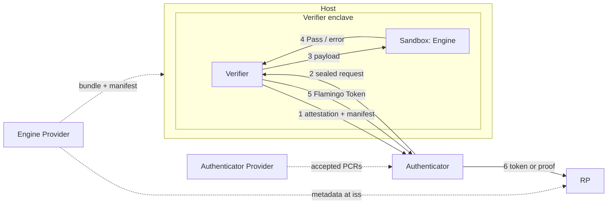

> [!NOTE]  
> This spec outlines a draft functionality for beta testing. Changes are expected.

## 1. Abstract

This spec defines the **Flamingo Verifier** (**Verifier**), a trusted execution environment (TEE) service. It runs one sandboxed biometric Engine release, provided by an Engine Provider. For a request, the Engine runs a pipeline's checks, e.g. fraud detection, on some of the request's entries, e.g. live frames, and compares entries, e.g. a live frame with a Credential image, under a requested `match_strictness`. If the Engine accepts, the Verifier signs a **Flamingo Token** over the Engine configuration, the compared entries and the public values of an Authenticator Assertion, if any. If a [WIP-106][wip-106] Trust Anchor Key Token (TAKT) and Authenticator Assertion Token (AAT) are provided, they are also verified. Consuming protocols such as [WIP-202][wip-202] use the Flamingo Token to prove the Verifier’s checks to a Relying Party (RP), optionally without revealing any entry.

## 2. Motivation

Many Proof-of-Human applications like deep fake prevention or human presence verification require A) running fraud detection models like presentation attack detection (PAD) on a set of input images and B) comparing images using embedding models, e.g., to verify that the person on a stream is the same as the one performing a liveness check on a phone.

Building a privacy preserving system for such image comparisons is very difficult. For example, running the models and comparisons locally on the user's device is privacy-preserving but it has very low security guarantees: a mobile device's output is not trustworthy, e.g., a jailbroken device could report that fraud detection and embedding comparison were performed, while simply running a spoofed client that does not perform them at all. Therefore, an RP cannot be sure that the claimed checks have actually been executed. Additionally, fraud detection models' security relies on obscurity and obtaining the model weights, or even just the model architecture, opens up a wide range of attack vectors.

To achieve verifiability in a privacy-preserving way, this document introduces a general approach that runs fraud detection models and embedding models in an attested Trusted Execution Environment (TEE). This allows users to verify that the TEE operator is not able to access any biometric data, and a signature by the TEE proves to RPs that all claimed checks have been correctly executed. The Verifier image MUST be open source and reproducibly built, so anyone can check that its attested measurement matches the source and that no raw media or embeddings leave the TEE. Fraud detection models cannot be open, so the Verifier runs them as a closed Engine inside a kernel-enforced sandbox that has no network or storage access. The Verifier attests which Engine release it runs, and the RP accepts only releases the Engine Provider signed.

## 3. Overview

This section is non-normative. It sketches the parties and the one-shot verification flow.



Dashed arrows are set up once. Numbered arrows are steps 1–6 of one verification; in step 7 the RP verifies the token locally:

1. The Verifier attests its measurement and its loaded release, and sends that release's manifest ([Attestation and Channel](#443-attestation-and-channel)) to the Authenticator. The Authenticator checks both and chooses a configuration. The results of this step can be cached and the attested channel can be re-used.
2. The Authenticator seals a request to the Verifier with its entries, which of them the pipeline checks, and which are compared ([Authenticator](#46-authenticator), [Request](#444-request)).
3. The Verifier checks the request and passes it to the sandboxed Engine ([Processing](#445-processing)).
4. The Engine runs the pipeline's checks on the pipeline inputs and compares the selected entries ([Request Handling](#435-request-handling)).
5. On a pass, the Verifier signs a Flamingo Token ([Flamingo Token](#45-flamingo-token)).
6. The Authenticator passes the token, or a proof over it such as [WIP-202][wip-202], to the RP.
7. The RP verifies it ([Token Verification](#47-token-verification)).

How the RP requests a token and what it learns is defined by the consuming protocol ([Terminology](#41-terminology)).

Components and parties:

- **RP:** requests and verifies the result, as its consuming protocol defines ([Token Verification](#47-token-verification)).
- **Authenticator:** checks the attestation and the manifest before sending biometrics ([Authenticator](#46-authenticator)).
- **Verifier:** open source; checks and forwards requests, enforces response timing and signs tokens. It runs one Engine release ([Verifier](#44-verifier)).
- **Sandbox and Engine:** closed source and closed weights; run fraud detection and comparison, with no way to export data ([Engine](#43-engine), [Loading and Isolation](#442-loading-and-isolation)).
- **Host and operator:** run the enclave and relay its ciphertext; trusted for availability only ([Loading and Isolation](#442-loading-and-isolation)).
- **Engine Provider:** signs Engine releases and publishes them ([Release and Release Manifest](#432-release-and-release-manifest), [Engine Provider Metadata](#434-engine-provider-metadata)).
- **Authenticator Provider:** ships the Verifier measurements its Authenticators accept ([Authenticator](#46-authenticator)).

What each party is trusted for is in [Trust Assumptions](#5-trust-assumptions).

## 4. Specification

### 4.1 Terminology

The key words "MUST", "MUST NOT", "REQUIRED", "SHALL", "SHALL NOT", "SHOULD", "SHOULD NOT", "RECOMMENDED", "MAY", and "OPTIONAL" in this document are to be interpreted as described in [RFC 2119](https://www.ietf.org/rfc/rfc2119.txt).

1. The **Verifier** is the TEE service this spec defines.
2. The **Engine** is the sandboxed component of the Verifier that performs extraction, fraud detection and comparison. This spec defines none of them.
3. The **Engine Provider** builds the Engine and signs its release manifests. It is identified by `iss`, an `https` URL without query or fragment ([RFC 8414 §2](https://www.rfc-editor.org/rfc/rfc8414#section-2)). It MAY be the same organization as an Authenticator Provider.
4. The **Authenticator Provider** is as defined in [WIP-106][wip-106].
5. The **host** is the machine that runs the Verifier's enclave and relays all its traffic, on AWS Nitro the parent EC2 instance. The **operator** runs the host. Neither is trusted beyond availability ([Trust Assumptions](#5-trust-assumptions)).
6. A **pipeline** is an Engine-defined set of pass/fail checks on its **pipeline inputs**, e.g. fraud detection such as presentation attack or deepfake detection.
7. An **entry** is an image or embedding in a request ([Request and response](#431-request-and-response)). It can be a pipeline input, compared, or both, e.g. a live frame that is checked and compared with a Credential image.
8. A **consuming protocol** defines how a Flamingo Token is requested and used, e.g. a proof type such as [WIP-202][wip-202], or an RP that verifies tokens directly.
9. The Field ($F$), the hash function ($H_t$), the signature scheme (`BabyJubJub-EdDSA-Poseidon2`) and the `PublicKey` representation MUST follow [WIP-100][wip-100]. `R(d)` reads a 256-bit digest `d` as a big-endian integer modulo $q$.

### 4.2 Constants

**Constants:**

| Constant | Value | Description |
| --- | --- | --- |
| `MAX_COMPARED` | `4` | Maximum compared entries, fixed by the Flamingo Token layout. |
| `DS_WIP_201` | `127603488023523044162070750169730750022280897185614` (`b"WORLD-ID/WIP-201/SIGN"`) | Domain separator for the Flamingo Token digest. |
| `DS_WIP_201_ENGINE` | `8362622191109606222205468683123474433460185506268139077` (`b"WORLD-ID/WIP-201/ENGINE"`) | Domain separator for `engine_config_hash`. |
| `MAX_ATTESTATION_AGE` | `10800` | Maximum age of an attestation document at verification, in seconds (3 hours, the validity of a Nitro attestation's certificate). |
| `MAX_DEBUG_REPORT` | `65536` | Maximum `debug_report` size, in bytes. |
| `CHANNEL_DOMAIN` | `WORLD-ID/WIP-201/CHANNEL` | Domain of the request channel. |
| `CHANNEL_KEY_DOMAIN` | `WORLD-ID/WIP-201/CHANNEL-KEY\0` | Domain of the channel key commitment, as bytes including the trailing `0x00`. |
| `EAT_PROFILE` | `https://world.org/eat/flamingo/v1` | The `eat_profile` claim ([RFC 9711 §4.3.2](https://datatracker.ietf.org/doc/html/rfc9711#section-4.3.2)) of a Flamingo Token. |

### 4.3 Engine

#### 4.3.1 Request and response

The Verifier passes the Engine request below to the Engine unchanged and passes nothing else. On the sandbox channel this WIP does not specify its encoding; in the Verifier request it is the `payload` map ([Request](#444-request)).

**Engine request fields:**

| Field | Type | Bounds | Description |
| --- | --- | --- | --- |
| `pipeline` | `uint` | `1..2^16` | A pipeline of the loaded release, chosen by the Authenticator ([Authenticator](#46-authenticator)). |
| `match_strictness` | `uint` | `< 2^8` | A level of the loaded release, chosen by the Authenticator. |
| `hints` | bytes | ≤ 1 KiB | Request-level Engine hints, e.g. experiment flags. MUST NOT change any security assumptions or weaken `match_strictness`; anything that changes the verdict belongs in `pipeline`. |
| `entries` | array of maps | | The request's images or embeddings, each a map; see below. Every entry MUST be in `pipeline_inputs` or `compare`. |
| `pipeline_inputs` | array of `uint` | exactly the pipeline's `inputs` count | Distinct indices into `entries` the pipeline checks; `pipeline_inputs[i]` is the entry the pipeline's `inputs[i]` describes. |
| `compare` | array of `uint` | `2..=MAX_COMPARED` | Distinct indices into `entries`. Order matters: `compare[k]` becomes `compared_entry_hash_k`. |

**Entry fields**, for each item of `entries`:

| Field | Type | Bounds | Description |
| --- | --- | --- | --- |
| `data` | bytes | | An encoded image or an embedding. |
| `meta` | bytes | ≤ 256 bytes | How the Engine reads `data`, e.g. which frame of a live capture it is. |

See [Appendix A2](#appendix-a2-examples) for an example request and response.

**Engine response variants:**

| Variant | Contents |
| --- | --- |
| `Pass` | Every check of the pipeline passed and every two entries in `compare` match at `match_strictness`. Optional `debug_report`. |
| `error` | Implementation-defined. Optional `debug_report`. |

The response never carries scores. This WIP does not specify its encoding.

#### 4.3.2 Release and Release Manifest

A **release** is one version of an Engine: its bundle, i.e. code, model weights and configuration ([Loading and Isolation](#442-loading-and-isolation)), and the release manifest that describes it. The manifest names the release's pipelines and strictness levels, and its hash, `release_hash`, identifies the release. A Verifier runs one release. See [Appendix A2](#appendix-a2-examples) for an example manifest.

A release manifest is a JWS ([RFC 7515](https://www.rfc-editor.org/rfc/rfc7515)) in compact serialization, signed with `ES256` by the Engine Provider's release key. Its protected header MUST contain `alg` = `ES256`, `kid` and `typ` = `world-id-engine-manifest`. Its payload is a JSON object:

**Manifest payload fields:**

| Field | Type | Description |
| --- | --- | --- |
| `iss` | string | The Engine Provider ([Terminology](#41-terminology)). |
| `engine_hash` | string | `SHA-384` of the Engine bundle, 96 lowercase hex digits. |
| `version` | integer | See [Versioning](#433-versioning). |
| `match_strictness_levels` | array of integers | The release's levels, non-empty, strictly ascending, each `< 2^8`. |
| `pipelines` | array | The release's pipelines; see below. `pipeline` values MUST be nonzero and unique within a manifest. |

**Pipeline fields**, for each item of `pipelines`:

| Field | Type | Description |
| --- | --- | --- |
| `pipeline` | integer | The pipeline identifier, `< 2^16`. |
| `inputs` | array | A non-empty array; see below. Item `i` describes the entry `pipeline_inputs[i]` names. |
| `response_slots` | array of integers | Non-empty, strictly ascending, positive release times in milliseconds; see [Response Timing](#446-response-timing). |

**Pipeline input fields**, for each item of a pipeline's `inputs`:

| Field | Type | Description |
| --- | --- | --- |
| `role` | string | What the input is, e.g. `live_frame`. Roles MAY repeat within a pipeline. |
| `media_types` | array of strings | Accepted media types, e.g. `image/jpeg`. MUST NOT be empty. |

1. **Release hash**. `release_hash` is the `SHA-256` of the manifest's JWS Payload ([RFC 7515 §2](https://www.rfc-editor.org/rfc/rfc7515#section-2)). It excludes the protected header and the signature, so re-signing a release keeps its `release_hash`.
2. **Signatures**. RPs MUST verify a release manifest under an active release key of its `iss` ([Engine Provider Metadata](#434-engine-provider-metadata)) before relying on it. The Verifier and Authenticators do not verify it.

#### 4.3.3 Versioning

1. `version` MUST be greater than the `version` of every earlier release of the same `iss`. Every change to the payload is a new release.
2. A later release MUST NOT change a pipeline's `inputs`, increase the number of its `response_slots`, or drop a `match_strictness` level; such a change uses a new `pipeline` value. A later release MAY drop a pipeline.

#### 4.3.4 Engine Provider Metadata

The Engine Provider MUST expose a JSON file over HTTPS at `<iss>/.well-known/world-id-engine.json`:

**Metadata fields:**

| Field | Type | Description |
| --- | --- | --- |
| `version` | integer | MUST be `1`. |
| `iss` | string | The Engine Provider. A reader MUST reject the file unless it equals the `iss` it was fetched for. |
| `release_keys` | array | Each entry: `jwk` (a P-256 JWK with `kid`) and `status` (`active`, `retired` or `revoked`). |
| `manifests` | array | The release manifests the Engine Provider offers, each a compact JWS. Removing one withdraws its release. Manifests with another `iss` are ignored. |

The Verifier never fetches the Engine Provider metadata. RPs compute the `engine_config_hash` values they accept from it.

#### 4.3.5 Request Handling

For each Engine request, in a fresh or reset instance ([Isolation](#442-loading-and-isolation)), the Engine:

1. **Validates** the request against its release: `pipeline` is defined, `match_strictness` is listed, and the pipeline inputs match the pipeline's `inputs` in count and media type. Otherwise it MUST return `error`.
2. **Checks** the pipeline inputs: it runs the pipeline's checks, e.g. presentation attack or deepfake detection, on the entries `pipeline_inputs` names, reading each entry's `meta` as the pipeline defines. The checks depend only on `pipeline`, not on `match_strictness`.
3. **Compares** the entries `compare` names: it extracts what the pipeline compares, e.g. face embeddings, and matches every two of them against the pipeline's thresholds for `match_strictness`.
4. **Responds** with `Pass` if every check passed and every comparison matched, otherwise with `error` ([Request and response](#431-request-and-response)).

Strictness levels are defined per release: every pipeline MUST support every level, a level MUST mean the same in every pipeline, and a higher level MUST be at least as strict for every two compared entries. Each pipeline sets the thresholds that meet each level, and the Engine Provider documents what each level means.

### 4.4 Verifier

#### 4.4.1 Build and Measurement

The Verifier runs as an [AWS Nitro Enclaves](https://aws.amazon.com/ec2/nitro/nitro-enclaves/) image, and its measurement MUST be verifiable from source:

1. **Source.** Each Verifier release MUST name its source by an immutable reference, e.g. a commit hash in a public repository.
2. **Build.** Building that source with the documented toolchain MUST produce a bit-identical Enclave Image File (EIF).
3. **Measurement.** PCR0, PCR1 and PCR2 of that EIF, as AWS Nitro Enclaves computes them, are the Verifier's measurement.
4. **Publication.** The Verifier operator MUST publish, per release, the source reference, the build instructions and PCR0–2.

#### 4.4.2 Loading and Isolation

1. **Loading.** The Engine bundle is everything the Engine runs: code, model weights and configuration. The host passes exactly one bundle at start-up, as one artifact, together with its release manifest. The Verifier MUST check that the bundle hashes to the manifest's `engine_hash` and that the manifest meets [Release and Release Manifest](#432-release-and-release-manifest). It MUST NOT let the Engine load anything outside its bundle. It verifies no signature and fetches nothing. The Engine is injected at runtime and bound by `release_hash`.
2. **Isolation.** The Engine sees raw biometrics and runs closed, injected models. The Verifier MUST give it no network access, no writable persistent storage, no process creation and no access to the Verifier's keys, and only one bounded request-response channel. Each request MUST run in a fresh or reset Engine instance, so no data from one request reaches another. The Verifier MUST bound the Engine's memory and return an `error` when it is exceeded. [Response Timing](#446-response-timing) bounds its runtime and the capacity of its timing channel to the host. See the [reference implementation's sandbox](https://github.com/worldcoin/flamingo/tree/main/verifier/sandbox-client) for one way to meet these requirements.
3. **Host.** The host relays all traffic. The Verifier MUST bound the memory a request can use, MUST advertise that bound alongside its channel attestation, and MUST reject a sealed request above it before decrypting it. The host MAY drop such requests before they reach the Verifier.

#### 4.4.3 Attestation and Channel

The Verifier generates a channel key and a Flamingo Token signing key at boot and attests each in its own Nitro attestation document: a `COSE_Sign1` chaining to the [AWS Nitro Root G1](https://aws-nitro-enclaves.amazonaws.com/AWS_NitroEnclaves_Root-G1.zip). Its PCR0–2 are the measurement, its `timestamp` in milliseconds divided by 1000 is the attestation time, and its `public_key` binds the key below. A document with all-zero PCRs comes from debug mode and MUST be rejected.

**Attestation documents:**

| Document | `public_key` | `user_data` | Used by |
| --- | --- | --- | --- |
| Channel attestation | `SHA-256(CHANNEL_KEY_DOMAIN \|\| channel_key)` | The loaded `release_hash`. | The Authenticator, to check the Verifier and encrypt a request; discarded afterwards. |
| `signing_key_attestation` | The Flamingo Token signing key (`kid`) | — | Consumers, with every Flamingo Token. |

1. **Manifest.** The Verifier MUST send the loaded release manifest, as received, together with the channel attestation.
2. **Response**. The Verifier MUST seal the padded response to `response_key`. Only the requester holds `response_key`, so the response is bound to its request; a `Success` is authenticated by its Flamingo Token.
3. **Refresh**. The Verifier MUST re-attest its signing key at least every `MAX_ATTESTATION_AGE` and return its latest `signing_key_attestation`.
4. **Carrying**. A proof or message that relies on a Flamingo Token MUST carry the Flamingo Token's `signing_key_attestation`.

The Engine needs no attestation of its own: the measured Verifier signs its `engine_config_hash` into each Flamingo Token. One `signing_key_attestation` covers every Flamingo Token of a boot, so consumers MAY cache it by key. It identifies the Verifier instance, not the user.

**Channel Encoding.** Both directions use the public-key encryption of [WIP-100][wip-100] §3.9.

1. **Info**. `info` is `CHANNEL_DOMAIN || 0x00` for a request and `CHANNEL_DOMAIN || 0x01` for a response.
2. **Request plaintext**. The first 1216 bytes are `response_key`, a fresh X-Wing encapsulation key; the rest is the [Request](#444-request).
3. **Rejection**. The Verifier MUST reject a request shorter than 1216 bytes or with an invalid `response_key`.

#### 4.4.4 Request

The request is a deterministic CBOR map ([RFC 8949 §4.2.1](https://datatracker.ietf.org/doc/html/rfc8949#section-4.2.1)) with the fields below. The Authenticator encrypts the entire encoded map to the Verifier ([Channel Encoding](#443-attestation-and-channel)). Field elements are 32-byte byte strings, the canonical big-endian encoding.

`payload` is a CBOR byte string that contains the deterministic CBOR encoding ([RFC 8949 §4.2.1](https://datatracker.ietf.org/doc/html/rfc8949#section-4.2.1)) of the [Engine request](#431-request-and-response). It is nested as bytes so that `cdh` commits to its exact encoding. The bounds in the Engine request are bounds of this map.

**Verifier request fields:**

| Field | Type | Description |
| --- | --- | --- |
| `version` | `uint` | MUST be `1`. |
| `payload` | bytes | The encoded [Engine request](#431-request-and-response); see above. |
| `aud` | Field element | The `rpId` of the request. |
| `nonce` | Field element | The RP's nonce for the request, sampled uniformly from the nonzero elements of $F$ with a CSPRNG. |
| `aat_inputs` | map, optional | Inputs for verifying a TAKT and an AAT; see below. |

`aat_inputs` is OPTIONAL. Authenticators without an Authenticator Provider that issues TAKTs omit it. If present, it is a map with the fields marked `aat_inputs.` below, and the Verifier obtains every input of [WIP-106 §3.8][wip-106] as follows:

**WIP-106 inputs:**

| WIP-106 §3.8 input | Type | Source |
| --- | --- | --- |
| `trust_anchor_key` | `PublicKey` | `aat_inputs.trust_anchor_key` |
| `takt` | bytes | `aat_inputs.takt` |
| `aat` | bytes | `aat_inputs.aat` |
| `now` | uint32 | `aat_inputs.now` |
| `min_build_version` | uint32 | `aat_inputs.min_build_version`. Authenticators set `0`, which sets no minimum; RPs do not rely on it until build floors are defined ([Future Considerations](#9-future-considerations)). |
| `aud`, `nonce` | uint64, Field element | The request's `aud` and `nonce`. The Verifier MUST reject an `aud` not less than $2^{64}$. |
| `cdh` | Field element | Computed as `R(SHA-256(payload))`. |
| `platform`, `sec_level`, `sec_meta` | uint8 | Unpacked from the TAKT's `sec_flags`. |
| `authenticator_meta` | uint8 | The AAT's `authenticator_meta`. |

#### 4.4.5 Processing

1. **Checks.** The Verifier MUST reject a request of any other shape, exceeding a bound, whose `pipeline_inputs` or `compare` repeats or names an out-of-range index, or that has an entry in neither. It MUST reject a request whose `pipeline` the loaded release does not define, whose `match_strictness` the release does not list, or whose `pipeline_inputs` count differs from the pipeline's `inputs`. It then derives the layout from `compare`, `pipeline_inputs` and the pipeline's input roles ([Flamingo Token](#45-flamingo-token)), and hashes the entries `compare` names, in order, into `compared_entry_hash` ([Flamingo Token](#45-flamingo-token)). It interprets nothing else.
2. **Authenticator Assertion.** If `aat_inputs` is present, every check of [WIP-106 §3.8][wip-106] MUST hold before the Verifier calls the Engine; otherwise it rejects the request. The Verifier is a WIP-106 TEE verifier: the Authenticator authenticates it through the channel attestation ([Attestation and Channel](#443-attestation-and-channel)), and the RP through the `signing_key_attestation`.
3. **AAT outputs.** The public inputs reach the Flamingo Token as `trust_anchor_key_hash`, `now` and `aat_flags` ([Flamingo Token](#45-flamingo-token)); `aud` and `nonce` as themselves. The TAKT, the AAT, the `assertion_key` and `build_version` MUST NOT leave the Verifier, and `aat_inputs` MUST NOT be passed to the Engine.
4. **Without an AAT.** The Verifier MUST set `has_aat` to `1` if it verified a TAKT and an AAT and to `0` otherwise. With `has_aat = 0`, `now`, `trust_anchor_key_hash` and `aat_flags` MUST be `0`.
5. **Replay**. The Verifier MUST reject a request whose (`aud`, `nonce`) it has already processed under the same `channel_key`, before running the Engine. The `channel_key` MUST NOT be exported or persisted across boots, so an in-memory set suffices: a reset discards the key along with the set, and no other instance can open a request sealed to it.
6. **Forwarding.** The Verifier MUST pass the Engine request to the Engine unchanged.

#### 4.4.6 Response Timing

1. **Slots.** Each pipeline's `response_slots` ([Release and Release Manifest](#432-release-and-release-manifest)) list its release times in milliseconds after a request's arrival. With one slot, every response takes exactly that long.
2. **Release.** The Verifier MUST release each response at the first slot of the request's pipeline at which the Engine has finished, measured from the request's arrival on its monotonic clock, whatever the outcome. A request whose Engine has not finished by the last slot fails; the Verifier MUST then terminate and reset the Engine instance.
3. **Choosing slots.** Engine Providers SHOULD set the first slot at or above the pipeline's fastest complete run, so early exits, e.g. a rejected input, are released together with completed runs, and the last slot above its 99.9th-percentile run time on the intended hardware, since slower requests fail. Between them, slots SHOULD follow the pipeline's run-time distribution.
4. **Leakage budget.** A response reveals at most $\log_2 n$ bits about its run time, for $n$ slots. Authenticators check the slot count before sending biometrics ([Authenticator](#46-authenticator)).

#### 4.4.7 Response

**Response variants:**

| Variant | Contents |
| --- | --- |
| `Success` | The Engine returned `Pass`. `token` ([Flamingo Token](#45-flamingo-token)), `signing_key_attestation` ([Attestation and Channel](#443-attestation-and-channel)), and the Engine response's `debug_report` if present. |
| `Failed` | `error` and an optional `debug_report`. When the Engine returned an `error`, both are that Engine response, passed through. The Verifier MAY return `Failed` with its own `error` when it rejects without a `Pass`. |

1. The response MUST be encrypted to the requester and MUST be padded to a fixed length, hiding the outcome and the report size.
2. `error` is implementation-defined and bounded in size; it comes from the Verifier or, passed through, from the Engine.
3. `debug_report` is optional Engine output outside the Flamingo Token. The Verifier MUST NOT emit a report larger than `MAX_DEBUG_REPORT`. Clients MUST NOT forward it without the user's explicit consent, and only to the Engine Provider. It SHOULD let the user inspect a report before forwarding it.
4. The Verifier MUST emit a Flamingo Token only when the Engine returns `Pass`.

### 4.5 Flamingo Token

The Flamingo Token is the primary **output** of a Verifier after a comparison. A Flamingo Token is a CWT ([RFC 8392](https://datatracker.ietf.org/doc/html/rfc8392)) in an untagged `COSE_Sign1`, encoded as deterministic CBOR ([RFC 8949 §4.2.1](https://datatracker.ietf.org/doc/html/rfc8949#section-4.2.1)).

1. The protected header MUST contain `alg` (label `1`) = `-65537` (Private Use, `BabyJubJub-EdDSA-Poseidon2`) and `kid` (label `4`) = the compressed signing public key.
2. The signature MUST be a `BabyJubJub-EdDSA-Poseidon2` signature per [WIP-100][wip-100] over the signed digest below.

The payload MUST contain exactly these claims, in the bytewise order of their encoded keys.

**Claims:**

| Claim | Key | Value |
| --- | --- | --- |
| `eat_profile` | `265` | `EAT_PROFILE`. |
| `compared_entry_hash_k`, `k = 0..3` | `-90000 - k` | `R(SHA-256(data))` of the entry `compare[k]` names, or `0` if `compare` has no position `k`. |
| `aud` | `-90004` | `aud` from the request. |
| `nonce` | `-90005` | `nonce` from the request. |
| `trust_anchor_key_hash` | `-90006` | [WIP-106][wip-106] hash of the `trust_anchor_key` that signed the verified TAKT, or `0` without an AAT. |
| `aat_flags` | `-90007` | `platform + 2^8 * sec_level + 2^16 * min_build_version + 2^48 * sec_meta + 2^52 * authenticator_meta`: the [WIP-106][wip-106] `sec_flags` layout with the public `min_build_version` in place of `build_version`, and `authenticator_meta` in bits 52-56; `0` without an AAT. |
| `has_aat` | `-90008` | `1` if the Verifier verified an AAT, otherwise `0`. |
| `now` | `-90009` | `now` of the verified AAT, or `0` without an AAT. |
| `engine_config_hash` | `-90010` | The Engine configuration that ran; see below. |

1. `aat_flags`, `has_aat` and `now` are CBOR uints. All other claims except `eat_profile` are 32-byte byte strings, the canonical big-endian encoding of a field element.
2. `eat_profile` is not in the signed digest and MUST be treated as an untrusted hint.

**Signed digest.** The signed message is **not** the COSE `Sig_structure`. It MUST be

```
H_16(DS_WIP_201; now,
     compared_entry_hash_0, compared_entry_hash_1, compared_entry_hash_2, compared_entry_hash_3,
     aud, nonce, trust_anchor_key_hash, aat_flags, has_aat, engine_config_hash)
```

per [WIP-100][wip-100] §3.3.2, with $k = 11$. A `compared_entry_hash_k` without a compared entry at position `k` is `0`. Four slots remain free.

**Engine configuration hash.** The layout is the deterministic CBOR array with one item per `compare` position: if the compared entry is `pipeline_inputs[i]`, the `role` of the pipeline's `inputs[i]`, as text; otherwise `null`. For example, comparing an unchecked entry, a `live_frame` pipeline input and another unchecked entry gives `[null, "live_frame", null]`. Then

```
engine_config_hash = H_8(DS_WIP_201_ENGINE; R(release_hash), pipeline, match_strictness, R(SHA-256(layout)))
```

per [WIP-100][wip-100] §3.3.2, with $k = 4$. It identifies the chosen configuration. The Verifier signs it into the Flamingo Token, and the RP checks it against the configurations it accepts ([Token Verification](#47-token-verification)).

### 4.6 Authenticator

1. **Accepted measurements.** The Authenticator MUST accept only PCR0–2 values its Authenticator Provider ships with it, e.g. in the app release or as signed configuration.
2. **Before sending biometrics**, the Authenticator MUST, in order:
   1. Check that the channel attestation ([Attestation and Channel](#443-attestation-and-channel)):
      - is a valid `COSE_Sign1` whose certificate chain leads to the AWS Nitro Root G1 and is valid at the current time;
      - does not have all-zero PCRs, and has PCR0–2 it accepts;
      - has `public_key = SHA-256(CHANNEL_KEY_DOMAIN || channel_key)` for the `channel_key` it encrypts to;
      - has `user_data` equal to the `release_hash` of the manifest the Verifier sent;
      - has a `timestamp` at most `MAX_ATTESTATION_AGE` old.
   2. Choose a `pipeline` the loaded release defines and whose `inputs` the device can produce, and a `match_strictness` the release lists. Within these constraints, the choice MAY follow the consuming protocol's requirements or the Authenticator Provider's policy. The consuming protocol sets the layout, from which the Authenticator builds `pipeline_inputs` and `compare`. The pipeline's `response_slots` MUST NOT exceed the slot count the Authenticator accepts; it SHOULD accept at most 8.
   3. Seal `response_key || request` to `channel_key` ([Channel Encoding](#443-attestation-and-channel)), send it, and open the response with `response_key`.
3. It MUST NOT send biometrics if any step fails. If the loaded release defines no pipeline and level that meet step 2.2, the Authenticator MAY use another Verifier instance.
4. The Authenticator needs no release keys: the attestation binds the manifest to the running Verifier, and the RP checks who signed the release ([Token Verification](#47-token-verification)).

### 4.7 Token Verification

Whoever relies on a Flamingo Token under a consuming protocol, the **checker**, accepts it if every check below holds. Checks marked **[token]** concern the token's own values; inside a circuit (e.g. [WIP-202][wip-202]) they are constraints, otherwise they run directly on the token. Checks marked **[policy]** compare values against the checker's accepted sets and state; they always run in the clear. Which values a proof reveals is up to the consuming protocol. The checks use these values:

**Values:**

| Value | Type | Description |
| --- | --- | --- |
| `verifier_key` | `PublicKey` | The Verifier's signing key, checked against its `signing_key_attestation`. |
| `now` | uint32 | The token's `now`: the `now` of [WIP-106 §3.8][wip-106] with an AAT, `0` without. A consuming protocol MAY also use the current time, e.g. as a circuit input. |
| `aud`, `nonce` | Field element | The RP's request. |
| `has_aat` | bool | Whether the Flamingo Token carries an AAT result. |
| `trust_anchor_key_hash` | Field element | Hash of an allowlisted `trust_anchor_key`. |
| `platform`, `sec_level`, `sec_meta`, `authenticator_meta` | uint8 | See [WIP-106 §3.6][wip-106]. |
| `min_build_version` | uint32 | Minimum `build_version`; `0` in this version. |
| `compared_entry_hash` | [Field element; 4] | From the Flamingo Token. |
| `engine_config_hash` | Field element | From the Flamingo Token. |
| `sig` | Signature | The Flamingo Token signature. |

1. **Attestation** [policy]. The `signing_key_attestation`:
   - chains to the AWS Nitro Root G1, with every certificate valid at its `timestamp`, and does not have all-zero PCRs;
   - has PCR0–2 the checker accepts;
   - attests `verifier_key`, the key that signed the Flamingo Token (`kid` is only a hint);
   - has a `timestamp` at most `MAX_ATTESTATION_AGE` old.
2. **Signature** [token]. The Verifier signed the Flamingo Token.
   - Compute the signed digest ([Flamingo Token](#45-flamingo-token)) from the values.
   - Verify `sig` under `verifier_key` per [WIP-100 §3.5.1][wip-100].
3. **Request.** The Flamingo Token is for this request.
   - [policy] `aud` is the RP's own; `nonce` is one the RP issued, has not expired and has not been used before.
   - [token] The digest uses `aud` and `nonce`.
4. **Authenticator Assertion.** The Flamingo Token carries the AAT result, or none.
   - [token] `has_aat` is `0` or `1`, and the digest uses it.
   - [token] The digest uses `trust_anchor_key_hash` and the token's `now`: the AAT's `now`, or `0` without one. A circuit whose `now` value is the current time uses `has_aat * now`.
   - [token] Range-check `platform`, `sec_level`, `sec_meta`, `authenticator_meta` and `min_build_version` to their widths, and constrain the `user_presence` bits of `authenticator_meta` below `5`.
   - [token] The digest uses `aat_flags = platform + 2^8 * sec_level + 2^16 * min_build_version + 2^48 * sec_meta + 2^52 * authenticator_meta`.
   - [token] When `has_aat = 0`, `trust_anchor_key_hash`, `platform`, `sec_level`, `sec_meta`, `authenticator_meta` and `min_build_version` MUST be `0`.
   - [policy] If `has_aat = 0`, the checker accepts requests without an AAT. Otherwise the values pass [WIP-106 §4][wip-106]: `now`, `min_build_version`, `trust_anchor_key_hash` and the `aat_flags` sub-fields.
5. **Engine.** The Flamingo Token names an Engine configuration the checker accepts.
   - [policy] `engine_config_hash` is the hash of a release, `pipeline`, `match_strictness` and layout the checker accepts, from an active release manifest it verified under an active key of the manifest's `iss` ([Engine Provider Metadata](#434-engine-provider-metadata)). The checker's minimum `version` per `iss` is part of what it accepts.
   - [token] The digest uses `engine_config_hash`. A consuming protocol's circuit MAY take its components as private values and recompute it, to constrain them.

The checks yield `compared_entry_hash`. The consuming protocol MUST bind each hash its statement depends on to its own inputs (e.g. the Issuer's claim or the RP's challenge).

## 5. Trust Assumptions

The protocol assumes the isolation, measurement and attestation of AWS Nitro Enclaves are sound. If they fail, neither privacy nor integrity holds. Every party in the table below is trusted only for the listed parts, and a compromise of one only affects those parts, except AWS.

**Parties:**

| Party | Trusted for | Not trusted for |
| --- | --- | --- |
| AWS (Nitro Enclaves) | Isolation, measurement and attestation of the enclave. | Nothing: if this fails, neither privacy nor integrity holds. |
| Engine Provider | Engine correctness: fraud detection, matching, keeping each pipeline stable across releases, and documenting what each level means. | Privacy: the sandbox keeps the Engine from exporting data. |
| Authenticator Provider | Verifying the Authenticator's integrity, as stated in the TAKT, and the Verifier measurements its Authenticators accept. | — |
| Authenticator | The source and freshness of the live capture. | — |
| Host and operator | Availability only. | Privacy and integrity: they see only ciphertext, and the Verifier rejects replayed requests ([Processing](#445-processing)). |

**Out of scope.** Collusion between an RP and the user's Authenticator, which can then produce any proof the RP accepts, and between an RP, an Engine Provider and the operator, which can only gather more than one response's worth of timing information through requests the user consents to one by one. Collusion between an Engine Provider and the operator alone is in scope: [Isolation](#442-loading-and-isolation) and [Response Timing](#446-response-timing) bound what they learn per request, and [Replay](#445-processing) keeps them from repeating a request.

## 6. Rationale

1. **The Verifier interprets no media.** Frame semantics and thresholds live in the Engine and the consumer; the Verifier only maps compared entries to roles for `engine_config_hash`. A new capture method or credential format never changes the request or Flamingo Token.
2. **The AAT is verified in the Verifier.** [WIP-106 §3.8][wip-106] requires a verifier that keeps the Private inputs confidential and reports only the Public values; the attested Verifier is one. The Verifier already handles the media, and consumers save one signature verification. As `cdh` covers the exact `payload`, the AAT vouches for exactly the compared input.
3. **The AAT is optional.** Not every Authenticator has an Authenticator Provider that issues AATs, and requiring one would exclude them. The RP decides per request whether it accepts a Flamingo Token without one.
4. **Public values as claims.** The Flamingo Token carries the Public values of [WIP-106 §3.8][wip-106], so a consumer applies the same RP policy either way. Consumers read them directly; the Verifier is trusted to derive them from one request, as it is for the comparison. `build_version` stays private as WIP-106 requires; `min_build_version` takes its place.
5. **`SHA-256` over received bytes.** RPs and Issuers compute or check these hashes outside circuits, where `SHA-256` is available everywhere. They cover the bytes the Verifier received, not embeddings derived from them, which no other party could reproduce.
6. **Signature over claim values, not CBOR bytes.** The signature covers a Poseidon2 hash of the claim values, so a circuit verifies the Flamingo Token without parsing CBOR. Each claim keeps its own field element; the wider `t=16` permutation costs less than unpacking packed claims in-circuit.
7. **No Verifier time.** Most TEEs have no trusted clock, so the Verifier does not timestamp the Flamingo Token; the RP's single-use `nonce` makes it fresh. The Authenticator states `now` for the AAT: the Verifier checks the AAT is valid at that `now` and signs it, and the RP checks `now` against its own clock ([WIP-106 §4][wip-106]).
8. **Match strictness instead of scores.** A score's meaning depends on the model and the pair, so an RP cannot pick a meaningful threshold, and scores are biometric signals. An ordered strictness survives model upgrades and keeps scores out of every Flamingo Token.
9. **A separate Engine Provider signs the Engine.** Models may come from different parties, and trust in the models stays separate from trust in the capture environment. A pipeline keeps its meaning across an Engine Provider's releases ([Versioning](#433-versioning)).
10. **Engine configuration hash.** As in remote attestation ([RFC 9334](https://www.rfc-editor.org/rfc/rfc9334)), the Verifier reports a measurement and the RP appraises it against reference values, here signed release manifests. One hash gives RPs exact control over accepted configurations, including which roles are compared, keeps the individual values private, and lets circuits constrain its components.
11. **Signatures outside the Verifier.** The RP's allowlist gives the protection a signature check in the TEE would, so one audited Verifier image serves every Engine Provider without trusted keys in its measurement.
12. **Quantized response times.** The host sees when each response leaves, and an Engine's execution time can depend on, or be modulated by, the biometric input. Releasing responses only at a few slots limits what that reveals to the slot index, at most $\log_2 n$ bits per request for $n$ slots, wherever the slots lie. Listing the slots rather than deriving them from a formula lets each Engine fit them to its run times, e.g. passes that cluster around two durations, and leaves no rounding for implementations to disagree on. The slots are in the signed manifest, so each Engine sets its latency trade-off in the open and Authenticators enforce their limit. A first slot no shorter than the fastest complete run keeps early exits from standing out, and the last slot bounds the Engine's runtime. Rejecting replayed requests keeps the host from collecting several observations of the same request. Slots are per pipeline because run times differ by pipeline; shared slots would let early exits of a slow pipeline stand out.
13. **Release hash.** The token commits to the signed release rather than to the bundle, so the pipelines and response slots the Verifier enforces are those the RP accepted. Hashing the JWS Payload instead of the JWS keeps the hash stable when a release is re-signed, e.g. after a key rotation, since `ES256` signatures are randomized.
14. **Minimum versions and stable pipelines.** RPs accept a minimum version per `iss` instead of exact releases, so a new release reaches them without changing their requests, and Verifiers can move to it. A breaking change gets a new `pipeline` value, which RPs opt into. As with FIDO metadata's `authenticatorVersion` and SUIT sequence numbers, the version is a plain integer that only orders releases.
15. **One entry list, two index lists.** `pipeline_inputs` says which entries the pipeline checks and `compare` which are compared, so one image can be both without being sent twice, and one pipeline serves any comparison. The layout in `engine_config_hash` shows whether each compared entry was checked, so an unchecked image cannot pass as the live capture, and it lets the RP fix which roles are compared while the Authenticator still picks the entries, e.g. the sharpest frame.
16. **Strictness levels per release.** Levels apply to comparisons, which every pipeline of a release shares, so a level means the same in every pipeline.
17. **One Engine per Verifier.** Selection becomes a check of the attested release instead of a search over several, and the enclave holds one set of model weights. Rolling deploys run old and new Verifiers side by side.
18. **`iss` as the Engine Provider identifier.** As in JWT ([RFC 7519](https://www.rfc-editor.org/rfc/rfc7519)) and OAuth metadata ([RFC 8414](https://www.rfc-editor.org/rfc/rfc8414)), the signer is named by an `https` URL from which its metadata location follows, and the metadata repeats it to defeat mix-ups.
19. **Attested manifests instead of Authenticator-side signatures.** The attestation already shows which release runs. Its authorship matters only for integrity, which the RP checks; privacy holds by the sandbox regardless. Authenticators then need only accepted PCRs, not Engine Providers' keys.
20. **Size limits at the host.** A size limit protects availability, which the host is trusted for anyway. The Verifier only needs to fail safely, by bounding the memory a request can use.
21. **No Engine configuration from the RP.** Every value the Engine ran with is in `engine_config_hash`, so the RP checks it at verification and never has to reveal its accepted set. The Authenticator chooses within its Verifier's release; a choice the RP does not accept costs the user a new capture. This WIP leaves the RP's request and what it learns to the consuming protocol.

## 7. Alternatives Considered

1. **Running the models in a ZK circuit.** The Authenticator proves extraction and fraud detection in ZK. Rejected: proving these models is still computationally infeasible for most devices and most models, and the prover would need the model weights, while fraud detection relies on keeping them secret.
2. **MPC.** Parties jointly run the models over secret-shared inputs and weights. Rejected: it runs the models orders of magnitude slower and adds the assumption that the parties don't collude.
3. **Random or fixed response times.** Random delays only lower the timing channel's bandwidth, since repeated requests average the noise out. A single fixed response time removes the channel but makes every request wait for the worst case. Rejected in favor of quantized response times.
4. **Exact `release_hash` lists.** The RP accepts only listed releases. Rejected: every release would require RPs to update their accepted sets, and Verifiers to keep old releases loaded until they do.
5. **Semantic versions.** `MAJOR.MINOR.PATCH` with breaking changes in a new major. Rejected: the only boundary RPs need is "breaking or not", which a new `pipeline` value expresses without range rules.

## 8. Security

1. **Post-quantum channel.** Biometrics don't expire, so a party that records ciphertexts today (e.g. the host) MUST NOT be able to decrypt them with a future quantum computer. X-Wing combines ML-KEM-768 with X25519 and stays secure while either holds, assuming its SHA3 hash functions are secure. Flamingo Token signatures are not post-quantum; the single-use `nonce` only prevents replay of an existing token, not forgery of tokens for nonces not yet spent once `BabyJubJub-EdDSA-Poseidon2` becomes forgeable (e.g. a quantum computer recovers the Verifier's signing key), letting a forger claim a live comparison no Engine ever verified. RPs MUST stop accepting Flamingo Tokens signed with this scheme once it is considered forgeable (e.g. once a cryptographically relevant quantum computer is considered feasible), i.e. before forgery becomes practical, and migrate to a post-quantum signature scheme.
2. **Authenticator integrity and missing AATs.** A TAKT and an AAT show that a genuine Authenticator produced `payload`, which keeps modified or emulated Authenticators from injecting media. Without an AAT anyone can submit arbitrary media, and the verdict becomes an oracle for tuning attacks; RPs that accept `has_aat = 0` accept that risk.
3. **Unreviewed Engines.** A host may load any Engine, and the channel attestation reveals which one. Authenticators do not check who signed it, so they may send biometrics to an unreviewed Engine; the sandbox still keeps it from exporting data (item 4), and its Flamingo Token carries an `engine_config_hash` no RP accepts. A leaked release key lets an attacker publish release manifests RPs accept until the Engine Provider marks the key `revoked`. RPs accept new releases unreviewed, so a leaked key or a faulty release reaches them at once; the Engine Provider withdraws a release by removing its manifest, and RPs MAY raise the minimum `version` they accept.
4. **Closed Engine.** The Engine is not trusted with privacy. The sandbox removes its channels out, the per-request reset keeps one request's data from the next, and `debug_report` reaches only the requester and is forwarded only with the user's consent.
5. **Flamingo Token privacy.** `compared_entry_hash` of a credential entry is constant per user, so together with `aud` and `nonce` a Flamingo Token links a user to a specific RP request. Consumers MUST keep Flamingo Tokens private, e.g. as private inputs to [WIP-202][wip-202].
6. **Verifier keys.** The Verifier generates its signing key inside the TEE at boot from the hardware RNG and never exports it, so a key in a valid `signing_key_attestation` was generated by that measurement and each boot uses a new key. A key cannot be revoked; RPs stop accepting a compromised measurement, and `MAX_ATTESTATION_AGE` bounds how long its attestation stays acceptable.
7. **Timing.** Each response reveals which slot of its pipeline it was released in ([Response Timing](#446-response-timing)), at most $\log_2 n$ bits per request for $n$ slots, a budget the Authenticator checks before sending biometrics; with per-pipeline slots, timing may also reveal the release and pipeline. Microarchitectural side channels on shared hardware remain outside the guarantees of AWS Nitro Enclaves.
8. **Stale measurements.** An Authenticator keeps accepting a compromised Verifier measurement until its Authenticator Provider removes it. Shipping the accepted PCRs as signed, expiring configuration, rather than only with app releases, shortens that window.

## 9. Future Considerations

1. **Other TEEs.** Support for TEEs beyond AWS Nitro Enclaves, through attestation profiles that map each provider's document, root and measurement to the rules of [Attestation and Channel](#443-attestation-and-channel).
2. **Several Engines per Verifier.** A Verifier that loads more than one release, with the Authenticator choosing among them.
3. **Build floors.** RPs do not know which Authenticator Provider answers, and build numbers are per provider, so `min_build_version` is `0` for now. A provider could publish a few coarse floors for Authenticators to report, which RPs check per provider at verification.
4. **Published measurements.** A standard format in which Verifier operators publish PCR values with a status, from which RPs and Authenticator Providers build their accepted sets.

## 10. Backwards Compatibility

This WIP introduces a new interface; no existing contracts or functionality are affected.

## Appendix A1. Test Vectors

Field elements are hex unless decimal, bytes are hex. The `trust_anchor_key` secret is 32 bytes of `0x07`, the `assertion_key` secret 32 bytes of `0x09` (P-256, signed per RFC 6979), the Verifier's signing key secret 32 bytes of `0x15`. `payload` has `pipeline = 1`, `match_strictness = 2`, empty `hints`, three entries with empty `meta` and `data` `"credential image"`, `"live image"` and `"challenge image"` (ASCII), `pipeline_inputs = [1]`, and `compare = [0, 1, 2]`. The loaded release has `release_hash` 32 bytes of `0x2a`. The pipeline's only input has role `live_frame`, so the layout is `[null, "live_frame", null]`. `min_build_version = 2006` exercises the field; Authenticators set `0` ([Request](#444-request)).

### With an AAT

```text
payload   = a66568696e74734067636f6d706172658300010267656e747269657383a264646174615063726564656e7469616c20696d616765646d65746140a264646174614a6c69766520696d616765646d65746140a264646174614f6368616c6c656e676520696d616765646d6574614068706970656c696e65016f706970656c696e655f696e707574738101706d617463685f7374726963746e65737302
cdh       = 0x0af15a9a4cc88809249b5f77c77c062ab531c738c426d0230ae8e7d627b47818

aud       = 1928118
nonce     = 42
now       = 1783446000
min_build_version = 2006

trust_anchor_key.x = 19037598474602150174935475944965340829216795940473064039209388058233204431288
trust_anchor_key.y = 3549932221586364715003722955756497910920276078443163728621283280434115857197
takt_message = 0x17a7e201265aef7edbe89f804b16ff8c98a7f87e1da7ed566bcaa91340053879
takt      = 84582aa2013a000100000458202d4bdf6ee60feda0975c770bb7a23dc6e4e0ed1e35ff3c2426cded4ec030d987a05885a4041a6a4e8b7008a101a4010220012158207135fa4fd93a09dce98bbf681b4bfcf50e7c0d6354e62afb0bff2a3429617865225820ed4c1f02ddb9023ee56a557e515d6a9dc66c11f220960de594334df588776724190109781d68747470733a2f2f776f726c642e6f72672f6561742f74616b742f76313a0001116f480003000007d6010258409a97b6c24c4873234fc4e72a4a239cedec22652cc9206f87a7b9735db9d54885aa069707c532d0ae86c41add78279ac40c949459193361e166c2705d3cca4c05
            (exp 1783532400; sec_flags 0x0003000007d60102: platform 2, sec_level 1, build_version 2006, sec_meta 3)
aat       = 8443a10126a058a3a6034800000000001d6bb6041a6a4d3d8d0a5820000000000000000000000000000000000000000000000000000000000000002a190109781c68747470733a2f2f776f726c642e6f72672f6561742f6161742f76313a0001387f58200af15a9a4cc88809249b5f77c77c062ab531c738c426d0230ae8e7d627b478183a000138805820000000000000000000000000000000000000000000000000000000000000000a584057b96a95fd3497149d4dda9a5b7d5ae9ffd8f290d396358c15225bc2289987306533b6b8bf250ab216d69da30c840a6da7b6cc9c0e20d4695a53fe16354651b3
            (exp 1783446925; authenticator_meta 10: user_presence 2, provider bits 0b01)

layout             = 83f66a6c6976655f6672616d65f6
R(SHA-256(layout)) = 0x1359acffcc4b1b31b7620a81bbf8802e5a9677da13ad8f5d16a7b269d48f97b5
engine_config_hash = 0x141bc7a9101b523c2cc6a2d8240b81f28120ae7d7890024e0972756485054602

has_aat        = 1
aat_flags      = 0x00a3000007d60102
compared_entry_hash_0 = 0x21e9fe96ff18807a727830c56281c96af824005400bcb8ef0f463b34cb20c415
compared_entry_hash_1 = 0x010cff8544f0007179c076ddb49de551bd5743797bfe05cb3b26f55c696f507b
compared_entry_hash_2 = 0x2abb4a81875eb0e308f0fbfb8c0a0f57e77243e095b145ae7973e0b2771e044d
compared_entry_hash_3 = 0
trust_anchor_key_hash = 0x14b904063236db16ecda3a3fa9aaa42b3f605706baa2fdb25afeab8df8f252d8
digest = 0x047bd6391aaf4381e4391921bfe26a5dacde36d3d6900aadf01d536cd8ca95ac
kid    = f2d46cc6aa89d38add66256beb34e089ebd1e33951c5085b3c228ed5dd8f1c12
sig    = 19e51ad35d53ab2858999ff9a9b8fc916791ac3b6839bc3bfbacc62fcc240c12064ac5e4f00d49ad48ab72c2bc853ff73691c197bb014c80bbcfcbb768fdb102

cwt = 84582aa2013a00010000045820f2d46cc6aa89d38add66256beb34e089ebd1e33951c5085b3c228ed5dd8f1c12a059017dac190109782168747470733a2f2f776f726c642e6f72672f6561742f666c616d696e676f2f76313a00015f8f582021e9fe96ff18807a727830c56281c96af824005400bcb8ef0f463b34cb20c4153a00015f905820010cff8544f0007179c076ddb49de551bd5743797bfe05cb3b26f55c696f507b3a00015f9158202abb4a81875eb0e308f0fbfb8c0a0f57e77243e095b145ae7973e0b2771e044d3a00015f92582000000000000000000000000000000000000000000000000000000000000000003a00015f93582000000000000000000000000000000000000000000000000000000000001d6bb63a00015f945820000000000000000000000000000000000000000000000000000000000000002a3a00015f95582014b904063236db16ecda3a3fa9aaa42b3f605706baa2fdb25afeab8df8f252d83a00015f961b00a3000007d601023a00015f97013a00015f981a6a4d39f03a00015f995820141bc7a9101b523c2cc6a2d8240b81f28120ae7d7890024e0972756485054602584019e51ad35d53ab2858999ff9a9b8fc916791ac3b6839bc3bfbacc62fcc240c12064ac5e4f00d49ad48ab72c2bc853ff73691c197bb014c80bbcfcbb768fdb102
```

### Without an AAT

Same `payload`, `aud`, `nonce` and `engine_config_hash`, with `has_aat = 0`, `now = 0`, `trust_anchor_key_hash = 0` and `aat_flags = 0`.

```text
digest = 0x16ebae7fd661f06a3388c9d07c337735abda0899e01583826a3f53e2cdcd8c3a
sig    = 4612b10f660ee89847341a06050f9c5a0e204cd3074c15e2ca0856032f0cf21bf34509c4b413f2a9df4ba62da0fe36f56265246e489b5a58c2b2825a7874e304

cwt = 84582aa2013a00010000045820f2d46cc6aa89d38add66256beb34e089ebd1e33951c5085b3c228ed5dd8f1c12a0590171ac190109782168747470733a2f2f776f726c642e6f72672f6561742f666c616d696e676f2f76313a00015f8f582021e9fe96ff18807a727830c56281c96af824005400bcb8ef0f463b34cb20c4153a00015f905820010cff8544f0007179c076ddb49de551bd5743797bfe05cb3b26f55c696f507b3a00015f9158202abb4a81875eb0e308f0fbfb8c0a0f57e77243e095b145ae7973e0b2771e044d3a00015f92582000000000000000000000000000000000000000000000000000000000000000003a00015f93582000000000000000000000000000000000000000000000000000000000001d6bb63a00015f945820000000000000000000000000000000000000000000000000000000000000002a3a00015f95582000000000000000000000000000000000000000000000000000000000000000003a00015f96003a00015f97003a00015f98003a00015f995820141bc7a9101b523c2cc6a2d8240b81f28120ae7d7890024e097275648505460258404612b10f660ee89847341a06050f9c5a0e204cd3074c15e2ca0856032f0cf21bf34509c4b413f2a9df4ba62da0fe36f56265246e489b5a58c2b2825a7874e304
```

## Appendix A2. Examples

This appendix is non-normative. The release and request match the vectors of [Appendix A1](#appendix-a1-test-vectors).

**Release manifest payload** ([Release and Release Manifest](#432-release-and-release-manifest)):

```json
{
  "iss": "https://engines.example.com",
  "engine_hash": "2a2a2a2a2a2a2a2a2a2a2a2a2a2a2a2a2a2a2a2a2a2a2a2a2a2a2a2a2a2a2a2a2a2a2a2a2a2a2a2a2a2a2a2a2a2a2a2a",
  "version": 7,
  "match_strictness_levels": [1, 2, 3],
  "pipelines": [
    {
      "pipeline": 1,
      "inputs": [{ "role": "live_frame", "media_types": ["image/jpeg", "image/png"] }],
      "response_slots": [500, 1587, 5039, 16000]
    }
  ]
}
```

**Engine request**, in CBOR diagnostic notation ([RFC 8949 §8](https://datatracker.ietf.org/doc/html/rfc8949#section-8)), the `payload` of Appendix A1 ([Request and response](#431-request-and-response)):

```
{
  "hints": h'',
  "compare": [0, 1, 2],
  "entries": [
    {"data": h'63726564656e7469616c20696d616765', "meta": h''},
    {"data": h'6c69766520696d616765', "meta": h''},
    {"data": h'6368616c6c656e676520696d616765', "meta": h''}
  ],
  "pipeline": 1,
  "pipeline_inputs": [1],
  "match_strictness": 2
}
```

Entry `1` is the pipeline's `live_frame` input and is also compared; entries `0` and `2` (a Credential image and a challenge) are only compared, so the layout is `[null, "live_frame", null]`.

**Engine response** ([Request and response](#431-request-and-response)): `Pass`, with no `debug_report`, if the live frame passes the pipeline's checks and all three entries match each other at level `2`; otherwise an `error`, e.g. `"presentation attack detected"`.

[wip-100]: wip-100.md
[wip-106]: https://github.com/worldcoin/world-id-protocol/blob/main/docs/WIPs/wip-106.md
[wip-202]: wip-202.md
