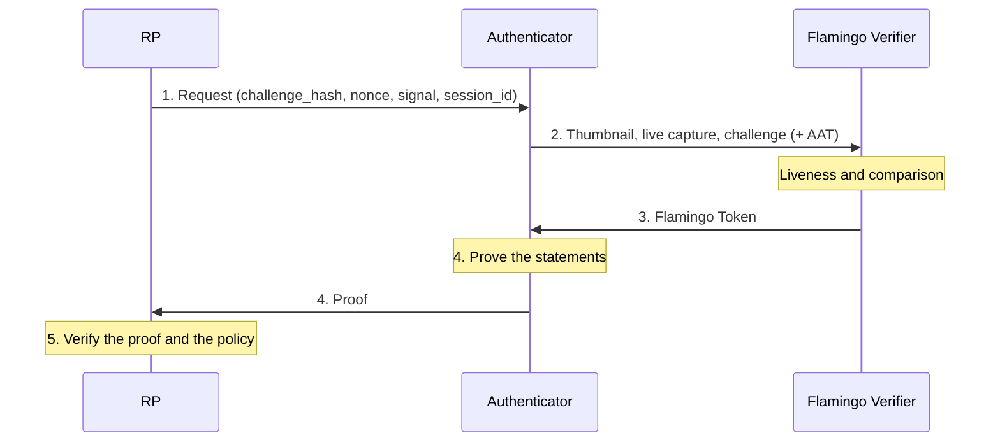

> [!NOTE]
> This spec outlines a draft functionality for beta testing. Changes are expected.

## 1. Abstract

This spec introduces a ZK circuit ("Proof of Embedding Similarity") which proves that a [WIP-201](wip-201.md) Flamingo Verifier matched a live capture and an RP-supplied challenge to the image committed in a user's [PoH Credential](https://docs.world.org/world-id/credentials/1). The proof reveals no image, no Flamingo Token and no Credential.

The circuit neither extracts embeddings nor compares them. It verifies the Flamingo Token, binds its compared entries to the Credential image and the RP's challenge, and checks the Issuer's Credential and an Authenticator's authorization of the result. For an RP billed under [WIP-107][wip-107], it also proves that the billing nullifier the Verifier checked belongs to the proving World ID. This first iteration supports only the PoH Credential; it shall be generalized to other Credentials in the future ([Future Considerations](#8-future-considerations)).

## 2. Motivation

Deepfakes make it hard to know who is on the other side of a video call or behind an online interaction in general. An RP that can capture an image of that party, the challenge, wants to know whether the image stems from a verified real human.

A [WIP-201](wip-201.md) Flamingo Verifier can be used to compare a live capture and the challenge with the face image of a user with a valid Orb Credential, and run fraud detection models on the live capture images. Its Flamingo Token alone does not answer the RP's question:

1. **No Credential.** The Flamingo Verifier compares any images, so the token does not show the compared image is the one in an issued (Orb) Credential.
2. **No owner.** It does not show that the user controls the World ID the Credential was issued to.
3. **Linkable.** The Credential image's hash is the same in every token of a user, so revealing tokens would link all their proofs.

This proof closes those gaps in zero knowledge. It binds the compared image to the Issuer's PoH Credential and the RP's challenge, and the result to a registered Authenticator. It reveals only values the RP sets or already knows, the Flamingo Verifier's key and time, the Flamingo configuration and the AAT values. An optional session lets the RP check that a later proof comes from the same World ID.

## 3. Overview

This section is non-normative. It sketches how one proof is made and checked.

```text
             ┌──────── Public inputs ────────┐
             │ challenge_hash,               │
             │ signal_hash, session_id, ...  │
             └───────────────┬───────────────┘
                             │
                           Proof
                             ▲
        ┌────────────────────┼────────────────────┐
        │                    │                    │
  PoH Credential ───────▶ World ID ───────▶ Flamingo Token
        │       issued to         authorizes      │
        ▼ claim 0                     ┌───────────┴───────────┐
hashes.json (PCP) ──── thumbnail ────▶│ Credential image hash │
                                      │ Live capture hash     │
                                      │ challenge_hash        │
                                      └───────────────────────┘
```

The proof combines a [WIP-201](wip-201.md) Flamingo Verifier with checks in the circuit to show that:

1. **Liveness.** A live capture passed the fraud checks of a Flamingo pipeline, e.g. presentation attack and deepfake detection.
2. **Match.** The live capture matches the RP's challenge image, e.g. a frame from a meeting stream, and the Orb thumbnail, the image captured at Orb sign-up that the PoH Credential commits to ([Supported Credentials](#41-supported-credentials)).
3. **Trusted Flamingo Verifier.** An attested Flamingo Verifier, running an Engine configuration the RP accepts, signed the result for this RP's request (`rp_id`, fresh `nonce`).
4. **Credential ownership.** The World ID creating the proof is registered, holds a valid PoH Credential from a trusted Issuer that commits to the thumbnail, and authorizes the result and the RP's `signal`.
5. **Untampered Authenticator (optional).** If the RP requires it, the live capture came from an untampered Authenticator, by the [WIP-106][wip-106] assertion the Flamingo Verifier checks.
6. **Session (optional).** The proof concerns the World ID of a session the RP names ([Session Proofs](https://github.com/worldcoin/world-id-protocol/blob/main/docs/world-id-4-specs/README.md)).

This lets an RP verify that the person it sees, e.g. on a video stream, is a verified human who was in front of the Authenticator when the proof was made. The optional `session_id` also lets it verify that the same human comes back across verifications.

**Proof flow:**



1. **Request.** The RP captures an image of the party it interacts with, the challenge, e.g. a frame of a video call, and requests a proof for `challenge_hash = R(SHA-256(challenge))`, with its `nonce` and an optional `signal` and `session_id` ([Proof Request](#44-proof-request)).
2. **Flamingo Verification (Liveness and Comparison).** The user's Authenticator sends the [WIP-201](wip-201.md) Flamingo Verifier three images, the face thumbnail from the user's PCP, a fresh live capture and the challenge, with an Authenticator Assertion if it has one. The Flamingo Verifier's Engine checks the live capture for liveness and fraud, e.g. deepfakes, and matches all three.
3. **Flamingo Token.** On a match, the Flamingo Verifier signs a Flamingo Token with the `SHA-256` of each image and the Engine configuration that ran ([Flamingo Token Entry Layout](#43-flamingo-token-entry-layout)).
4. **Proof.** The Authenticator proves the statements above in zero knowledge ([Circuit Constraints](#46-circuit-constraints)).
5. **Verification.** The RP verifies the proof, and checks the Flamingo Verifier's attestation, the Engine configuration, the time, the AAT values and, if it named one, the session against its own policy ([Reference Verification](#48-reference-verification)).

The RP learns that the party in its challenge matches a live person who holds an Orb-verified World ID. It does not learn which World ID, and sees no image, Flamingo Token or Credential.

## 4. Specification

The key words "MUST", "MUST NOT", "REQUIRED", "SHALL", "SHALL NOT", "SHOULD", "SHOULD NOT", "RECOMMENDED", "MAY", and "OPTIONAL" in this document are to be interpreted as described in [RFC 2119](https://www.ietf.org/rfc/rfc2119.txt).

1. The terms [Authenticator](https://docs.rs/world-id-core/latest/world_id_core/struct.Authenticator.html), Issuer and [Credential][credential] are as defined in the World ID Protocol. **Flamingo Verifier**, **Flamingo Token** and **Engine** are as defined in [WIP-201][wip-201].
2. The Field ($F$), the Curve (`BabyJubJub`), the hashes ($H_t$, $H_\text{var}$) and EdDSA MUST follow [WIP-100][wip-100]. `R(d)` is as defined in [WIP-201][wip-201].

### 4.1 Supported Credentials

This first iteration supports only the [PoH Credential](https://docs.world.org/world-id/credentials/1), comparing the PCP's `thumbnail.png`:

1. **Personal Custody Package (PCP).** At verification, the Orb packages the user's images and stores them on the user's device ([World implements Personal Custody](https://world.org/blog/announcements/world-implements-personal-custody)). The package includes `hashes.json`, which the Orb signs: a JSON object mapping each file name, e.g. `thumbnail.png` for the face thumbnail, to the lowercase hex `SHA-256` of the file, plus a `version`. orb-core writes it as compact JSON (no insignificant whitespace) with sorted keys; [constraint 3](#46-circuit-constraints) relies on this format.
2. **PoH Credential.** The [PoH Credential](https://docs.world.org/world-id/credentials/1) commits in claim 0 to the Orb-signed `hashes.json` as $H_\text{var}$ with label `CLAIMS_HASH_V1`. This chain lets the circuit bind the compared image to the Issuer's Credential without hashing the image.

### 4.2 Constants

| Constant                                         | Value                                                                              | Description                                                                                              |
| ------------------------------------------------ | ---------------------------------------------------------------------------------- | -------------------------------------------------------------------------------------------------------- |
| `CLAIM_INDEX`                                    | `0`                                                                                | Credential claim holding the `hashes.json` commitment.                                                   |
| `MIN_HASHES_JSON_BYTES`, `MAX_HASHES_JSON_BYTES` | `3072`, `5120`                                                                     | Accepted `hashes.json` lengths. |
| `DS_WIP_202_AUTH`                                | `127603488023523044162070750169730750023380107613256` (`b"WORLD-ID/WIP-202/AUTH"`) | Domain separator for the Authenticator's authorization.                                                  |

The following constants are re-used, but are not defined by this spec:

| Name | Value | Defined in |
| --- | --- | --- |
| `NUM_KEYS` | `7` | [WIP-100 §3.8][wip-100] |
| `MAX_DEPTH` | `30` | [WIP-100 §3.8][wip-100] |
| `MAX_CLAIMS` | `15` | `world-id-primitives` [`Credential::MAX_CLAIMS`](https://docs.rs/world-id-primitives/latest/world_id_primitives/credential/struct.Credential.html#associatedconstant.MAX_CLAIMS) |
| `MERKLE_LEAF_DS` | `b"World ID PK"` | [WIP-100 §3.8][wip-100] |
| `DS_QUERY` | `b"World ID Query"` | [WIP-100 §3.8][wip-100] |
| `DS_NULLIFIER` | `b"World ID Proof"` | [WIP-100 §3.8][wip-100] |
| `DS_CREDENTIAL_V1` | `b"POSEIDON2+EDDSA-BJJ"` | `world-id-primitives` [`ds::CREDENTIAL_V1`](https://docs.rs/world-id-primitives/latest/world_id_primitives/poseidon/ds/constant.CREDENTIAL_V1.html) |
| `DS_CREDENTIAL_SUB` | `b"H_CS(id, r)"` | `world-id-primitives` [`ds::CREDENTIAL_SUB`](https://docs.rs/world-id-primitives/latest/world_id_primitives/poseidon/ds/constant.CREDENTIAL_SUB.html) |
| `DS_SESSION_COMMITMENT` | `b"H(id, r)"` | `world-id-primitives` [`ds::SESSION_COMMITMENT`](https://docs.rs/world-id-primitives/latest/world_id_primitives/poseidon/ds/constant.SESSION_COMMITMENT.html) |
| `CLAIMS_HASH_V1` | `b"CLAIMS_HASH_V1"` | `world-id-primitives` [`ds::CLAIMS_HASH_V1`](https://docs.rs/world-id-primitives/latest/world_id_primitives/poseidon/ds/constant.CLAIMS_HASH_V1.html) |

### 4.3 Flamingo Token Entry Layout

The circuit binds the Flamingo Token's `compared_entry_hash_k` ([WIP-201](wip-201.md)) by their index `k`:

| `k` | Entry | Bound to |
| --- | --- | --- |
| `0` | Credential image | `R(credential_digest)`, from the Credential's `hashes.json` ([constraint 3](#46-circuit-constraints)). |
| `1` | Live capture | The private `live_capture_hash`; `compare_sources = 256` (bytes `[0, 1, 0, 0]`) marks it as pipeline input `0`, and the AAT, if present, vouches for it through `cdh`. |
| `2` | Challenge | The public `challenge_hash`. |
| `3` | Unused | `0`. |

1. The Authenticator MUST put the live capture at `pipeline_inputs[0]` and compare (Credential image, live capture, challenge), so `compare_sources` is `256`: bytes `[0, 1, 0, 0]`, i.e. compare position `1` is pipeline input `0` and the other positions are references ([WIP-201 Flamingo Token](wip-201.md#45-flamingo-token)). The chosen pipeline's `inputs[0]` MUST have role `live_frame`.
2. `challenge_hash` MUST be `R(SHA-256(challenge))` over the exact challenge bytes. The RP MUST compute it itself from the challenge image it checked against the party it interacts with ([Reference Verification](#48-reference-verification)).

### 4.4 Proof Request

An RP requesting this proof MUST include the following values in its signed proof request. Their encoding is outside this WIP.

| Value | Description |
| --- | --- |
| `rp_id`, `nonce` | As for every World ID proof; `rp_id` is the Flamingo Token's `aud`; `nonce` as in [WIP-201 Request and Response](wip-201.md#441-request-and-response). |
| `action` | REQUIRED, with or without `session_id`. An RP-chosen field element whose most significant byte is `BILLED_ACTION_PREFIX` (`0x03`, [WIP-107 §4.1](wip-107.md#41-constants)). The proof does not use it; the RP's signature over it authorizes registration under [WIP-107 §4.5](wip-107.md#45-rp-authorization). |
| `challenge_hash` | `R(SHA-256(challenge))` of the challenge image ([Flamingo Token Entry Layout](#43-flamingo-token-entry-layout)). |
| AAT requirements | Optional: whether an AAT is required, and optional hints for `platform`, `sec_level`, `sec_meta` and `authenticator_meta`. |
| Credential policy | `issuer_schema_id`, `issuer_version`, `genesis_issued_at_min` and `expires_at_min`. The RP checks the Issuer key itself ([Reference Verification](#48-reference-verification)). |
| `session_id` | Optional. An existing session commitment, if the proof must concern the same World ID as an earlier one. |
| `signal` | Optional. Arbitrary bytes the proof commits to, as for Uniqueness Proofs. |

The RP MUST sign the request with the [RP signature message](https://github.com/worldcoin/world-id-protocol/blob/main/crates/primitives/src/rp.rs) over `action`, `version || nonce || createdAt || expiresAt || action` (81 bytes), whether or not `session_id` is set. A Session Proof request signs no action and cannot authorize registration. When the Authenticator re-derives `session_id_r`, its session-seed OPRF query carries `action` as RP signature verification data. Of the values above, the signature covers only `nonce` and `action`; the RP checks the others at verification ([Reference Verification](#48-reference-verification)). The prefix marks the request as one that may consume billing capacity ([WIP-107 §4.5](wip-107.md#45-rp-authorization)). OPRF nodes reject it for Uniqueness Proofs, so the signature cannot authorize one.

The Authenticator builds the Flamingo request and the circuit inputs from these values. It chooses the pipeline and `match_strictness` as [WIP-201 Authenticator](wip-201.md#46-authenticator) requires, under [Flamingo Token Entry Layout](#43-flamingo-token-entry-layout). It sets the Flamingo request's `expires_at` to the request's expiry, at most `MAX_REQUEST_LIFETIME` ahead ([WIP-201 Request and Response](wip-201.md#441-request-and-response)). The RP then checks the proof against the same values ([Reference Verification](#48-reference-verification)).

Authenticators set `aat_inputs.min_build_version` to `0`, which sets no minimum; the circuit fixes it to `0` ([Circuit Constraints](#46-circuit-constraints)). Proofs therefore check no Authenticator build version for now ([Future Considerations](#8-future-considerations)).

### 4.5 Circuit Inputs

**Public inputs**, grouped as: the proof's time, the RP's request, the Flamingo Token, its AAT values, the World ID, and the Credential:

| Input | Type | Description |
| --- | --- | --- |
| `now` | uint32 | The proof's time: the Flamingo Token's `now`, signed by the Flamingo Verifier. The Credential must be valid at it, and the RP checks it is recent ([Reference Verification](#48-reference-verification)). |
| `rp_id`, `nonce` | Field element | The RP's request; `rp_id` is the token's `aud`. |
| `challenge_hash` | Field element | `R(SHA-256(challenge))`, see [Entry Layout](#43-flamingo-token-entry-layout). |
| `signal_hash` | Field element | The RP's `signal` hashed as for Uniqueness Proofs: `keccak256(signal)` shifted right by 8 bits, or `0` without a signal. |
| `session_id` | Field element | Session commitment, or `0`. |
| `flamingo_verifier_key` | `PublicKey` | The Flamingo Verifier's signing key, WIP-201's `verifier_key`; the RP checks its attestation. |
| `engine_config_hash` | Field element | The Engine configuration that ran. |
| `has_aat` | bool | Whether the Flamingo Verifier verified an AAT. |
| `trust_anchor_key_hash` | Field element | The TAKT's trust anchor, or `0` without an AAT. |
| `platform`, `sec_level`, `sec_meta`, `authenticator_meta` | uint8 | The AAT's public flags, or `0` without an AAT. |
| `merkle_root` | Field element | The root hash of the Merkle tree used for inclusion (representing the `WorldIDRegistry`). |
| `issuer_schema_id` | Field element | The Credential type. |
| `issuer_version` | Field element | The Credential schema version, `< 2^8`. |
| `cred_pk` | `PublicKey` | The Issuer's key. |
| `genesis_issued_at_min` | Field element | Minimum time the Credential was first issued. |
| `expires_at_min` | Field element | Minimum expiration of the Credential, as in Uniqueness and Session Proofs; the RP's `created_at` if it sets none. |

All other inputs MUST remain private.

**Private inputs, Flamingo Token.** With the public values above, they let the circuit verify the [WIP-201 Flamingo Token](wip-201.md#45-flamingo-token). Constraint 1 fixes the remaining claims: `compared_entry_hash_0`, `_2`, `_3`, `compare_sources` and `min_build_version`.

| Input | Type | Description |
| --- | --- | --- |
| `live_capture_hash` | Field element | The token's `compared_entry_hash_1`, the hash of the live capture. |
| `billing_nullifier` | Field element | The token's `billing_nullifier`. |
| `sig` | Signature | The Flamingo Verifier's signature over the token. |

**Private inputs, World ID:**

| Input | Type | Description |
| --- | --- | --- |
| `user_pk` | [`PublicKey`; `NUM_KEYS`] | The list of authenticator public keys registered in the `WorldIDRegistry`. |
| `pk_index` | Field element | The index in `user_pk` of the key used for signature. |
| `sig_s` | Field element | The `s` component from the EdDSA signature on the authorization message. |
| `sig_r` | [Field element; 2] | The `r` component from the EdDSA signature on the authorization message. |
| `leaf_index` | Field element | The index of the user's World ID in the `WorldIDRegistry`. |
| `siblings` | [Field element; `MAX_DEPTH`] | The sequence of all siblings from the `leaf_index` to the `merkle_root`. |
| `session_id_r` | Field element | The blinding factor of the session commitment, re-derived through the OPRF from the `sessionId`'s `oprf_seed` as for Session Proofs ([World ID 4.0](https://github.com/worldcoin/world-id-protocol/blob/main/docs/world-id-4-specs/README.md)). |
| `billing_action` | Field element | The [WIP-107][wip-107] `billingAction` of the context the Flamingo Token's `billing_nullifier` is registered under. |
| `billing_oprf_output` | [Field element; 2] | The unblinded OPRF output of the WIP-107 billing query, cached by the Authenticator ([WIP-107 §4.6](wip-107.md#46-authenticator-cache)). |

**Private inputs, Credential:**

| Input | Type | Description |
| --- | --- | --- |
| `claims` | [Field element; `MAX_CLAIMS`] | The Credential's claims. |
| `cred_s` | Field element | The `s` component from the Issuer's EdDSA signature on the Credential. |
| `cred_r` | [Field element; 2] | The `r` component from the Issuer's EdDSA signature on the Credential. |
| `cred_associated_data_hash` | Field element | The Credential's associated data hash. |
| `cred_genesis_issued_at` | Field element | When the Credential was first issued. |
| `cred_expires_at` | Field element | When the Credential expires. |
| `cred_sub_blinding_factor` | Field element | The blinding factor of the Credential's `sub`. |
| `cred_id` | Field element | The Credential's identifier. |
| `hashes_json` | [Field element; ⌈`MAX_HASHES_JSON_BYTES` / 31⌉] | `hashes.json` as the 31-byte big-endian chunks that $H_\text{var}$ absorbs ([WIP-100][wip-100] §3.3.3); unused chunks are zero. |
| `hashes_json_len` | Field element | The length of `hashes.json` in bytes. |
| `digest_offset` | uint32 | Position in `hashes_json` where the `thumbnail.png` digest starts. |

### 4.6 Circuit Constraints

The circuit MUST enforce the following constraints. They hold jointly; the numbering only groups them. Every inequality (`<`, `<=`) is over integers range-checked to the stated width.

1. **Flamingo Token Verification**
   - Enforce checks 2 (Signature) and 3 (Well-formed values) of [WIP-201 Consuming Flamingo Tokens](wip-201.md#47-consuming-flamingo-tokens), with `compared_entry_hash_0 = R(credential_digest)`, `compared_entry_hash_1 = live_capture_hash`, `compared_entry_hash_2 = challenge_hash`, `compared_entry_hash_3 = 0`, `compare_sources = 256` (bytes `[0, 1, 0, 0]`: only the live capture is a pipeline input) and `min_build_version = 0`, yielding its signed `digest`.

2. **Challenge Present**
   - `challenge_hash != 0`, since `0` marks an unused position, so the token must have compared a challenge.

3. **Credential Image Binding**
   1. *`hashes.json` is the Credential's.*
      - `MIN_HASHES_JSON_BYTES <= hashes_json_len <= MAX_HASHES_JSON_BYTES`, and the chunks beyond `hashes_json_len` are zero.
      - `claims[CLAIM_INDEX]` equals $H_\text{var}$ ([WIP-100 §3.3.3][wip-100]) with label `CLAIMS_HASH_V1` over the first `hashes_json_len` bytes. The capacity tag binds `hashes_json_len`, not `MAX_HASHES_JSON_BYTES`; the last chunk holds only the remaining bytes, and only the $\lceil$`hashes_json_len`/31$\rceil$ chunks are absorbed.
      - Only the chunks around `digest_offset` are split into bytes; other chunks with the same commitment would be a Poseidon2 collision.
   2. *Extract the image digest.*
      - `18 <= digest_offset` and `digest_offset + 64 < hashes_json_len`.
      - The 64 bytes at `digest_offset` are lowercase hexadecimal digits, followed by `"`, all within the first `hashes_json_len` bytes.
      - The 17 bytes before `digest_offset` are `"thumbnail.png":"`, and the byte before them is `{` or `,`.
      - The digits decode as the 32-byte big-endian digest `credential_digest`.

4. **World ID Authentication**
   - Compute `message = H_8(DS_WIP_202_AUTH; digest, flamingo_verifier_key.x, flamingo_verifier_key.y, signal_hash)`, with `digest` from item 1.
   - Enforce [WIP-100 World ID Authentication](wip-100.md#61-world-id-authentication) over `message`, yielding `leaf_index`.

5. **Session Commitment**
   - Enforce [WIP-100 Session Commitment](wip-100.md#63-session-commitment). `session_id = 0` means no session.

6. **Credential Verification**
   - Enforce [WIP-100 Credential Verification](wip-100.md#62-credential-verification) at `now`, yielding `claims`.
   - Range-check `expires_at_min` as 64-bit and constrain `expires_at_min < cred_expires_at`.

7. **Billing Nullifier Ownership**
   - Compute `billing_query = H_4(DS_QUERY; leaf_index, rp_id, billing_action)`.
   - `billing_nullifier * (billing_nullifier - H_4(DS_NULLIFIER; billing_query, billing_oprf_output[0], billing_oprf_output[1])) == 0`.
   - This makes billing optional: `billing_nullifier = 0` means the RP is not billed, and any other value MUST be this World ID's billing nullifier for `rp_id`. The Flamingo Verifier sets it ([WIP-107 §4.7](wip-107.md#47-billing-verification)). With `0`, `billing_action` and `billing_oprf_output` are unconstrained and SHOULD be `0`.

Items 4–7 MUST use the same `leaf_index` per [WIP-100 Composition](wip-100.md#64-composition), which binds the Credential, the session and the billing nullifier to the World ID whose Authenticator authorized the result.

### 4.7 Verification Requirements

1. **Root Freshness**. Verifiers MUST check that the provided public input `merkle_root` is valid and non-expired. Verifiers MAY check `WorldIDRegistry.isValidRoot(merkle_root)` on every verification or cache a valid result until the root's actual expiration (e.g. from `WorldIDRegistryV2.getRootExpiration`). The configured `getRootValidityWindow()` is not the root's remaining lifetime and MUST NOT, by itself, determine the cache duration. A `getRootExpiration` result of `0` denotes the latest root, not an unlimited cache lifetime. Cache access MUST NOT extend the expiration.
2. **Proving System**. Proofs of Embedding Similarity MUST use the [ProveKit](https://github.com/worldfnd/provekit) proving system. Verifiers MUST NOT use verification artifacts supplied by the prover.

### 4.8 Reference Verification

An RP accepts a proof if the following hold. It MUST check items 2–7 before verifying the proof (item 1).

1. The proof verifies according to [Proving System](#47-verification-requirements).
2. The Flamingo Token values pass checks 1 and 4–6 of [WIP-201 Consuming Flamingo Tokens](wip-201.md#47-consuming-flamingo-tokens); constraints 1–3 cover check 7, and constraint 7 covers check 8.
3. `now` is within 5 minutes of the RP's own clock.
4. The World ID and Credential are trusted:
   - `merkle_root` satisfies [Root Freshness](#47-verification-requirements) at verification time;
   - `cred_pk` is a trusted Issuer key for `issuer_schema_id` and `issuer_version`, for the [PoH Credential](https://docs.world.org/world-id/credentials/1).
5. The request matches:
   - `genesis_issued_at_min` and `expires_at_min` are the RP's own;
   - `challenge_hash` is `R(SHA-256(challenge))` of a challenge image the RP checked against the party it interacts with;
   - `signal_hash` is the hash of the RP's own `signal`, or `0` if its request had none.
6. If the RP needs this proof to concern the same World ID as another proof, `session_id` is nonzero and equals that proof's session commitment.
7. **AAT values.** If `has_aat = 1`, `trust_anchor_key_hash`, `platform`, `sec_level`, `sec_meta` and `authenticator_meta` are within the RP's own policy ([WIP-106 §4](wip-106.md#4-reference-verification)), whether or not its request stated them. If `has_aat = 0`, the RP accepts proofs without an AAT.

## 5. Rationale

1. **Authenticator authorization in the circuit.** As in other World ID proofs, a signature by a registered Authenticator key shows the prover controls the World ID the Credential was issued to. A copy of the Credential and `hashes.json` alone cannot produce a proof, revoking an Authenticator stops its proofs, and even a compromised Flamingo Verifier cannot authorize results for a World ID whose Authenticators it does not control.
2. **Binding the compared image to the PoH Credential.** The PoH Credential commits to `hashes.json`, which lists the `SHA-256` of the face thumbnail under `thumbnail.png`. The circuit reads that digest at a prover-supplied offset and uses it as `compared_entry_hash[0]` in the token's digest, so the live capture and challenge were compared with the Credential image. The offset is safe because in the compact format orb-core writes ([Supported Credentials](#41-supported-credentials)) the checked pattern occurs only once.
3. **Fixed entry layout in the Flamingo Token.** Positions and `compare_sources` bind entries to roles without parsing the Engine release manifest in the circuit.
4. **Optional session ID.** An RP can check that a later proof comes from the same World ID as an earlier one, e.g. so a different person cannot take over an account. It is optional so proofs stay unlinkable by default.
5. **Credential verification.** The circuit verifies the Issuer's signature, so the RP knows the World ID holds a valid Orb-verified PoH Credential.
6. **Signal in the authorization message.** The signal binds the proof to the RP's context, e.g. an account or a transaction, so a relayed proof cannot be reused for another one. Signing it with the Authenticator key binds the public input to a constraint; an unconstrained public input could be malleable.
7. **Only the challenge's image hash is public.** A public `challenge_hash` is what lets the RP verify that the proof concerns its own challenge, and with it the party it interacts with; without this check the proof is meaningless. The Credential image's hash is constant per user and would link all their proofs, so it stays private, and so does the live capture's.
8. **Billing nullifier without OPRF verification.** Every registered `billingNullifier` passed a Uniqueness Proof that verified its OPRF output under the RP's pinned key ([WIP-107 §4.4](wip-107.md#44-registration-proof)), and the Flamingo Verifier signs only a registered one. Constraint 7 opens it to this proof's `leaf_index` and `rp_id`; by the collision resistance of Poseidon2, which also makes nullifiers unique, they are the registered World ID and RP. A wrong `billing_oprf_output` only yields an unregistered nullifier, which the Flamingo Verifier never signs. Verifying the OPRF evaluation again would add no guarantee, and would cost a hash-to-curve, several scalar multiplications and the pinned OPRF key as a public input.
9. **Private billing nullifier.** The billing nullifier is constant per World ID, RP and billing period, so a public one would let the RP link all of a user's proofs within a period. The RP needs no billing value: it is the billed party, so billing is enforced by the Flamingo Verifier and constraint 7, not by checks of the RP.

## 6. Alternatives Considered

1. **Comparing embeddings in the circuit.** Rejected: extraction and fraud detection would still run outside, and the circuit would need fixed-point arithmetic, a fixed embedding dimension and a hash per embedding.
2. **Verifying the AAT in the circuit.** Rejected: verification in the Flamingo Verifier per [WIP-201][wip-201] saves the TAKT's EdDSA verification and the AAT's `ES256` verification on the device, which circuits cannot do efficiently yet.
3. **Verifying more in the Flamingo Verifier.** EdDSA verifications dominate the circuit's cost, so moving more of them into the TEE is tempting. Rejected: World ID authentication there would reveal the leaf index, a permanent identifier, to the TEE, require the Authenticator key to leave the device, and remove the check a compromised Flamingo Verifier cannot forge. Credential verification there would reveal the Credential and tie the Flamingo Verifier to one Credential format, while it currently compares any images.

## 7. Security

1. **Privacy.** The proof hides the media, the Flamingo Token, the Credential, `hashes.json` and the billing nullifier. Public are the values the RP chose (`rp_id`, `nonce`, `challenge_hash`, `signal_hash`, `session_id`, `expires_at_min` and the Credential policy), `now`, `engine_config_hash`, the AAT's public values and `flamingo_verifier_key`; an uncommon combination can narrow the set of possible users. `flamingo_verifier_key` is the same for every token of one Flamingo Verifier boot, so it groups proofs by Verifier instance, not by user.
2. **No uniqueness.** An Embedding Similarity Proof provides no uniqueness guarantees by design. Its use case is different. An RP that needs uniqueness MUST also request a Uniqueness Proof with the same nonzero `session_id`.
3. **Relay and stream integrity.** A proof shows the challenge image matches the Credential's subject. It does not establish that a video stream is unmodified or prevent a relayed interaction.
4. **Billing.** [WIP-107][wip-107] billing holds against a modified Authenticator, which can neither obtain a Flamingo Token for a billed RP without a registered billing nullifier nor prove with one that is not its own. It does not hold against an RP that colludes with the user's Authenticator, which [WIP-201](wip-201.md#5-trust-assumptions) places out of scope ([WIP-107 §6](wip-107.md#6-security)).

## 8. Future Considerations

1. **Other Credentials.** The circuit shall be generalized to other Credentials, likely through a circuit-friendly, general format for Credentials and custody packages.
2. **Build version floors.** Build numbers are per Authenticator Provider, so the RP cannot state one useful minimum. A later version may let RPs require a minimum build per Authenticator Provider, e.g. keyed by `trust_anchor_key_hash`, which would make `min_build_version` a circuit input again.

## 9. Backwards Compatibility

This WIP introduces a new interface; no existing contracts or functionality are affected. Constraint 7 and the Flamingo Token's `billing_nullifier` claim ([WIP-201](wip-201.md#45-flamingo-token)) change this circuit and the token digest of earlier drafts; their proofs and Flamingo Tokens do not verify under this version.

[credential]: https://docs.rs/world-id-primitives/latest/world_id_primitives/credential/struct.Credential.html
[wip-100]: wip-100.md
[wip-107]: wip-107.md
[wip-201]: wip-201.md
[wip-106]: wip-106.md
